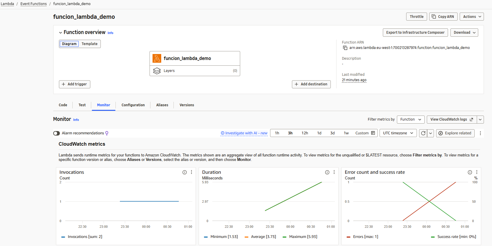
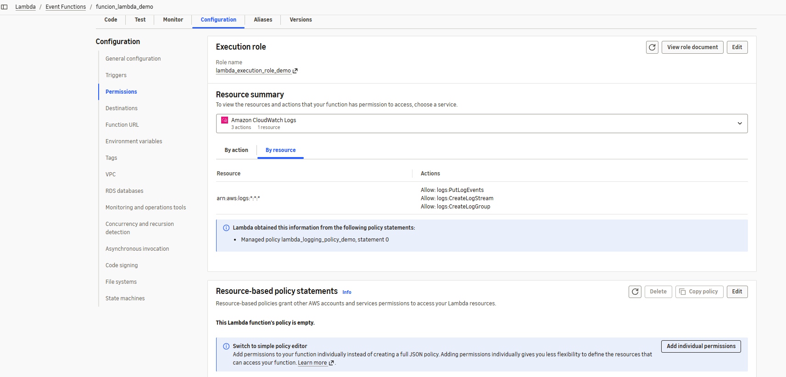
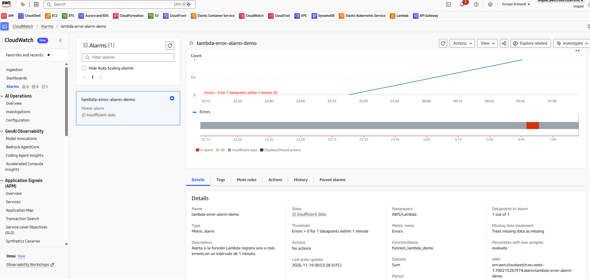
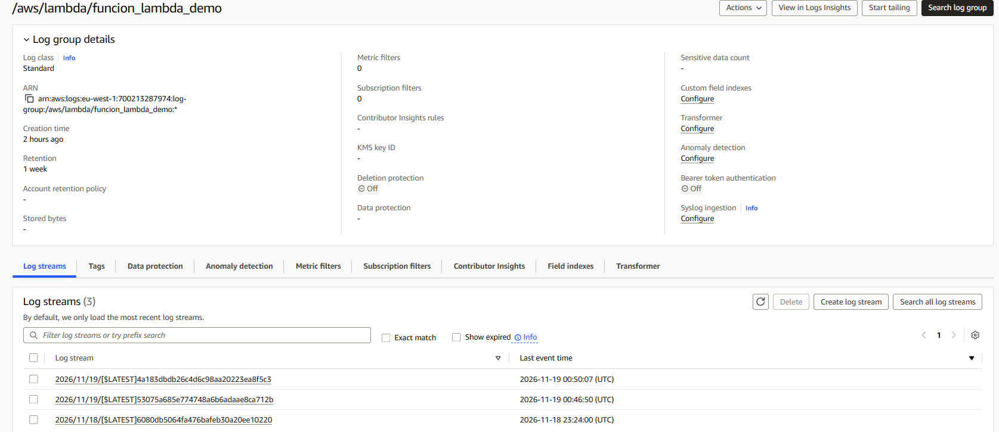
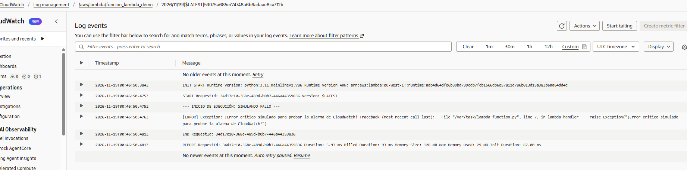
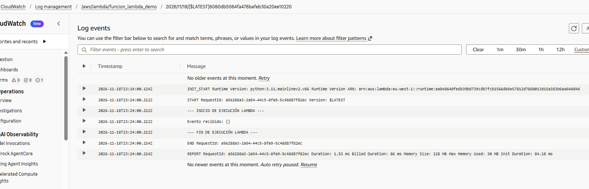

# LAMBDA

## FASE 0: ¿Qué es AWS Lambda y cómo funciona?

+ **AWS Lambda** es un servicio de computación serverless (sin servidores) orientado a eventos.

+ **¿Qué significa en la práctica?**
    - **Cero gestión de infraestructura:** No aprovisionas EC2, no actualizas sistemas operativos, no configuras parches de seguridad ni balanceadores de carga. AWS se encarga de todo el ciclo de vida del hardware y del runtime.
    - **Modelo de pago por uso (Pay-as-you-go):** Pagas exclusivamente por los milisegundos que tu código está ejecutándose y por el número de peticiones. Si nadie invoca tu función, el costo es estrictamente cero.
    - **Escalabilidad automática:** Si tu aplicación recibe una petición, Lambda arranca una instancia. Si recibe 10,000 peticiones concurrentes, AWS escala horizontalmente de forma automática y transparente en cuestión de milisegundos.

+ **Anatomía básica de una función Lambda en Python:**  
Una función Lambda estándar consta de un **handler** (el punto de entrada de la ejecución) que recibe dos argumentos principales: el **evento** (`event`) que disparó la función y el **contexto** (`context`) de ejecución.
```python
import json

def lambda_handler(event, context):
    print("Log generado automáticamente hacia CloudWatch")
    
    return {
        "statusCode": 200,
        "body": json.dumps("¡Hola desde AWS Lambda con Terraform!")
    }
```

## FASE 1: Seguridad e Identidad (IAM y Redes)

+ Antes de desplegar código, en el mundo Cloud y DevOps la regla de oro es: primero la seguridad. Ningún recurso se crea si no tiene una identidad con permisos estrictamente acotados (Principio de Mínimo Privilegio).

**1. Creación del archivo de Terraform (main.tf)**  
+ Crea una carpeta para tu proyecto y dentro crea un archivo llamado `main.tf`. Vamos a escribir los bloques necesarios para:
    + Configurar el proveedor de AWS.
    + Crear el **Rol de IAM** que asumirá la función Lambda.
    + Crear la **Política de permisos** para que la Lambda pueda escribir en CloudWatch Logs (crear grupos de logs, flujos y enviar eventos).
    + Asociar dicha política al rol mediante un `aws_iam_role_policy_attachment`.

+ Código `main.tf`:
```bash
terraform {
  required_version = ">= 1.0.0"
  required_providers {
    aws = {
      source  = "hashicorp/aws"
      version = "~> 5.0"
    }
  }
}

provider "aws" {
  region = "eu-west-1" # Región de Irlanda (estándar para pruebas)
}

# 1. Política de Confianza (Trust Policy): Permite que el servicio Lambda asuma este rol
data "aws_iam_policy_document" "lambda_assume_role" {
  statement {
    actions = ["sts:AssumeRole"]

    principals {
      type        = "Service"
      identifiers = ["lambda.amazonaws.com"]
    }
  }
}

# 2. Creación del Rol de IAM
resource "aws_iam_role" "lambda_exec_role" {
  name               = "lambda_execution_role_demo"
  assume_role_policy = data.aws_iam_policy_document.lambda_assume_role.json
}

# 3. Política de Permisos para CloudWatch Logs (Mínimo Privilegio)
data "aws_iam_policy_document" "lambda_logging_policy" {
  statement {
    effect = "Allow"
    actions = [
      "logs:CreateLogGroup",
      "logs:CreateLogStream",
      "logs:PutLogEvents"
    ]
    resources = ["arn:aws:logs:*:*:*"]
  }
}

# 4. Creación de la política como recurso gestionado
resource "aws_iam_policy" "lambda_logging" {
  name        = "lambda_logging_policy_demo"
  path        = "/"
  description = "IAM policy for logging from a lambda"
  policy      = data.aws_iam_policy_document.lambda_logging_policy.json
}

# 5. Adjuntar la política de logs al rol de ejecución de la Lambda
resource "aws_iam_role_policy_attachment" "lambda_logs" {
  role       = aws_iam_role.lambda_exec_role.name
  policy_arn = aws_iam_policy.lambda_logging.arn
}
```
> `assume_role_policy`: En AWS, los servicios no pueden actuar por sí mismos a menos que un rol les conceda permiso explícito mediante una Trust Relationship (relación de confianza). Aquí le decimos a AWS que el servicio global lambda.amazonaws.com tiene permitido usar este rol.  

> `CloudWatch Actions`: Limitamos estrictamente los permisos a tres acciones concretas de CloudWatch (CreateLogGroup, CreateLogStream, PutLogEvents). Jamás le daríamos permisos de AdministratorAccess a una función Lambda.

+ **El Rol de IAM (aws_iam_role)**:
    - **¿Qué es?**: Un rol es una identidad dentro de AWS que tiene permisos específicos, pero no tiene credenciales permanentes asociadas (no tiene contraseña ni claves de acceso a largo plazo).
    - **¿Para qué sirve?**: Está pensado para ser asumido temporalmente por servicios de AWS (como Lambda, EC2 o ECS) o por usuarios externos de confianza.

+ **La Política de Confianza / Trust Policy (assume_role_policy): **
    - Es el "pasaporte" o la cláusula que dice quién tiene derecho a ponerse este rol.
    ```bash
    principals {
    type        = "Service"
    identifiers = ["lambda.amazonaws.com"]
    }
    ```
    - Esto significa: "Cualquier instancia del servicio global de AWS Lambda tiene permiso para invocar el comando sts:AssumeRole y tomar esta identidad temporalmente". Si un servicio que no sea Lambda intenta usar este rol, AWS lo rechaza de inmediato.

+ **La Política de Permisos / Permissions Policy (aws_iam_policy)**
    - Una vez que el servicio se pone el rol, esta política define qué puede hacer dentro de AWS.
    - En nuestro script, limitamos los permisos estrictamente al principio de mínimo privilegio:
    ```bash
    actions = [
    "logs:CreateLogGroup",
    "logs:CreateLogStream",
    "logs:PutLogEvents"
    ]
    ```
    - Le permitimos crear el grupo de logs, el flujo de logs dentro de ese grupo y escribir los eventos (los print() de nuestra función). Jamás le damos acceso a S3, bases de datos o administración total.

+ **El bloque aws_iam_policy.lambda_logging**
    - En Terraform, cuando trabajamos con permisos de IAM, solemos separar las cosas en dos partes:
        + **El documento de política (`data "aws_iam_policy_document"`)**: Es simplemente una forma que tiene Terraform de escribir el código JSON de la política de forma limpia y ordenada utilizando sintaxis HCL. No crea ningún recurso real en AWS por sí solo; es solo un plano o plantilla en papel.
        + **El recurso de política (`resource "aws_iam_policy"`)**: Es el paso donde le decimos a Terraform: "Toma ese plano en JSON (data...json) y créalo de verdad como un objeto físico y gestionado dentro de AWS" asignándole un ARN (Amazon Resource Name) único.
    - Gracias a que lo creamos como un recurso independiente (`aws_iam_policy`), ese objeto obtiene un ARN propio (`arn:aws:iam::700213287974:policy/...`), lo que nos permite reutilizarlo en múltiples roles si fuera necesario, es decir, es una** Managed Policy.**

+ **El Adjunto / Policy Attachment (aws_iam_role_policy_attachment)**
    - Es el hilo conductor que cose la Política de Permisos al Rol de IAM. Sin este adjunto, el rol existe y sabe qué servicio lo puede usar, pero está "vacío" de permisos operativos.

### Managed Policies (Políticas Gestionadas) vs. Inline Policies (Políticas Inline)

+ **Managed Policies:**
    - Son entidades independientes y reutilizables dentro de IAM (ya sean creadas por ti o predeterminadas por AWS como AdministratorAccess).
    - Viven por separado del rol. Si borras el rol, la política sigue existiendo (puedes reutilizarla).
    - Una misma Managed Policy se puede adjuntar a 10 roles diferentes.
    - Recomendado por AWS. Facilita la auditoría centralizada, el control de versiones y el principio de menor privilegio modular.

+ **Inline Policies:**
    - Son políticas incrustadas directamente dentro de un único usuario, grupo o rol.
    - Mueren con el recurso. Si eliminas el rol, la política inline desaparece para siempre.
    - Pertenece exclusivamente a ese rol y no se puede compartir.
    - Desaconsejado en producción para la mayoría de casos, salvo excepciones muy acotadas de encapsulamiento estricto.


## FASE 2: Computación Serverless (AWS Lambda)

+ Crea un archivo llamado `lambda_function.py` en la misma carpeta de tu proyecto. Este será el código que ejecutará AWS:
```Python
import json

def lambda_handler(event, context):
    print("--- INICIO DE EJECUCIÓN LAMBDA ---")
    print(f"Evento recibido: {json.dumps(event)}")
    
    # Lógica sencilla de negocio o saludo
    mensaje = "¡Hola, Miguel! Tu Lambda desplegada con Terraform funciona perfectamente."
    
    print("--- FIN DE EJECUCIÓN LAMBDA ---")
    
    return {
        "statusCode": 200,
        "body": json.dumps({
            "mensaje": mensaje,
            "estado": "Exitoso"
        })
    }
```
> def lambda_handler(event, context):: Es el punto de entrada oficial (handler) que AWS Lambda busca obligatoriamente.  

> event: Es un diccionario de Python que contiene los datos de entrada o el evento que disparó la función (por ejemplo, una petición HTTP desde un API Gateway, un archivo subido a S3, etc.). Si se invoca manualmente sin datos, llega vacíos o con {}.  

> context: Un objeto que proporciona información sobre el entorno de ejecución en tiempo real (tiempo restante antes de que la función expire, ID de la petición, memoria asignada, etc.).  

> Los print(...): En una aplicación tradicional con servidores, los print irían a la consola estándar. En AWS Lambda, cualquier print se intercepta automáticamente y se envía de forma estructurada a CloudWatch Logs. Por eso necesitábamos los permisos de IAM de la Fase 1.  

> El return (Diccionario HTTP): Devuelve una respuesta estructurada típica con un código de estado (statusCode: 200 para éxito) y un cuerpo (body) serializado en JSON.  

+ **El empaquetado y despliegue en Terraform (main.tf)**: Las funciones Lambda en AWS no leen archivos sueltos de Python directamente; requieren que el código esté comprimido en un archivo `.zip`. Terraform cuenta con un recurso excelente para automatizar esto (`data.archive_file`) y otro para desplegar la función (`aws_lambda_function`).
```bash
# 1. Empaquetar automáticamente el código Python en un archivo .zip
data "archive_file" "lambda_zip" {
  type        = "zip"
  source_file = "${path.module}/lambda_function.py"
  output_path = "${path.module}/lambda_function.zip"
}

# 2. Desplegar la función AWS Lambda
resource "aws_lambda_function" "mi_primera_lambda" {
  filename         = data.archive_file.lambda_zip.output_path
  function_name    = "funcion_lambda_demo"
  role             = aws_iam_role.lambda_exec_role.arn
  handler          = "lambda_function.lambda_handler" # Archivo.funcion
  source_code_hash = data.archive_file.lambda_zip.output_base64sha256
  runtime          = "python3.11"

  environment {
    variables = {
      ENTORNO = "dev"
    }
  }
}
```
> `handler`: Le indica a AWS exactamente dónde buscar el código de entrada. "`lambda_function.lambda_handler`" significa: "Busca dentro del archivo `lambda_function.py` la función llamada `lambda_handler`".  

> `source_code_hash`: Truco de senior en Terraform. Le dice a Terraform que calcule un hash SHA256 del contenido del archivo `.zip`. Si modificas el código en Python, el hash cambia, y Terraform sabe exactamente que debe actualizar y subir un nuevo zip a AWS en el próximo apply. Sin esto, Terraform ignoraría los cambios internos del script de Python.

> `data "archive_file" "lambda_zip"`: AWS Lambda no sabe leer archivos sueltos de Python en tu disco local; exige un archivo comprimido .zip. Este bloque le ordena a Terraform: "Toma mi archivo lambda_function.py que está en esta misma carpeta (${path.module}) y compímelo automáticamente en un archivo llamado lambda_function.zip antes de hacer el despliegue".  

> `resource "aws_lambda_function" "mi_primera_lambda"`: 
    - filename: Apunta directamente al archivo .zip generado por el bloque anterior.  
    - role: Conecta la Lambda con el rol de IAM que creamos en la Fase 1 (aws_iam_role.lambda_exec_role.arn), dándole permiso para ejecutarse y escribir logs.  
    - handler: Le indica a AWS el punto exacto de entrada (nombre_del_archivo.nombre_de_la_funcion). En nuestro caso, lambda_function.lambda_handler.  
    - source_code_hash: Concepto clave de DevOps. Calcula una huella digital (hash) del archivo zip. Si modificas algo en tu código de Python, el hash cambia, y Terraform sabe que debe subir el nuevo .zip a AWS. Si no usaras esto, Terraform vería que el recurso ya existe y no actualizaría el código.  
    - environment: Permite inyectar variables de entorno seguras (como credenciales, endpoints de bases de datos o modos de ejecución) sin quemarlas en el código fuente.  

+ **Runtime de Python en AWS Lambda**: El Runtime es el entorno de ejecución preconfigurado que provee AWS para que tu código corra sin que tengas que instalar bibliotecas base o sistemas operativos.
    - Cuando seleccionas ``runtime = "python3.11"``, AWS levanta una infraestructura interna basada en Linux optimizada donde ya viene instalado el intérprete oficial de Python 3.11, junto con bibliotecas esenciales de AWS como boto3 (el SDK oficial para interactuar con servicios de AWS).
    - Tú te centras 100% en la lógica de negocio; AWS gestiona la seguridad del sistema operativo subyacente y las actualizaciones del intérprete.

+ **Invocar la Lambda para probarla**: Una vez que hayas ejecutado terraform apply con éxito en tu terminal, puedes probar tu función Lambda en vivo utilizando la AWS CLI desde tu WSL Ubuntu.
```bash
aws lambda invoke \
  --function-name funcion_lambda_demo \
  --payload '{}' \
  response.json
```
> --function-name: Le indica qué función invocar.  
> --payload '{}': Envía un evento vacío de prueba (como si alguien llamara a la función sin datos adicionales).  
> response.json: Descarga la respuesta que devuelve la Lambda directamente en un archivo local llamado response.json.  

+ Resultados:
```bash
aws lambda invoke \
  --function-name funcion_lambda_demo \
  --payload '{}' \
  response.json
{
    "StatusCode": 200,
    "ExecutedVersion": "$LATEST"
}
terraform  ❯ cat response.json
{"statusCode": 200, "body": "{\"mensaje\": \"\\u00a1Hola, Miguel! Tu Lambda desplegada con Terraform funciona perfectamente.terraform  ❯ ": \"Exitoso\"}"}
```
> Esta respuesta no viene de tu código Python, sino de la API de AWS Lambda. Cuando ejecutas ``aws lambda invoke``, tu terminal hace una petición HTTPS al servicio Lambda en la región ``eu-west-1``.  
> ``"StatusCode": 200``: Significa que AWS recibió la petición correctamente, levantó el contenedor efímero (microVM Firecracker) con Python 3.11, asumió el rol de IAM que creaste en la Fase 1 y ejecutó tu función sin que el entorno colapsara.  
> ``"ExecutedVersion": "$LATEST"``: Indica que AWS ejecutó la versión más reciente del código que subiste. (En entornos de producción reales se usan versiones numeradas y Aliases como prod o dev, algo que veremos más adelante).  
> El runtime de Python serializa ese diccionario de respuesta y se lo entrega de vuelta a AWS, quien lo guarda literalmente en el archivo local ``response.json`` que especificaste en el comando.  
> ``Doble serialización JSON (\"mensaje\")``: El objeto exterior es un diccionario convertido a JSON ``({"statusCode": 200, "body": "..."})``. Como dentro de "body" ejecutaste ``json.dumps(...)``, Python convirtió el diccionario interno en una cadena de texto (string), escapando las comillas con barras invertidas (\"). Este es el formato estándar que exige Amazon API Gateway cuando expones una Lambda como una API REST pública.  
> Caracteres Unicode ``(\u00a1)``: Python convierte por defecto caracteres no ASCII (como el signo de apertura de exclamación ¡) a su representación Unicode (\u00a1). Si quisieras ver el ¡ normal, en Python se usa ``json.dumps(..., ensure_ascii=False)``.  


## FASE 3: Observabilidad y Logs (Amazon CloudWatch)

+ En producción, lo que no se monitoriza, no existe. Si una función Lambda falla en silencio a las 3:00 AM, necesitamos que CloudWatch lo registre y nos alerte.

+ Por defecto, cuando creas una Lambda, AWS genera un grupo de logs automáticamente, pero retiene los logs para siempre, lo cual genera costos innecesarios y malas prácticas de cumplimiento (compliance). Vamos a definir explícitamente el CloudWatch Log Group en Terraform con una política de retención de 7 días y una alarma de métrica para fallos.

+ Añade esto al final de tu `main.tf`:
```bash
# 1. CloudWatch Log Group con retención explícita de 7 días
resource "aws_cloudwatch_log_group" "lambda_log_group" {
  name              = "/aws/lambda/funcion_lambda_demo"
  retention_in_days = 7
}

# 2. Alarma de CloudWatch para detectar errores en la Lambda
resource "aws_cloudwatch_metric_alarm" "lambda_error_alarm" {
  alarm_name          = "lambda-error-alarm-demo"
  comparison_operator = "GreaterThanThreshold"
  evaluation_periods  = 1
  metric_name         = "Errors"
  namespace           = "AWS/Lambda"
  period              = 60
  statistic           = "Sum"
  threshold           = 0
  alarm_description   = "Alerta si la función Lambda registra uno o más errores en un intervalo de 1 minuto."
  
  dimensions = {
    FunctionName = aws_lambda_function.mi_primera_lambda.function_name
  }
}
```
> ``retention_in_days = 7``: Una pregunta típica de optimización de costos en AWS. Evita acumular gigabytes de logs antiguos de forma indefinida.  

> ``Metric Alarm (Errors)``: Monitoreamos la métrica nativa ``Errors`` del namespace AWS/Lambda filtrada por el nombre de nuestra función. Si la suma de errores en 1 minuto es mayor que 0 (``threshold = 0``), la alarma salta automáticamente.  

### Terraform import: error en logs al invocar

+ Cuando invocaste la función Lambda con aws lambda invoke al final de la Fase 2, la Lambda ejecutó tus print(). Al ver que tenía permisos (logs:CreateLogGroup) y que aún no existía ningún grupo de logs con ese nombre, AWS lo creó automáticamente por su cuenta.

+ Ahora, al intentar crearlo desde Terraform en la Fase 3, Terraform mira su archivo de estado (terraform.tfstate), ve que él no lo ha creado y le pide a AWS que lo cree desde cero. AWS responde: "Error, ese recurso ya existe en tu cuenta".
```bash
terraform import aws_cloudwatch_log_group.lambda_log_group /aws/lambda/funcion_lambda_demo
```
> aws_cloudwatch_log_group.lambda_log_group: Es la dirección exacta de tu recurso dentro de tu archivo main.tf.  
> /aws/lambda/funcion_lambda_demo: Es el ID real que tiene ese recurso dentro de AWS.  
```bash
Import successful!

The resources that were imported are shown above. These resources are now in
your Terraform state and will henceforth be managed by Terraform.

terraform  ❯ terraform apply
```
> Verás que Terraform no intenta crearlo de nuevo, sino que lo actualiza en el sitio (update in-place) para aplicarle la regla de retención de 7 días que definiste en tu código.
**
+ Comprobación visual de tus logs en tiempo real:** Para ver los print() que generó tu Lambda anteriormente desde la terminal, ejecuta:
`aws logs tail /aws/lambda/funcion_lambda_demo --follow --since 1h`  

## FASE 4: Seguridad Avanzada (KMS y Security Groups) + El Flujo Completo de Entrevista

+ En esta última fase, vamos a llevar nuestra infraestructura de un entorno básico de laboratorio a una arquitectura de producción empresarial. Nunca basta con que el código "funcione"; debes demostrar cómo proteges los datos en reposo, cómo aíslas la red y cómo respondes ante fallos.

+ **Por qué añadimos KMS y Security Groups a una Lambda**:
    - **AWS KMS (Key Management Service):** Si tu Lambda maneja variables de entorno sensibles (ej. claves de API o cadenas de conexión), AWS las cifra por defecto con una clave gestionada por ellos. En entornos regulados o entrevistas de nivel arquitecto, se exige **crear una Customer Managed Key (CMK)** propia en KMS para tener control total sobre la rotación de claves y las políticas de acceso.
    - **Security Groups (Redes):** Por defecto, una Lambda corre en una red gestionada por AWS con acceso a internet. Si tu Lambda necesita conectarse a una base de datos privada (como un RDS en una subred privada de tu VPC), debes conectarla a tu VPC y **asignarle un Security Group** restrictivo que controle estrictamente qué tráfico puede salir (Egress).

+ Añade estos recursos al final de tu archivo main.tf para completar la arquitectura de seguridad:
```bash
# 1. Clave de cifrado KMS (Customer Managed Key) para variables de entorno y logs
resource "aws_kms_key" "lambda_kms_key" {
  description             = "Clave KMS para cifrar variables de entorno de la Lambda"
  deletion_window_in_days = 7
  enable_key_rotation     = true # Buena práctica de seguridad en entrevistas
}

resource "aws_kms_alias" "lambda_kms_alias" {
  name          = "alias/lambda-demo-key"
  target_key_id = aws_kms_key.lambda_kms_key.key_id
}

# 2. Security Group restrictivo (preparado para entornos VPC)
# Usamos la VPC por defecto de tu cuenta para este laboratorio
data "aws_vpc" "default" {
  default = true
}

resource "aws_security_group" "lambda_sg" {
  name        = "lambda-security-group-demo"
  description = "Security Group restrictivo para AWS Lambda"
  vpc_id      = data.aws_vpc.default.id

  # Regla de salida (Egress): Solo permitimos tráfico HTTPS saliente (puerto 443)
  egress {
    from_port   = 443
    to_port     = 443
    protocol    = "tcp"
    cidr_blocks = ["0.0.0.0/0"]
    description = "Permitir solo llamadas salientes HTTPS seguras"
  }
}
```

+ Además, actualiza el bloque resource "aws_lambda_function" "mi_primera_lambda" que ya tenías en tu main.tf añadiendo la línea kms_key_arn para vincular la clave de cifrado:
```bash
resource "aws_lambda_function" "mi_primera_lambda" {
  filename         = data.archive_file.lambda_zip.output_path
  function_name    = "funcion_lambda_demo"
  role             = aws_iam_role.lambda_exec_role.arn
  handler          = "lambda_function.lambda_handler"
  source_code_hash = data.archive_file.lambda_zip.output_base64sha256
  runtime          = "python3.11"
  kms_key_arn      = aws_kms_key.lambda_kms_key.arn # <-- AÑADE ESTA LÍNEA

  environment {
    variables = {
      ENTORNO = "dev"
    }
  }
}
```

## FASE 5: generar un error para Cloudwatch

+ Modificamos la function:
```bash
import json

def lambda_handler(event, context):
    print("--- INICIO DE EJECUCIÓN: SIMULANDO FALLO ---")
    
    # Forzamos una excepción no controlada para que AWS Lambda registre un error
    raise Exception("¡Error crítico simulado para probar la alarma de CloudWatch!")
```
> terraform apply

+ Invocamos la funcion con:
```bash
aws lambda invoke \
  --function-name funcion_lambda_demo \
  --payload '{}' \
  response_error.json

cat response.json 
{"statusCode": 200, "body": "{\"mensaje\": \"\\u00a1Hola, Miguel! Tu Lambda desplegada con terraform  ❯ ciona perfectamente.\", \"estado\": \"Exitoso\"}"}
```
> Aunque el comando devuelva un StatusCode: 200 porque la API de AWS respondió, dentro de la ejecución el script habrá lanzado la excepción.

+ Comprobar el estado de la Alarma en CloudWatch: Las alarmas de CloudWatch evalúan métricas en ventanas de tiempo (en nuestro caso configuramos period = 60 segundos). Tras un par de minutos, la métrica Errors habrá sumado 1 y la alarma cambiará de estado (OK a ALARM).
```bash
aws cloudwatch describe-alarms \
  --alarm-names lambda-error-alarm-demo \
  --query "MetricAlarms[0].[AlarmName, StateValue, StateReason]" \
  --output text

lambda-error-alarm-demo ALARM   Threshold Crossed: 1 datapoint [1.0 (19/11/26 00:46:00)] was greater than the threshold (0.0).
```
> Inyectamos una excepción no manejada: Pusimos raise Exception("¡Error crítico simulado para probar la alarma de CloudWatch!"). Al no estar envuelta en un bloque try/except, Python abortó la ejecución de lambda_handler de golpe.  

> El runtime de Lambda reportó el fallo: AWS Lambda detectó que el código terminó con error, capturó el traceback (el rastro del error en Python) y sumó 1.0 a la métrica nativa Errors en el minuto 00:46:00 (de ahí el 1 datapoint [1.0 ...]).  

> CloudWatch evaluó la regla y disparó la alarma: En Terraform definimos que si Errors (Sum en periodos de 60 segundos) era mayor que 0 (GreaterThanThreshold con threshold = 0), la alarma debía cambiar de OK a ALARM. Como 1.0 es mayor que 0.0, saltó la alarma.  

+ Ver los logs detallados del error: `aws logs tail /aws/lambda/funcion_lambda_demo --since 30m --format short`
```bash
aws logs tail /aws/lambda/funcion_lambda_demo --since 30m --format short
2026-11-19T00:46:50 INIT_START Runtime Version: python:3.11.mainlinev2.v86      Runtime Version ARN: arn:aws:lambda:eu-west-1::runtime:aab4d64dfe6b39bd739cdb7fcb1566db6e57812d786b013d15a383b6aa64dd4d
2026-11-19T00:46:50 START RequestId: 34d17e10-368e-489d-b0b7-446a44359836 Version: $LATEST
2026-11-19T00:46:50 --- INICIO DE EJECUCIÓN: SIMULANDO FALLO ---
2026-11-19T00:46:50 [ERROR] Exception: ¡Error crítico simulado para probar la alarma de CloudWatch!
Traceback (most recent call last):
  File "/var/task/lambda_function.py", line 7, in lambda_handler
    raise Exception("¡Error crítico simulado para probar la alarma de CloudWatch!")
2026-11-19T00:46:50 END RequestId: 34d17e10-368e-489d-b0b7-446a44359836
2026-11-19T00:46:50 REPORT RequestId: 34d17e10-368e-489d-b0b7-446a44359836      Duration: 5.93 ms       Billed Duration: 93ms      Memory Size: 128 MB     Max Memory Used: 29 MB  Init Duration: 87.00 ms
2026-11-19T00:50:07 INIT_START Runtime Version: python:3.11.mainlinev2.v86      Runtime Version ARN: arn:aws:lambda:eu-west-1::runtime:aab4d64dfe6b39bd739cdb7fcb1566db6e57812d786b013d15a383b6aa64dd4d
```

+ Verlo en la Consola Web de AWS:
    - A. En AWS Lambda:
        + Entra en la consola de AWS Lambda (asegúrate de tener seleccionada arriba a la derecha la región eu-west-1 / Irlanda).
        + Haz clic en funcion_lambda_demo.
        + En la pestaña Monitor: Verás gráficos de Invocations (invocaciones) y Error count and success rate (tasa de errores) con el pico en el momento de la prueba.
        + En la pestaña Configuration -> Permissions: Verás el rol lambda_execution_role_demo y su política de logs.

  
  

    - B. En Amazon CloudWatch (Logs y Alarmas):
        + Entra en la consola de CloudWatch (misma región eu-west-1).
        + Para ver los logs:
            - Ve a Logs -> Log groups en el menú izquierdo.
            - Abre /aws/lambda/funcion_lambda_demo.
            - Verás la retención configurada en 7 days y dentro los Log streams (cada instancia/ejecución genera un flujo) con el detalle del error.

        + Para ver la alarma:
            - Ve a Alarms -> All alarms en el menú izquierdo.
            - Haz clic en lambda-error-alarm-demo.
            - Verás el estado en rojo ALARM, el historial de cambios de estado (History) y el gráfico de la métrica Errors cruzando el umbral 0.

  
  
  
  

## Finalidad del proyecto

+ Una AWS Lambda es una función de código que se ejecuta bajo demanda sin que tú tengas que aprovisionar, configurar ni mantener ningún servidor (por eso se llama Serverless o computación sin servidores).

+ El modelo Lambda: Con Lambda, el código está "dormido" y no consume recursos de infraestructura. Cuando ocurre un evento (una petición HTTP, un mensaje en una cola, un comando manual de la CLI), AWS despierta el código en milisegundos en un contenedor efímero (Firecracker), procesa la petición y vuelve a apagarse inmediatamente. Pagas exclusivamente por los milisegundos exactos que tarda en ejecutarse.

+ Para qué sirve realmente esta función Lambda y cuál es su utilidad práctica:
    - Procesamiento de eventos en tiempo real: Cada vez que un usuario sube una foto a un bucket de S3, se dispara una Lambda automáticamente para redimensionarla o generar miniatura.

    - APIs Web Serverless: Funciona como el "cerebro" o backend detrás de un endpoint HTTP (usando API Gateway) para registrar usuarios, procesar pagos o consultar bases de datos, pagando cero euros cuando nadie la usa.

    - Tareas de mantenimiento automatizadas (Cron Jobs): Una Lambda que se ejecuta cada noche a las 2:00 AM para limpiar bases de datos temporales, generar reportes de costes de AWS o hacer backups.
> Lo que hemos construido en las Fases 1 a 3 es la plantilla esqueleto perfecta (con permisos seguros, logs controlados y alarmas) sobre la cual cualquier empresa construye cualquier automatización serverless.  

+ La Fase 4 añade la capa de seguridad de grado empresarial que te pedirán sí o sí en cualquier entorno profesional:
    - **AWS KMS (Key Management Service):**
        + El problema: Si tu Lambda necesitara conectarse a una base de datos, requeriría una contraseña o un token secreto. Si guardas ese secreto plano en el código, es una brecha de seguridad masiva.
        + La solución: KMS cifra ese secreto. Con el bloque de KMS que añadimos, creamos una clave propia (no la que regala AWS por defecto) y activamos la rotación automática (AWS cambia la clave periódicamente por seguridad).

    - **Security Groups (Firewalls de red):**
        + El problema: Por defecto, una Lambda en AWS puede salir a internet a cualquier sitio sin restricciones.
        + La solución: El Security Group actúa como un guardia de seguridad en la puerta, permitiendo únicamente tráfico de salida estrictamente necesario (por ejemplo, el puerto 443 para HTTPS) y bloqueando todo lo demás.


+ Nuestro script en Python (``lambda_function.py``) hace tres cosas muy sencillas pero representativas:
    - **Recibe un evento (event) y un contexto (context):** Captura cualquier dato que le envíes al invocarla (aunque en nuestra prueba fuera un JSON vacío {}).
    - **Genera trazabilidad (print):** Escribe logs estructurados que viajan automáticamente a Amazon CloudWatch, simulando lo que haría una aplicación de producción al registrar pasos intermedios.
    - **Devuelve una respuesta estructurada (JSON + HTTP 200):** Devuelve un diccionario formateado imitando el estándar que exigiría un API Gateway (código de estado y cuerpo serializado).

+ **Valor Técnico / Arquitectónico:**
    - **Cero gestión de sistemas operativos:** Te olvidas de parches de seguridad, actualizaciones del kernel de Linux, dimensionamiento de discos o balanceadores de carga. AWS gestiona todo el plano de infraestructura subyacente.
    - **Escalabilidad horizontal instantánea:** Si tu aplicación pasa de recibir 1 petición al día a 50,000 peticiones simultáneas en un segundo, AWS Lambda escala automáticamente creando instancias paralelas del contenedor sin que tengas que tocar nada.
    - **Alineación con eventos:** Es el componente ideal para arquitecturas orientadas a eventos (Event-Driven Architecture), como procesar imágenes al subirlas a S3, procesar colas de mensajes (SQS) o ejecutar tareas programadas (EventBridge).

+ **Valor para tu perfil profesional (Sysadmin -> Cloud/DevOps):**
    - Para ti, que vienes de gestionar entornos 24/7 en on-premise, dominar Serverless con Terraform demuestra que entiendes cómo diseñar arquitecturas modernas, eficientes en costes (FinOps) y altamente seguras sin depender de servidores tradicionales. Has construido el ciclo completo: seguridad con IAM, empaquetado de código con Terraform, despliegue, observabilidad con CloudWatch y control de red con Security Groups.

## Simulación de Pregunta de Entrevista de Producción
+ Imagina que estás frente al arquitecto principal o el Hiring Manager y te lanza esta pregunta:
> "En nuestro entorno de producción tenemos tareas automatizadas críticas ejecutándose en AWS Lambda. ¿Cómo diseñas esta arquitectura para garantizar que sea segura, auditable y que sepamos de inmediato si algo falla?"

+ Tu respuesta estructurada (Nivel Senior):
    - **Identidad y Mínimo Privilegio (IAM):**"Nunca utilizo credenciales estáticas. Asigno a cada función Lambda un rol de IAM dedicado con una política de confianza exclusiva para lambda.amazonaws.com y políticas gestionadas granulares que otorgan únicamente los permisos indispensables para esa tarea (por ejemplo, escritura en un Log Group específico o lectura en un bucket concreto)."
    - **Protección de Datos y Red (KMS y Security Groups):**"Cifro las variables de entorno sensibles utilizando claves KMS gestionadas por el cliente (CMK) con rotación automática activada. Si la función interactúa con recursos internos como bases de datos RDS, la despliego dentro de subredes privadas de una VPC asociada a un Security Group sin reglas de entrada (Ingress) y con salida (Egress) restringida únicamente a los puertos necesarios (como 443 o 5432)."
    - **Observabilidad, Costos y Alertas Proactivas (CloudWatch):**"Gestiono los CloudWatch Log Groups mediante Infraestructura como Código (Terraform) definiendo políticas de retención explícitas (por ejemplo, 7 o 30 días según cumplimiento) para evitar costos ocultos por almacenamiento infinito. Además, configuro alarmas de CloudWatch sobre las métricas nativas Errors y Throttles conectadas a temas de Amazon SNS para notificar al equipo de guardia (Slack/PagerDuty) en menos de un minuto ante cualquier anomalía."
    - **Inmutabilidad y Trazabilidad (Terraform)**:"Todo el ciclo de vida —incluyendo el empaquetado del código con validación de hash SHA256— se despliega mediante Terraform, asegurando despliegues reproducibles, auditoría de cambios y cero configuración manual en consola."