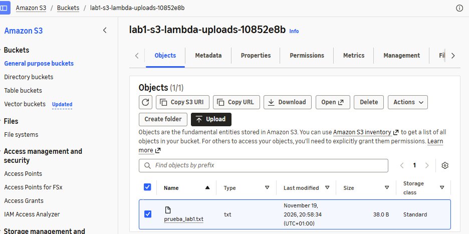
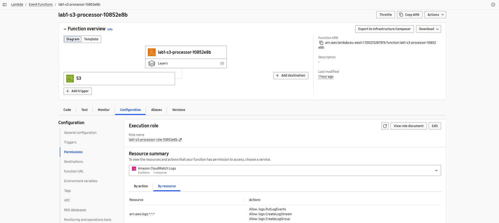
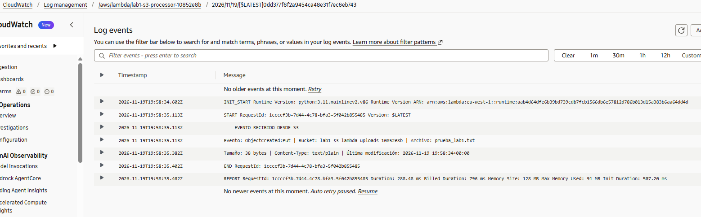

# Lab 1: Procesador de archivos en S3 (Arquitectura orientada a eventos)

## INTRODUCCION

+ **Lab 1: Procesador de archivos en S3 (Arquitectura orientada a eventos)**
    - **Utilidad real:** Automatizar el procesamiento de ficheros subidos por usuarios o sistemas externos (validación de formatos, parseo de CSV/JSON, generación de resúmenes o auditoría).
    - **Qué aprenderás:** Cómo configurar una notificación de evento en un bucket de S3 para disparar una Lambda, leer el event real que envía S3 (nombre del bucket y clave del objeto) y dar permisos granulares (s3:GetObject) solo sobre ese bucket.

## ARQUITECTURA

+ Arquitectura del Lab 1: S3 $\rightarrow$ Lambda $\rightarrow$ CloudWatch Logs
    - **Bucket S3:** Recibe el archivo subido. Configuramos ``force_destroy = true`` únicamente para este laboratorio, de modo que ``terraform destroy`` pueda borrar el bucket incluso si quedó algún archivo dentro.
    - **Permiso de invocación (``aws_lambda_permission``):** Por defecto, nadie externo puede invocar tu Lambda. Hay que autorizar explícitamente a ``s3.amazonaws.com`` a llamarla, acotando source_arn al bucket concreto.
    - **Notificación en S3 (``aws_s3_bucket_notification``):** Conecta el evento ``s3:ObjectCreated:*`` (cualquier subida o creación de objeto en el bucket) con el ARN de nuestra función Lambda.
    - **IAM con mínimo privilegio:** La Lambda solo recibe permiso ``s3:GetObject`` sobre el bucket del laboratorio (además de sus permisos de CloudWatch Logs).

## FUNCION

+ Creamos un archivo llamado ``s3_processor.py`` que lea el evento enviado por S3, extraiga el nombre del bucket y la clave (key o ruta) del archivo subido, y consulte sus metadatos usando ``boto3``:
```python
import json
import urllib.parse
import boto3

# Cliente de S3 inicializado al cargar el entorno de ejecución
s3_client = boto3.client("s3")


def lambda_handler(event, context):
    print("--- EVENTO RECIBIDO DESDE S3 ---")

    # Recorremos cada evento recibido dentro de la estructura de S3
    for record in event.get("Records", []):
        bucket_name = record["s3"]["bucket"]["name"]
        object_key = urllib.parse.unquote_plus(record["s3"]["object"]["key"])
        event_name = record.get("eventName", "desconocido")

        print(f"Evento: {event_name} | Bucket: {bucket_name} | Archivo: {object_key}")

        # Consultamos los metadatos del objeto subido sin descargar su cuerpo completo
        head = s3_client.head_object(Bucket=bucket_name, Key=object_key)

        print(
            f"Tamaño: {head['ContentLength']} bytes | "
            f"Content-Type: {head.get('ContentType', 'N/A')} | "
            f"Última modificación: {head['LastModified']}"
        )

    return {
        "statusCode": 200,
        "body": json.dumps({"mensaje": "Procesamiento de evento S3 completado"})
    }
```

+ Los diccionarios en python/boto3:
```bash
# Ejemplo
evento_ejemplo = {
    "eventName": "ObjectCreated:Put",
    "s3": {
        "bucket": {
            "name": "mi-bucket-demo"
        },
        "object": {
            "key": "informe.txt"
        }
    }
}
```
> Vas bajando nivel a nivel: entra en "s3", luego en "bucket", luego en "name" y obtienes "mi-bucket-demo": `nombre_bucket = evento_ejemplo["s3"]["bucket"]["name"]`  

> Peligro: Si pides una clave que no existe con corchetes (por ejemplo evento_ejemplo["no_existe"]), Python lanza un KeyError y rompe la ejecución de tu Lambda.  

> Con .get("clave", valor_por_defecto): `tipo_evento = evento_ejemplo.get("eventName", "desconocido")`: .get() busca "eventName". Si existe, devuelve su valor ("ObjectCreated:Put"). Si no existe, en lugar de romper el programa, devuelve el valor por defecto que le indiques ("desconocido"). Por eso en nuestro código hicimos event.get("Records", []): si por alguna prueba rara no viene la clave "Records", devuelve una lista vacía [] y el bucle for simplemente no da vueltas en vez de fallar con KeyError.  


+ **head_object vs. get_object:** Cuando llega un archivo a S3, a veces no necesitas leer su contenido completo, sino solo saber qué es y cuánto pesa (por ejemplo, para validar si está vacío, comprobar su Content-Type o registrar auditoría):
    - **s3_client.head_object(Bucket=bucket_name, Key=object_key):**
        + Consulta solo los metadatos del archivo (tamaño en ``ContentLength``, tipo MIME en ``ContentType``, fecha de modificación ``LastModified``, etiquetas, etc.).
        + No descarga el cuerpo del archivo, lo cual es más rápido y evita gastar memoria innecesaria en la Lambda si suben un fichero grande.
        + (Importante: en AWS S3, para llamar a ``head_object`` o ``get_object``, el rol IAM necesita permiso ``s3:GetObject`` sobre el objeto).

    - **s3_client.get_object(...):**
        + Descarga tanto los metadatos como el cuerpo (Body) del archivo (un stream de bytes que luego leerías con ``.read().decode("utf-8")`` si es texto).


## TERRAFORM

+ Providers.tf:
```bash
terraform {
  # Exigimos Terraform 1.0 o superior para evitar incompatibilidades de sintaxis
  required_version = ">= 1.0.0"

  required_providers {
    # Proveedor oficial de AWS para crear buckets, roles IAM, funciones Lambda, etc.
    aws = {
      source  = "hashicorp/aws"
      version = "~> 5.0"
    }
    # Proveedor random para generar un sufijo único y evitar choques de nombres en S3
    random = {
      source  = "hashicorp/random"
      version = "~> 3.6"
    }
  }
}

# Región de trabajo: Irlanda (eu-west-1)
provider "aws" {
  region = "eu-west-1"
}
```

+ main.tf:
```bash
# Genera un identificador aleatorio de 4 bytes (8 caracteres hexadecimales)
# para que el nombre del bucket S3 sea único a nivel global en AWS.
resource "random_id" "bucket_suffix" {
  byte_length = 4
}

# ==========================================
# 1. ALMACENAMIENTO (AMAZON S3)
# ==========================================

# Crea el bucket S3 donde se subirán los archivos que dispararán la Lambda.
# force_destroy = true permite borrar el bucket con terraform destroy aunque tenga objetos dentro.
resource "aws_s3_bucket" "uploads_bucket" {
  bucket        = "lab1-s3-lambda-uploads-${random_id.bucket_suffix.hex}"
  force_destroy = true # Facilita el terraform destroy en laboratorio
}

# Bloquea cualquier configuración accidental que exponga el bucket o sus objetos a internet.
resource "aws_s3_bucket_public_access_block" "uploads_bucket_pab" {
  bucket = aws_s3_bucket.uploads_bucket.id

  block_public_acls       = true
  block_public_policy     = true
  ignore_public_acls      = true
  restrict_public_buckets = true
}

# ==========================================
# 2. IDENTIDAD Y PERMISOS (IAM)
# ==========================================

# Política de confianza (Trust Policy): permite que el servicio AWS Lambda asuma este rol.
data "aws_iam_policy_document" "lambda_assume_role" {
  statement {
    effect  = "Allow"
    actions = ["sts:AssumeRole"]

    principals {
      type        = "Service"
      identifiers = ["lambda.amazonaws.com"]
    }
  }
}

# Rol de IAM que usará la función Lambda durante su ejecución.
resource "aws_iam_role" "s3_lambda_role" {
  name               = "lab1-s3-processor-role-${random_id.bucket_suffix.hex}"
  assume_role_policy = data.aws_iam_policy_document.lambda_assume_role.json
}

# --- Política 1: Permisos exclusivos para escribir logs en CloudWatch ---
data "aws_iam_policy_document" "lambda_logs_doc" {
  statement {
    sid    = "CloudWatchLogsWrite"
    effect = "Allow"
    actions = [
      "logs:CreateLogGroup",
      "logs:CreateLogStream",
      "logs:PutLogEvents"
    ]
    resources = ["arn:aws:logs:*:*:*"]
  }
}

# Crea la política de logs como recurso gestionado independiente en IAM.
resource "aws_iam_policy" "lambda_logs_policy" {
  name        = "lab1-s3-lambda-logs-policy-${random_id.bucket_suffix.hex}"
  description = "Permite a la Lambda crear grupos/flujos de logs y enviar eventos a CloudWatch"
  policy      = data.aws_iam_policy_document.lambda_logs_doc.json
}

# Adjunta la política de logs al rol de la Lambda.
resource "aws_iam_role_policy_attachment" "lambda_logs_attach" {
  role       = aws_iam_role.s3_lambda_role.name
  policy_arn = aws_iam_policy.lambda_logs_policy.arn
}

# --- Política 2: Permisos exclusivos de lectura sobre nuestro bucket S3 ---
data "aws_iam_policy_document" "s3_read_doc" {
  statement {
    sid    = "ReadObjectsFromLabBucket"
    effect = "Allow"
    actions = [
      "s3:GetObject"
    ]
    # Limitamos el permiso únicamente a los objetos dentro de nuestro bucket
    resources = ["${aws_s3_bucket.uploads_bucket.arn}/*"]
  }
}

# Crea la política de lectura S3 como recurso gestionado independiente en IAM.
resource "aws_iam_policy" "s3_read_policy" {
  name        = "lab1-s3-lambda-s3-read-policy-${random_id.bucket_suffix.hex}"
  description = "Permite leer metadatos y objetos solo del bucket de laboratorio"
  policy      = data.aws_iam_policy_document.s3_read_doc.json
}

# Adjunta la política de lectura S3 al rol de la Lambda.
resource "aws_iam_role_policy_attachment" "s3_read_attach" {
  role       = aws_iam_role.s3_lambda_role.name
  policy_arn = aws_iam_policy.s3_read_policy.arn
}
```
> IAM separado en dos politicas distintas: modularidad y el mínimo privilegio: una política se encarga únicamente de observabilidad (logs) y la otra del acceso a datos (S3). Así, si mañana quieres reutilizar la política de logs en otra Lambda o auditar qué permisos de S3 tiene esta función, está todo perfectamente separado.  

+ Ya tenemos en la primera parte de main.tf el sufijo aleatorio, el bucket S3 protegido y el rol de IAM con las dos políticas separadas (logs y lectura de S3). Añadimos el resto a main.tf:
```bash
# ==========================================
# 3. EMPAQUETADO Y OBSERVABILIDAD (ZIP + LOGS)
# ==========================================

# Comprime automáticamente s3_processor.py en un archivo s3_processor.zip
# dentro de la misma carpeta del módulo (${path.module}).
data "archive_file" "s3_processor_zip" {
  type        = "zip"
  source_file = "${path.module}/s3_processor.py"
  output_path = "${path.module}/s3_processor.zip"
}

# Crea explícitamente el Log Group antes de invocar la Lambda para controlar
# la retención a 7 días desde el primer momento y evitar retención infinita.
resource "aws_cloudwatch_log_group" "s3_processor_logs" {
  name              = "/aws/lambda/lab1-s3-processor-${random_id.bucket_suffix.hex}"
  retention_in_days = 7
}

# ==========================================
# 4. COMPUTACIÓN SERVERLESS (AWS LAMBDA)
# ==========================================

# Crea la función Lambda en Python 3.11 usando el rol IAM de la primera parte.
resource "aws_lambda_function" "s3_processor" {
  filename         = data.archive_file.s3_processor_zip.output_path
  function_name    = "lab1-s3-processor-${random_id.bucket_suffix.hex}"
  role             = aws_iam_role.s3_lambda_role.arn
  handler          = "s3_processor.lambda_handler"
  source_code_hash = data.archive_file.s3_processor_zip.output_base64sha256
  runtime          = "python3.11"

  # Garantizamos que los adjuntos IAM y el Log Group existan antes de crear la función.
  depends_on = [
    aws_iam_role_policy_attachment.lambda_logs_attach,
    aws_iam_role_policy_attachment.s3_read_attach,
    aws_cloudwatch_log_group.s3_processor_logs
  ]
}

# ==========================================
# 5. DISPARADOR DESDE S3 (PERMISO + EVENTO)
# ==========================================

# Autoriza explícitamente al servicio s3.amazonaws.com a invocar esta Lambda,
# restringiendo el origen (source_arn) únicamente a nuestro bucket de laboratorio.
resource "aws_lambda_permission" "allow_s3_invoke" {
  statement_id  = "AllowExecutionFromS3Bucket"
  action        = "lambda:InvokeFunction"
  function_name = aws_lambda_function.s3_processor.function_name
  principal     = "s3.amazonaws.com"
  source_arn    = aws_s3_bucket.uploads_bucket.arn
}

# Configura el bucket para que cada vez que se cree un objeto (s3:ObjectCreated:*)
# envíe un evento a nuestra función Lambda.
resource "aws_s3_bucket_notification" "on_file_upload" {
  bucket = aws_s3_bucket.uploads_bucket.id

  lambda_function {
    lambda_function_arn = aws_lambda_function.s3_processor.arn
    events              = ["s3:ObjectCreated:*"]
  }

  # Espera a que exista el permiso de invocación; de lo contrario S3 rechaza
  # registrar la notificación porque no puede verificar que tiene permiso para llamar a la Lambda.
  depends_on = [aws_lambda_permission.allow_s3_invoke]
}
```
> Empaquetado del código Python (data.archive_file) en un .zip.  
> Grupo de logs en CloudWatch (aws_cloudwatch_log_group) con retención de 7 días.  
> Función Lambda (aws_lambda_function) vinculada al rol IAM y al .zip.  
> Permiso de invocación desde S3 (aws_lambda_permission) para que Amazon S3 pueda llamar a tu función.  
> Notificación del bucket S3 (aws_s3_bucket_notification) para disparar la Lambda al crear objetos.  

+ **Diferencia entre el Rol IAM y aws_lambda_permission:**
    - El Rol IAM (``s3_lambda_role``) dice qué puede hacer la Lambda hacia afuera (leer S3, escribir en CloudWatch).
    - ``aws_lambda_permission`` dice quién desde afuera tiene permiso para invocar la Lambda (en este caso, s3.amazonaws.com sobre ese bucket concreto).
    - El orden en aws_s3_bucket_notification: Cuando configuras una notificación en S3 hacia una Lambda, AWS comprueba en ese instante que el servicio S3 tenga permiso para invocar la función. Por eso ``depends_on = [aws_lambda_permission.allow_s3_invoke]`` evita errores de orden de creación.


## DESPLIEGUE Y COMPROBACION

+ Desplegamos:
```bash
terraform init
terraform apply

Apply complete! Resources: 12 added, 0 changed, 0 destroyed.

Outputs:

lambda_function_name = "lab1-s3-processor-10852e8b"
s3_bucket_name = "lab1-s3-lambda-uploads-10852e8b"
```

+ Comprobamos los recursos creados:
```bash
terraform state list
data.archive_file.s3_processor_zip
data.aws_iam_policy_document.lambda_assume_role
data.aws_iam_policy_document.lambda_logs_doc
data.aws_iam_policy_document.s3_read_doc
aws_cloudwatch_log_group.s3_processor_logs
aws_iam_policy.lambda_logs_policy
aws_iam_policy.s3_read_policy
aws_iam_role.s3_lambda_role
aws_iam_role_policy_attachment.lambda_logs_attach
aws_iam_role_policy_attachment.s3_read_attach
aws_lambda_function.s3_processor
aws_lambda_permission.allow_s3_invoke
aws_s3_bucket.uploads_bucket
aws_s3_bucket_notification.on_file_upload
aws_s3_bucket_public_access_block.uploads_bucket_pab
random_id.bucket_suffix
```

+ Comprobar que el bucket y la notificación hacia Lambda existen en S3:
```bash
aws s3api get-bucket-notification-configuration \
  --bucket lab1-s3-lambda-uploads-10852e8b
{
    "LambdaFunctionConfigurations": [
        {
            "Id": "tf-s3-lambda-20261119193822655800000003",
            "LambdaFunctionArn": "arn:aws:lambda:eu-west-1:700213287974:function:lab1-s3-processor-10852e8b",
            "Events": [
                "s3:ObjectCreated:*"
            ]
        }
    ]
}
```
> Confirma que el bucket tiene configurada la sección LambdaFunctionConfigurations apuntando al ARN de lab1-s3-processor-10852e8b para el evento s3:ObjectCreated:*.  

+ Comprobar la configuración básica de la Lambda:
```bash
aws lambda get-function-configuration \
  --function-name lab1-s3-processor-10852e8b \
  --query "[FunctionName, Runtime, Handler, Role]" \
  --output table
--------------------------------------------------------------------
|                     GetFunctionConfiguration                     |
+------------------------------------------------------------------+
|  lab1-s3-processor-10852e8b                                      |
|  python3.11                                                      |
|  s3_processor.lambda_handler                                     |
|  arn:aws:iam::700213287974:role/lab1-s3-processor-role-10852e8b  |
+------------------------------------------------------------------+
```
> Confirma el runtime (python3.11), el handler (s3_processor.lambda_handler) y el rol IAM asignado.  

## TEST CREAR Y SUBIR ARCHIVO DE PRUEBA S3

+ Crear y subir un archivo de prueba a S3:
```bash
echo "Prueba real del Lab 1 desde Barcelona" > prueba_lab1.txt
aws s3 cp prueba_lab1.txt s3://lab1-s3-lambda-uploads-10852e8b/prueba_lab1.txt

upload: ./prueba_lab1.txt to s3://lab1-s3-lambda-uploads-10852e8b/prueba_lab1.txt
```
> Cuando termine el aws s3 cp, la subida habrá disparado automáticamente la notificación en S3.

  
  

+ Ver los logs en CloudWatch:
```bash
aws logs tail /aws/lambda/lab1-s3-processor-10852e8b --since 10m --format short

2026-11-19T19:58:34 INIT_START Runtime Version: python:3.11.mainlinev2.v86      Runtime Version ARN: arn:aws:lambda:eu-west-1::runtime:aab4d64dfe6b39bd739cdb7fcb1566db6e57812d786b013d15a383b6aa64dd4d
2026-11-19T19:58:35 START RequestId: 1ccccf3b-7d44-4c78-bfa3-5f042b855485 Version: $LATEST
2026-11-19T19:58:35 --- EVENTO RECIBIDO DESDE S3 ---
2026-11-19T19:58:35 Evento: ObjectCreated:Put | Bucket: lab1-s3-lambda-uploads-10852e8b | Archivo: prueba_lab1.txt
2026-11-19T19:58:35 Tamaño: 38 bytes | Content-Type: text/plain | Última modificación: 2026-11-19 19:58:34+00:00
2026-11-19T19:58:35 END RequestId: 1ccccf3b-7d44-4c78-bfa3-5f042b855485
2026-11-19T19:58:35 REPORT RequestId: 1ccccf3b-7d44-4c78-bfa3-5f042b855485      Duration: 288.48 ms     Billed Duration: 796 ms     Memory Size: 128 MB     Max Memory Used: 91 MB  Init Duration: 507.20 ms
```

  

+ El proceso explicado:
```bash
1. Subida del objeto a S3 (ObjectCreated:Put):
Al subir prueba_lab1.txt, Amazon S3 completa la escritura del objeto y revisa su configuración de notificaciones (aws_s3_bucket_notification). Ve que el evento coincide con s3:ObjectCreated:*.

2. Validación de permiso (aws_lambda_permission):
S3 invoca de forma asíncrona a la Lambda lab1-s3-processor-10852e8b. AWS comprueba que existe el permiso que le otorga a s3.amazonaws.com permiso para llamar a esa función desde ese source_arn concreto.

3. Arranque del entorno y asunción del rol IAM:
Lambda prepara el entorno de ejecución de Python 3.11 y asume temporalmente el rol lab1-s3-processor-role-10852e8b (gracias a la Trust Policy con lambda.amazonaws.com). Con ese rol obtiene credenciales temporales que permiten a boto3 leer en S3 y escribir en CloudWatch Logs.

4. Ejecución de lambda_handler(event, context):
AWS pasa el JSON del evento de S3 dentro de event. Tu código entra en el bucle for record in event.get("Records", []):, extrae el nombre del bucket, decodifica la clave (object_key) con urllib.parse.unquote_plus y lee eventName.

5. Consulta de metadatos con s3_client.head_object(...):
Tu código llama a head_object usando el cliente de boto3. S3 comprueba que el rol de la Lambda tiene s3:GetObject sobre arn:aws:s3:::lab1-s3-lambda-uploads-10852e8b/* y devuelve los metadatos (ContentLength, ContentType, LastModified) sin descargar todo el contenido.

6. Envío de print() a CloudWatch Logs:
Cada print(...) de Python sale por la salida estándar del contenedor y el entorno de Lambda lo envía al Log Group /aws/lambda/lab1-s3-processor-10852e8b (que ya tenías creado con retención de 7 días).
```

+ Hemos configurado un bucket S3 para que, cada vez que entra un archivo, dispare automáticamente una función Lambda que inspecciona ese archivo y deja registro en CloudWatch Logs sin que nadie tenga que vigilarlo ni ejecutar comandos a mano.

+ Hacer aws s3 cp solo guarda el archivo en el disco/bucket; es como dejar una carta en el buzón. La Lambda es el proceso automático que abre el buzón en cuanto llega una carta, lee su contenido o metadatos, comprueba si es válido, guarda un registro o lo envía a otro sistema. Si en un entorno real suben 500 ficheros al día, no puedes estar pendiente de revisarlos todos a mano ni tener un servidor encendido 24/7 esperando que llegue alguno.

### SI QUEREMOS QUE FUESE UN TIPO DE FICHERO EN CONCRETO

+ Si configuras events = ["s3:ObjectCreated:*"] sin filtro, la Lambda se ejecuta cada vez que se sube cualquier archivo (imágenes, temporales, .log, etc.). Con filter_suffix = ".txt" le decimos a S3: "Dispara la Lambda únicamente cuando el nombre del archivo termine en .txt". Añadimos en main.tf: 
```bash
resource "aws_s3_bucket_notification" "on_file_upload" {
  bucket = aws_s3_bucket.uploads_bucket.id

  lambda_function {
    lambda_function_arn = aws_lambda_function.s3_processor.arn
    events              = ["s3:ObjectCreated:*"]
    filter_suffix       = ".txt" # Solo dispara la Lambda si el archivo acaba en .txt
  }

  depends_on = [aws_lambda_permission.allow_s3_invoke]
}
```
> (También existe filter_prefix si quisieras filtrar solo una "carpeta" lógica, como filter_prefix = "entradas/").

### Leer el contenido del archivo en Python con get_object

+ Antes usábamos head_object (solo metadatos). Ahora vamos a usar get_object para descargar y leer el texto del archivo:
```python
import json
import urllib.parse
import boto3

s3_client = boto3.client("s3")


def lambda_handler(event, context):
    print("--- EVENTO RECIBIDO DESDE S3 ---")

    for record in event.get("Records", []):
        bucket_name = record["s3"]["bucket"]["name"]
        object_key = urllib.parse.unquote_plus(record["s3"]["object"]["key"])
        event_name = record.get("eventName", "desconocido")

        print(f"Evento: {event_name} | Bucket: {bucket_name} | Archivo: {object_key}")

        # 1. Pedimos el objeto completo a S3
        response = s3_client.get_object(Bucket=bucket_name, Key=object_key)

        # 2. response["Body"] es un flujo de bytes (stream).
        #    .read() lee todos los bytes y .decode("utf-8") los convierte a texto legible.
        contenido = response["Body"].read().decode("utf-8", errors="replace")

        print(f"Contenido del archivo:\n{contenido}")

    return {
        "statusCode": 200,
        "body": json.dumps({"mensaje": "Archivo leído correctamente"})
    }
```