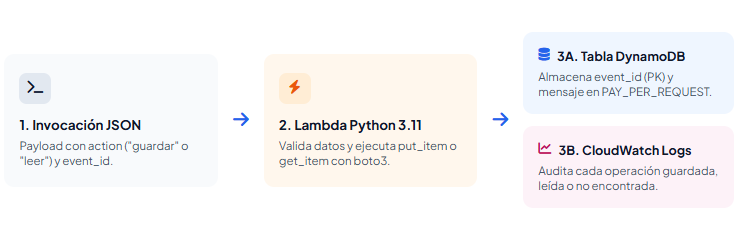
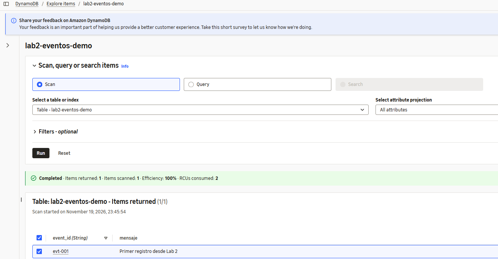
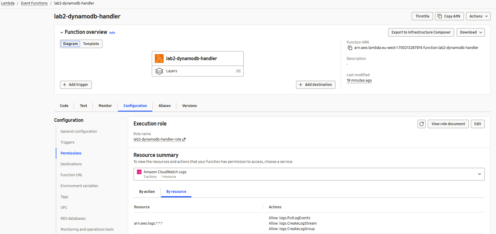
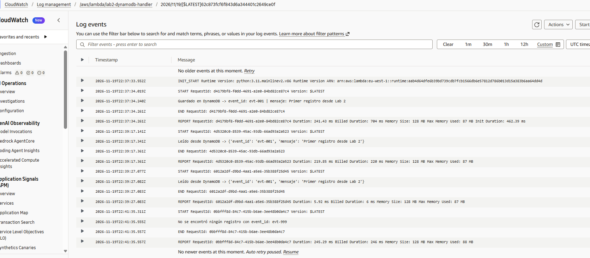

# Lab 2: Escritura y consulta en DynamoDB (Persistencia serverless con boto3)

  

+ **Lab 2: Escritura y consulta en DynamoDB (Persistencia serverless con boto3)**
    - **Utilidad real:** Guardar registros de auditoría, estados de procesos o datos de microservicios sin gestionar bases de datos relacionales.
    - **Qué aprenderás:** Usar el SDK boto3 de Python dentro de Lambda para hacer put_item o get_item en una tabla DynamoDB, y aplicar mínimo privilegio en IAM restringiendo el recurso al ARN exacto de la tabla.

## INTRODUCCION

+ **¿Qué es DynamoDB?** Es una base de datos clave-valor / documento serverless de AWS. A diferencia de una base de datos tradicional donde tienes que levantar un servidor o configurar tablas con esquemas rígidos de columnas, en DynamoDB defines una clave primaria (por ejemplo, id) y guardas elementos (ítems) con atributos JSON de forma rápida y escalable.

+ **¿Qué vamos a construir?**
    - **Una tabla DynamoDB** (``lab2-eventos-demo``) con clave de partición ``event_id`` (tipo S = String / texto).
    - **Una función Lambda** (``lab2-dynamodb-handler``) con permisos IAM de mínimo privilegio únicamente sobre el ARN de esa tabla.
    - Un código en Python (``dynamodb_handler.py``) que soporte dos acciones sencillas al invocar la Lambda:
        + ``guardar``: Inserta un registro en DynamoDB usando ``put_item``.
        + ``leer``: Consulta un registro concreto por su ``event_id`` usando ``get_item``.

## FUNCION

+ Creamos la funcion `dynamodb_handler.py`:
```python
import json
import boto3

# Creamos el cliente de DynamoDB fuera del handler para reutilizarlo entre ejecuciones
dynamodb = boto3.client("dynamodb")


def lambda_handler(event, context):
    # Definimos el nombre de la tabla DynamoDB que crearemos en Terraform
    table_name = "lab2-eventos-demo"
    
    # Leemos qué operación queremos hacer: "guardar" o "leer".
    # Si no viene "action" en el event, usamos "leer" por defecto.
    action = event.get("action", "leer")
    
    # Leemos el ID del evento (clave primaria de la tabla)
    event_id = event.get("event_id")

    # Validación básica: sin event_id no podemos guardar ni consultar un ítem concreto
    if not event_id:
        return {
            "statusCode": 400,
            "body": json.dumps({"error": "Falta el parámetro 'event_id' en el evento"})
        }

    if action == "guardar":
        # Obtenemos un mensaje opcional; si no se envía, ponemos uno por defecto
        mensaje = event.get("mensaje", "Evento registrado desde Lambda")

        # put_item crea o sobrescribe un ítem en la tabla DynamoDB
        dynamodb.put_item(
            TableName=table_name,
            Item={
                "event_id": {"S": str(event_id)},
                "mensaje": {"S": str(mensaje)}
            }
        )

        print(f"Guardado en DynamoDB -> event_id: {event_id} | mensaje: {mensaje}")
        return {
            "statusCode": 200,
            "body": json.dumps({
                "accion": "guardar",
                "event_id": event_id,
                "estado": "guardado_ok"
            })
        }

    elif action == "leer":
        # get_item busca exactamente el ítem cuya clave de partición coincida con event_id
        respuesta = dynamodb.get_item(
            TableName=table_name,
            Key={
                "event_id": {"S": str(event_id)}
            }
        )

        # La respuesta de get_item incluye "Item" solo si el registro existe
        item = respuesta.get("Item")
        if not item:
            print(f"No se encontró ningún registro con event_id: {event_id}")
            return {
                "statusCode": 404,
                "body": json.dumps({"mensaje": f"No existe el registro '{event_id}'"})
            }

        # Extraemos los valores de texto ("S") del diccionario devuelto por DynamoDB
        datos_limpios = {
            "event_id": item["event_id"]["S"],
            "mensaje": item.get("mensaje", {}).get("S", "")
        }

        print(f"Leído desde DynamoDB -> {datos_limpios}")
        return {
            "statusCode": 200,
            "body": json.dumps({
                "accion": "leer",
                "datos": datos_limpios
            })
        }

    else:
        return {
            "statusCode": 400,
            "body": json.dumps({"error": f"Acción no válida: {action}. Usa 'guardar' o 'leer'."})
        }
```

+ La función actúa como un pequeño servicio de lectura/escritura sobre la tabla ``lab2-eventos-demo`` en DynamoDB, controlado por lo que le pases en el diccionario ``event`` al invocarla:
    - Comprueba parámetros de entrada: Lee ``action`` (por defecto "leer") y event_id (la clave primaria del registro). Si no llega ``event_id``, devuelve un error 400 y no toca la base de datos.
    - Si ``action == "guardar"``: Toma el ``mensaje`` enviado (o uno por defecto) y usa ``dynamodb.put_item(...)`` para insertar o actualizar un registro con ``event_id`` y ``mensaje`` en la tabla. Devuelve 200 confirmando que se guardó.
    - Si ``action == "leer"``: Usa dynamodb.get_item(...) buscando por ``event_id``. Si no encuentra nada, devuelve 404; si existe, extrae los valores limpios y devuelve 200 con los datos encontrados.
    - Si llega otra acción distinta: Devuelve un error ``400`` indicando que solo acepta ``"guardar"`` o ``"leer"``.
> En pocas palabras: recibe una orden (guardar o leer) y un identificador (event_id), habla con DynamoDB mediante boto3 y responde con el resultado.


## TERRAFORM

+ **Primera parte de main.tf: Tabla DynamoDB + Rol y Políticas IAM**:
    - La tabla ``aws_dynamodb_table`` con ``PAY_PER_REQUEST`` (pagas por petición real, ideal para laboratorios y cargas variables) y ``event_id`` como clave de partición (``hash_key``).
    - **El rol de IAM** (``aws_iam_role``) para que Lambda pueda asumirlo.
    - **Política 1:** Permisos exclusivos para escribir logs en CloudWatch.
    - **Política 2:** Permisos exclusivos de ``dynamodb:PutItem`` y ``dynamodb:GetItem`` sobre el ARN exacto de nuestra tabla (``aws_dynamodb_table.eventos_table.arn``), aplicando mínimo privilegio.
```bash
# ==========================================
# 1. BASE DE DATOS NOSQL (AMAZON DYNAMODB)
# ==========================================

# Crea la tabla donde se guardarán y consultarán los eventos desde Lambda.
# PAY_PER_REQUEST evita tener que reservar capacidad fija de lectura/escritura.
resource "aws_dynamodb_table" "eventos_table" {
  name         = "lab2-eventos-demo"
  billing_mode = "PAY_PER_REQUEST"
  hash_key     = "event_id"

  # Solo declaramos en attribute los atributos que forman parte de las claves (hash/range)
  attribute {
    name = "event_id"
    type = "S" # S = String (texto)
  }

  tags = {
    Laboratorio = "Lab2-DynamoDB"
  }
}

# ==========================================
# 2. IDENTIDAD Y PERMISOS (IAM)
# ==========================================

# Política de confianza (Trust Policy): permite que AWS Lambda asuma este rol.
data "aws_iam_policy_document" "lambda_assume_role" {
  statement {
    effect  = "Allow"
    actions = ["sts:AssumeRole"]

    principals {
      type        = "Service"
      identifiers = ["lambda.amazonaws.com"]
    }
  }
}

# Rol IAM que usará la función Lambda durante su ejecución.
resource "aws_iam_role" "dynamodb_lambda_role" {
  name               = "lab2-dynamodb-handler-role"
  assume_role_policy = data.aws_iam_policy_document.lambda_assume_role.json
}

# --- Política 1: Permisos exclusivos para CloudWatch Logs ---
data "aws_iam_policy_document" "lambda_logs_doc" {
  statement {
    sid    = "CloudWatchLogsWrite"
    effect = "Allow"
    actions = [
      "logs:CreateLogGroup",
      "logs:CreateLogStream",
      "logs:PutLogEvents"
    ]
    resources = ["arn:aws:logs:*:*:*"]
  }
}

resource "aws_iam_policy" "lambda_logs_policy" {
  name        = "lab2-dynamodb-logs-policy"
  description = "Permite a la Lambda escribir sus logs en CloudWatch"
  policy      = data.aws_iam_policy_document.lambda_logs_doc.json
}

resource "aws_iam_role_policy_attachment" "lambda_logs_attach" {
  role       = aws_iam_role.dynamodb_lambda_role.name
  policy_arn = aws_iam_policy.lambda_logs_policy.arn
}

# --- Política 2: Permisos mínimos para leer y escribir en nuestra tabla DynamoDB ---
data "aws_iam_policy_document" "dynamodb_access_doc" {
  statement {
    sid    = "ReadAndWriteEventosTableOnly"
    effect = "Allow"
    actions = [
      "dynamodb:PutItem",
      "dynamodb:GetItem"
    ]
    # Restringimos el permiso exclusivamente a la tabla creada en este laboratorio
    resources = [aws_dynamodb_table.eventos_table.arn]
  }
}

resource "aws_iam_policy" "dynamodb_access_policy" {
  name        = "lab2-dynamodb-table-access-policy"
  description = "Permite PutItem y GetItem únicamente sobre la tabla lab2-eventos-demo"
  policy      = data.aws_iam_policy_document.dynamodb_access_doc.json
}

resource "aws_iam_role_policy_attachment" "dynamodb_access_attach" {
  role       = aws_iam_role.dynamodb_lambda_role.name
  policy_arn = aws_iam_policy.dynamodb_access_policy.arn
}
```
> no hemos puesto "dynamodb:*" ni "*" en resources: solo hemos dado PutItem y GetItem sobre el ARN exacto de aws_dynamodb_table.eventos_table. Si alguien comprometiera esta Lambda, no podría borrar la tabla (DeleteTable), escanear otras tablas ni leer datos de otras partes de la cuenta.

+ En DynamoDB, la tabla solo necesita conocer los atributos que forman parte de las claves (hash_key —clave de partición— y, si existiera, range_key —clave de ordenación—) o de sus índices secundarios:
    - DynamoDB usa event_id para calcular en qué partición interna distribuir y localizar el registro al hacer get_item o put_item.
    - El resto de campos de cada ítem —como mensaje, origen o prioridad— son atributos libres que se definen al vuelo cuando guardas el ítem desde tu código (put_item).
    - Imagina que hoy guardas registros con event_id y mensaje. El mes que viene, un nuevo evento incluye además "severidad": "alta" y "ip_origen": "10.0.1.5". Con DynamoDB puedes guardar ese nuevo ítem con esos campos extra sin modificar la tabla en Terraform ni provocar cortes o migraciones de esquema.
```bash
1. ¿Cómo guarda un registro (put_item)?
Supón que envías este evento a tu Lambda:
- action: "guardar"
- event_id: "evt-101"
- mensaje: "Backup completado"

¿Qué hace DynamoDB por debajo?
- Toma el valor de la clave de partición ("evt-101") y lo pasa por una función hash interna.
- El resultado de esa función actúa como un "índice matemático" que apunta a una estantería concreta (por ejemplo, la Estantería B).
- Coloca allí todo el ítem (event_id = "evt-101", mensaje = "Backup completado").
Regla de oro: Si haces put_item con un event_id que ya existe (por ejemplo, "evt-101"), DynamoDB sobrescribe ese registro por completo en esa misma posición, no crea dos duplicados con el mismo event_id.

2. ¿Cómo busca un registro (get_item)?
Ahora envías a tu Lambda:
- action: "leer"
- event_id: "evt-101"

¿Qué hace DynamoDB?
- Vuelve a pasar "evt-101" por la misma función hash interna.
- Sabe exactamente que debe ir directo a la Estantería B y buscar el ítem con event_id = "evt-101", sin tener que revisar toda la tabla fila por fila.
- En milisegundos te devuelve el ítem completo (y de ahí en Python extraemos "mensaje").
```

+ **Segunda parte de main.tf (ZIP, CloudWatch Logs y Lambda)**:
```bash
# ==========================================
# 3. EMPAQUETADO Y OBSERVABILIDAD (ZIP + LOGS)
# ==========================================

# Empaqueta dynamodb_handler.py en un archivo zip dentro de la carpeta del proyecto.
data "archive_file" "dynamodb_handler_zip" {
  type        = "zip"
  source_file = "${path.module}/dynamodb_handler.py"
  output_path = "${path.module}/dynamodb_handler.zip"
}

# Crea el Log Group antes de invocar la función para fijar la retención a 7 días
# y evitar que los logs se acumulen indefinidamente sin control de costes.
resource "aws_cloudwatch_log_group" "dynamodb_handler_logs" {
  name              = "/aws/lambda/lab2-dynamodb-handler"
  retention_in_days = 7
}

# ==========================================
# 4. COMPUTACIÓN SERVERLESS (AWS LAMBDA)
# ==========================================

# Crea la función Lambda que leerá y escribirá registros en DynamoDB.
resource "aws_lambda_function" "dynamodb_handler" {
  filename         = data.archive_file.dynamodb_handler_zip.output_path
  function_name    = "lab2-dynamodb-handler"
  role             = aws_iam_role.dynamodb_lambda_role.arn
  handler          = "dynamodb_handler.lambda_handler"
  source_code_hash = data.archive_file.dynamodb_handler_zip.output_base64sha256
  runtime          = "python3.11"

  # Garantizamos que los permisos IAM y el Log Group existan antes de crear la Lambda.
  depends_on = [
    aws_iam_role_policy_attachment.lambda_logs_attach,
    aws_iam_role_policy_attachment.dynamodb_access_attach,
    aws_cloudwatch_log_group.dynamodb_handler_logs
  ]
}
```
> en este Lab 2 no necesitamos un recurso aws_lambda_permission. DynamoDB nunca invoca a la Lambda en este diseño. Por eso, quien necesita permiso es el rol IAM de la Lambda hacia DynamoDB (política con dynamodb:PutItem y dynamodb:GetItem), no un permiso de invocación entrante hacia la Lambda.

+ **¿Cuándo SÍ necesitarías aws_lambda_permission en el futuro?:** Cada vez que otro servicio o agente externo quiera disparar/invocar tu Lambda desde fuera:
    - Cuando Amazon S3 o EventBridge o SNS vayan a llamar a la función.
    - Cuando API Gateway exponga una ruta que invoque a la Lambda.
    - Cuando quieras permitir que otra cuenta de AWS invoque tu función.
> En resumen: permisos de IAM en el rol de la Lambda = qué puede hacer la Lambda hacia otros servicios; aws_lambda_permission = quién tiene permiso para llamar/invocar a la Lambda.

## TEST Y COMPROBAR RESULTADOS

+ Terraform descarga los proveedores necesarios (aws), comprueba la configuración, genera el .zip de dynamodb_handler.py y te pide confirmación (yes) para crear la tabla lab2-eventos-demo, el rol IAM con sus dos políticas y adjuntos, el Log Group y la función Lambda lab2-dynamodb-handler.
```bash
terraform init
terraform apply
Apply complete! Resources: 8 added, 0 changed, 0 destroyed.

Outputs:

dynamodb_table_name = "lab2-eventos-demo"
lambda_function_name = "lab2-dynamodb-handler"
```
  

+ Para invocar la función Lambda desde la AWS CLI pasando un JSON en --payload, el payload debe ir codificado en Base64 (en Linux/WSL puedes usar base64 -w 0 para que no meta saltos de línea):

+ Probar guardar:
```bash
aws lambda invoke \
  --function-name lab2-dynamodb-handler \
  --cli-binary-format raw-in-base64-out \
  --payload '{"action":"guardar","event_id":"evt-001","mensaje":"Primer registro desde Lab 2"}' \
  respuesta_guardar.json
{
    "StatusCode": 200,
    "ExecutedVersion": "$LATEST"
}

at respuesta_guardar.json
{"statusCode": 200, "body": "{\"accion\": \"guardar\", \"event_id\": \"evt-001\", \"estado\": \"guardado_ok\"}"}terraform (mterraform (main)
```

+ Probar leer registro existente:
```bash
aws lambda invoke \
  --function-name lab2-dynamodb-handler \
  --cli-binary-format raw-in-base64-out \
  --payload '{"action":"leer","event_id":"evt-001"}' \
  respuesta_leer_ok.json
{
    "StatusCode": 200,
    "ExecutedVersion": "$LATEST"
}
cat respuesta_leer_ok.json
{"statusCode": 200, "body": "{\"accion\": \"leer\", \"datos\": {\"event_id\": \"evt-001\", \"mensaje\": \"Primer registro deterraf
```

+ Probar leer registro que no existe:
```bash
aws lambda invoke \
  --function-name lab2-dynamodb-handler \
  --cli-binary-format raw-in-base64-out \
  --payload '{"action":"leer","event_id":"evt-999"}' \
  respuesta_leer_404.json
{
    "StatusCode": 200,
    "ExecutedVersion": "$LATEST"
}
cat respuesta_leer_404.json
 "body": "{\"mensaje\": \"No existe el registro 'evt-999'\"}"}
```
  

+ Consultar directamente a DYNAMODB desde AWS CLI:
```bash
aws dynamodb get-item \
  --table-name lab2-eventos-demo \
  --key '{"event_id": {"S": "evt-001"}}' \
  --output json
{
    "Item": {
        "event_id": {
            "S": "evt-001"
        },
        "mensaje": {
            "S": "Primer registro desde Lab 2"
        }
    }
}
```

+ Listar toda la tabla dynamodb:
```
aws dynamodb scan --table-name lab2-eventos-demo
{
    "Items": [
        {
            "event_id": {
                "S": "evt-001"
            },
            "mensaje": {
                "S": "Primer registro desde Lab 2"
            }
        }
    ],
    "Count": 1,
    "ScannedCount": 1,
    "ConsumedCapacity": null
}
```  

  

## RESUMEN

+ Al invocar la función lab2-dynamodb-handler, Lambda actúa como intermediario programable entre quien llama (tú desde la CLI, otra Lambda o más adelante un API Gateway) y la base de datos DynamoDB:
    - Recibe la petición (event) e interpreta la orden: Comprueba que venga event_id y mira si action es "guardar" o "leer".
    - Habla con DynamoDB usando boto3 y su rol IAM:
        + Si es "guardar", llama a put_item para insertar/actualizar el ítem (event_id + mensaje) en lab2-eventos-demo.
        + Si es "leer", llama a get_item para buscar por event_id y devolver los datos (o un 404 si no existe).
    - Devuelve una respuesta estructurada: Responde con statusCode (200, 400 o 404) y un body en JSON indicando qué ocurrió.

+ Lambda no guarda por sí misma un historial permanente de lo que ocurre en cada ejecución: se limita a escribir en su salida estándar (print(...)) y a emitir métricas técnicas (duración, errores, invocaciones). Amazon CloudWatch es el sistema de observabilidad que recoge esos registros en el Log Group /aws/lambda/lab2-dynamodb-handler (con la retención de 7 días que definimos en Terraform) para que puedas auditar qué guardó, qué leyó o qué falló sin depender solo de la respuesta inmediata de la llamada.