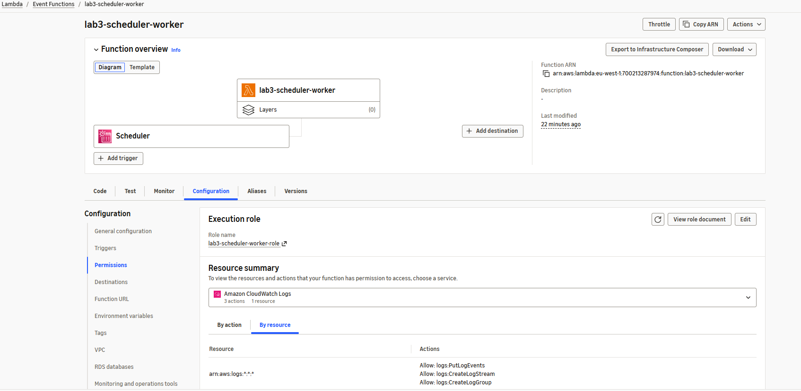
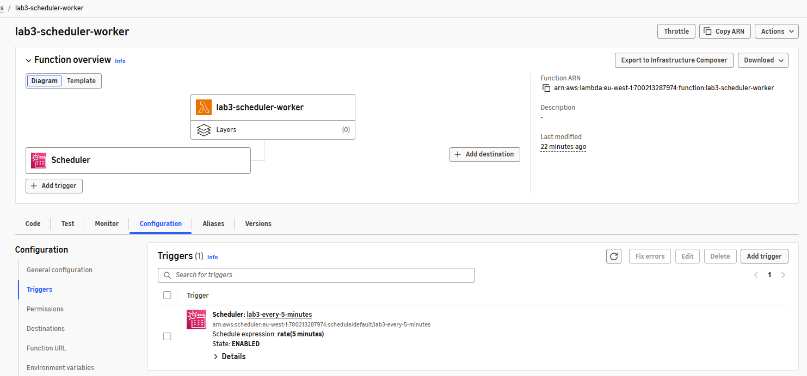
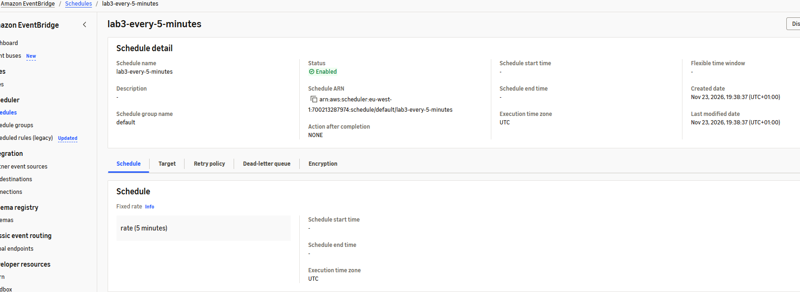
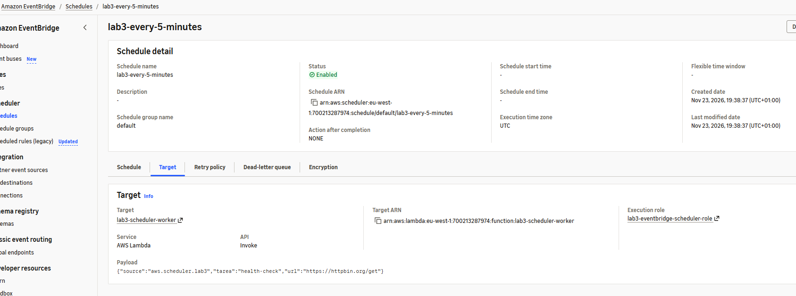
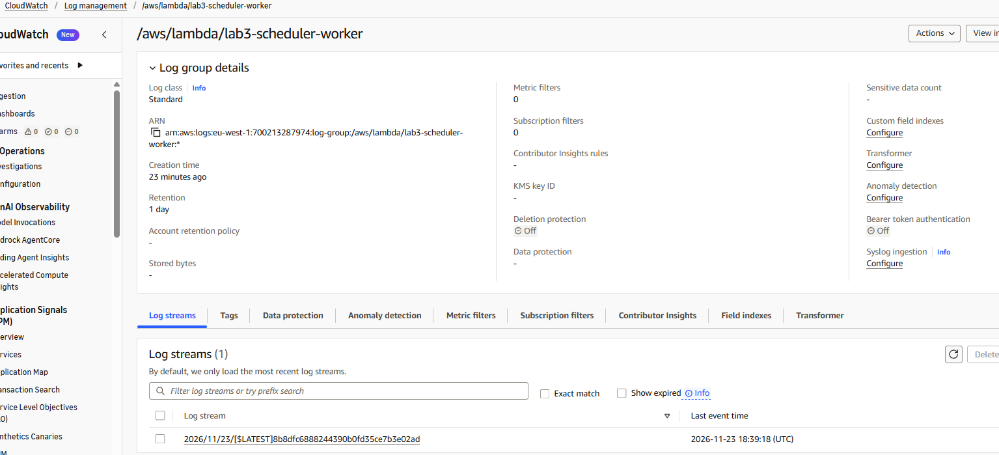
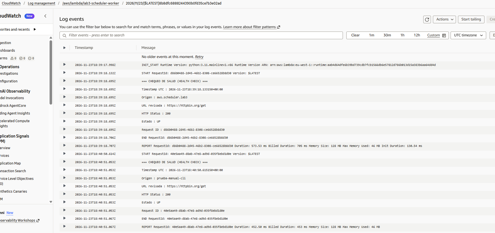

# Lab 3: Tarea programada con EventBridge Scheduler (Reemplazo moderno de cron jobs)

  

+ **Lab 3: Tarea programada con EventBridge Scheduler (Reemplazo moderno de cron jobs)**
    - **Utilidad real:** Limpieza periódica de recursos, comprobaciones de salud, envíos de reportes diarios o apagado/encendido de entornos de laboratorio fuera de horario.
    - **Qué aprenderás:** Disparar una Lambda según una expresión cron o de tasa (rate), añadir permisos de invocación (aws_lambda_permission) para que el servicio disparador pueda llamar a la función, y diseñar funciones idempotentes.

## INTRODUCCION

+ En el Lab 3 vamos a ver ejecuciones programadas en el tiempo (tareas recurrentes tipo cron o rate) usando Amazon EventBridge Scheduler (o una regla programada de EventBridge) para disparar una función Lambda automáticamente cada cierto intervalo (por ejemplo, cada 5 minutos o cada 1 minuto en pruebas).

+ **¿Para qué sirve esto en la vida real?**
    - Comprobar periódicamente el estado de un servicio, una API o un recurso.
    - Limpiar datos temporales, generar informes diarios o lanzar procesos automáticos a una hora fija sin tener un servidor encendido las 24 horas.

+ **¿Qué vamos a construir en este Lab 3?**
    - Una carpeta nueva, por ejemplo ``lab03-scheduled-lambda``.
    - ``providers.tf``: Proveedores aws y archive (o random si usamos sufijo).
    - ``scheduler_worker.py``: Una función Lambda en Python que se ejecuta automáticamente según el horario programado, registra una marca de tiempo (timestamp en UTC) y un resumen de ejecución.
    - ``main.tf`` (lo iremos viendo en partes comentadas):
        - Rol IAM y políticas para la Lambda (CloudWatch Logs).
        - Empaquetado .zip, Log Group con retención de 7 días y función Lambda.
        - Programación periódica (por ejemplo, cada 5 minutos) y permiso/rol necesario para invocar la Lambda.
    - ``outputs.tf``: Nombre de la función Lambda y del programador/regla creada.


## FUNCION

+ Creamos la funcion scheduler_worker.py:
```python
import json
from datetime import datetime, timezone

def lambda_handler(event, context):
    # Obtenemos la hora exacta de ejecución en formato ISO 8601 (ej. "2026-11-20T00:15:00+00:00")
    ejecutado_en = datetime.now(timezone.utc).isoformat()

    # EventBridge suele enviar información del evento dentro de "event" (o puede ir vacío si se prueba a mano)
    fuente = event.get("source", "invocacion-manual-o-scheduler")

    print("=== TAREA PROGRAMADA EJECUTADA ===")
    print(f"Timestamp UTC : {ejecutado_en}")
    print(f"Origen        : {fuente}")
    print(f"Request ID    : {context.aws_request_id if context else 'local'}")

    return {
        "statusCode": 200,
        "body": json.dumps({
            "mensaje": "Tarea programada ejecutada correctamente",
            "timestamp_utc": ejecutado_en
        })
    }
```
> datetime y timezone: Librería estándar de Python para trabajar con fechas y horas. Usamos timezone.utc para registrar siempre la hora en formato UTC (estándar en la nube para evitar líos con cambios de horario de verano/invierno).  

> datetime.now(timezone.utc).isoformat() genera una cadena de texto clara con la fecha y hora exacta en UTC en el momento en que salta la programación.  

> event.get("source", ...) lee de forma segura si viene un campo "source" en el event sin lanzar error si no existe.  

> context.aws_request_id muestra el identificador único de esa ejecución concreta de Lambda (muy útil en logs).  

## TERRAFORM

+ Aquí usamos ``aws_scheduler_schedule (EventBridge Scheduler)``, que es el servicio moderno de programación en AWS. A diferencia de S3 (que invoca directamente a la Lambda mediante aws_lambda_permission), EventBridge Scheduler asume un rol IAM (aws_iam_role) con permiso lambda:InvokeFunction sobre el ARN de nuestra función para poder dispararla según el horario (rate(5 minutes)).

+ main.tf:
```bash
# ==========================================
# 1. EMPAQUETADO Y OBSERVABILIDAD (ZIP + LOGS)
# ==========================================

data "archive_file" "scheduler_worker_zip" {
  type        = "zip"
  source_file = "${path.module}/scheduler_worker.py"
  output_path = "${path.module}/scheduler_worker.zip"
}

resource "aws_cloudwatch_log_group" "scheduler_worker_logs" {
  name              = "/aws/lambda/lab3-scheduler-worker"
  retention_in_days = 7
}

# ==========================================
# 2. ROL IAM DE LA FUNCIÓN LAMBDA (LOGS)
# ==========================================

data "aws_iam_policy_document" "lambda_assume_role" {
  statement {
    effect  = "Allow"
    actions = ["sts:AssumeRole"]

    principals {
      type        = "Service"
      identifiers = ["lambda.amazonaws.com"]
    }
  }
}

resource "aws_iam_role" "lambda_exec_role" {
  name               = "lab3-scheduler-worker-role"
  assume_role_policy = data.aws_iam_policy_document.lambda_assume_role.json
}

data "aws_iam_policy_document" "lambda_logs_doc" {
  statement {
    sid    = "CloudWatchLogsWrite"
    effect = "Allow"
    actions = [
      "logs:CreateLogGroup",
      "logs:CreateLogStream",
      "logs:PutLogEvents"
    ]
    resources = ["arn:aws:logs:*:*:*"]
  }
}

resource "aws_iam_policy" "lambda_logs_policy" {
  name        = "lab3-scheduler-worker-logs-policy"
  description = "Permite a la Lambda escribir logs en CloudWatch"
  policy      = data.aws_iam_policy_document.lambda_logs_doc.json
}

resource "aws_iam_role_policy_attachment" "lambda_logs_attach" {
  role       = aws_iam_role.lambda_exec_role.name
  policy_arn = aws_iam_policy.lambda_logs_policy.arn
}

# ==========================================
# 3. FUNCIÓN LAMBDA
# ==========================================

resource "aws_lambda_function" "scheduler_worker" {
  filename         = data.archive_file.scheduler_worker_zip.output_path
  function_name    = "lab3-scheduler-worker"
  role             = aws_iam_role.lambda_exec_role.arn
  handler          = "scheduler_worker.lambda_handler"
  source_code_hash = data.archive_file.scheduler_worker_zip.output_base64sha256
  runtime          = "python3.11"

  depends_on = [
    aws_iam_role_policy_attachment.lambda_logs_attach,
    aws_cloudwatch_log_group.scheduler_worker_logs
  ]
}

# ==========================================
# 4. EVENTBRIDGE SCHEDULER (DISPARADOR CADA 5 MIN)
# ==========================================

# Rol que EventBridge Scheduler asumirá para tener permiso de invocar la Lambda
data "aws_iam_policy_document" "scheduler_assume_role" {
  statement {
    effect  = "Allow"
    actions = ["sts:AssumeRole"]

    principals {
      type        = "Service"
      identifiers = ["scheduler.amazonaws.com"]
    }
  }
}

resource "aws_iam_role" "scheduler_invoke_role" {
  name               = "lab3-eventbridge-scheduler-role"
  assume_role_policy = data.aws_iam_policy_document.scheduler_assume_role.json
}

data "aws_iam_policy_document" "scheduler_invoke_lambda_doc" {
  statement {
    sid       = "InvokeSchedulerWorkerLambdaOnly"
    effect    = "Allow"
    actions   = ["lambda:InvokeFunction"]
    resources = [aws_lambda_function.scheduler_worker.arn]
  }
}

resource "aws_iam_policy" "scheduler_invoke_lambda_policy" {
  name        = "lab3-scheduler-invoke-lambda-policy"
  description = "Permite a EventBridge Scheduler invocar únicamente lab3-scheduler-worker"
  policy      = data.aws_iam_policy_document.scheduler_invoke_lambda_doc.json
}

resource "aws_iam_role_policy_attachment" "scheduler_invoke_lambda_attach" {
  role       = aws_iam_role.scheduler_invoke_role.name
  policy_arn = aws_iam_policy.scheduler_invoke_lambda_policy.arn
}

# Programación recurrente cada 5 minutos que invoca la función Lambda
resource "aws_scheduler_schedule" "every_5_minutes" {
  name       = "lab3-every-5-minutes"
  group_name = "default"

  flexible_time_window {
    mode = "OFF"
  }

  schedule_expression = "rate(5 minutes)"

  target {
    arn      = aws_lambda_function.scheduler_worker.arn
    role_arn = aws_iam_role.scheduler_invoke_role.arn

    # Enviamos un payload JSON de ejemplo para que el código lea event["source"]
    input = jsonencode({
      source = "aws.scheduler.lab3"
      tarea  = "chequeo-periodico"
    })
  }

  depends_on = [aws_iam_role_policy_attachment.scheduler_invoke_lambda_attach]
}
```


## TEST Y COMPROBAR RESULTADOS

+ Aunque el scheduler saltará solo cada 5 minutos, puedes hacer una prueba manual al instante para comprobar cómo responde tu función con un event personalizado:
```bash
Apply complete! Resources: 0 added, 0 changed, 0 destroyed.

Outputs:

lambda_function_name = "lab3-scheduler-worker"
log_group_name = "/aws/lambda/lab3-scheduler-worker"
scheduler_name = "lab3-every-5-minutes"

#-------------------------------
 aws lambda invoke \
  --function-name lab3-scheduler-worker \
  --cli-binary-format raw-in-base64-out \
  --payload '{"source":"prueba-manual-cli","tarea":"verificacion-inmediata"}' \
  respuesta_lab3.json
{
    "StatusCode": 200,
    "ExecutedVersion": "$LATEST"
}
terraform (main) ❯ cat respuesta_lab3.json
{"statusCode": 200, "body": "{\"mensaje\": \"Tarea programada ejecutada correctamente\", \"timestamp_utc\": \"2026-11-20T00:terraform (main) ❯ rm respuesta_lab3.json 
```
+ Prueba manual con una URL que responde 200 y otra con un error 404:
```bash
# Prueba 1: URL válida (esperamos estado UP / 200)
aws lambda invoke \
  --function-name lab3-scheduler-worker \
  --cli-binary-format raw-in-base64-out \
  --payload '{"source":"prueba-cli","url":"https://httpbin.org/get"}' \
  res_ok.json && cat res_ok.json && echo ""
{
    "StatusCode": 200,
    "ExecutedVersion": "$LATEST"
}
{"statusCode": 200, "body": "{\"timestamp_utc\": \"2026-11-23T18:55:16.344455+00:00\", \"url\": \"https://httpbin.org/get\", \"http_status\": 200, \"estado\": \"UP\"}"}
cat res_ok.json 
{"statusCode": 200, "body": "{\"timestamp_utc\": \"2026-11-23T18:55:16.344455+00:00\", \"url\": \"https://httpbin.org/get\",terraform (main) ❯ 00, \"estado\": \"UP\"}"}

# Prueba 2: Ruta inexistente (esperamos estado DOWN_HTTP_ERROR / 404)
aws lambda invoke \
  --function-name lab3-scheduler-worker \
  --cli-binary-format raw-in-base64-out \
  --payload '{"source":"prueba-cli","url":"https://httpbin.org/status/404"}' \
  res_404.json && cat res_404.json && echo ""
{
    "StatusCode": 200,
    "ExecutedVersion": "$LATEST"
}
{"statusCode": 200, "body": "{\"timestamp_utc\": \"2026-11-23T18:55:36.337187+00:00\", \"url\": \"https://httpbin.org/status/404\", \"http_status\": 404, \"estado\": \"DOWN_HTTP_ERROR\"}"}
terraform (main) ❯ cat res_404.json 
{"statusCode": 200, "body": "{\"timestamp_utc\": \"2026-11-23T18:55:36.337187+00:00\", \"url\": \"https://httpbin.org/statusterraform (main) ❯ us\": 404, \"estado\": \"DOWN_HTTP_ERROR\"}"}
```
  
  


+ Revisar recursos y logs desde AWS CLI:
```bash
# 1. Ver detalles de la función Lambda
aws lambda get-function --function-name lab3-scheduler-worker --query 'Configuration.{FunctionName:FunctionName,Runtime:Runtime,Timeout:Timeout,Role:Role}'
{
    "FunctionName": "lab3-scheduler-worker",
    "Runtime": "python3.11",
    "Timeout": 10,
    "Role": "arn:aws:iam::700213287974:role/lab3-scheduler-worker-role"
}

# 2. Ver la programación creada en EventBridge Scheduler
aws scheduler get-schedule --name lab3-every-5-minutes
{
    "ActionAfterCompletion": "NONE",
    "Arn": "arn:aws:scheduler:eu-west-1:700213287974:schedule/default/lab3-every-5-minutes",
    "CreationDate": "2026-11-23T19:38:37.589000+01:00",
    "FlexibleTimeWindow": {
        "Mode": "OFF"
    },
    "GroupName": "default",
    "LastModificationDate": "2026-11-23T19:38:37.589000+01:00",
    "Name": "lab3-every-5-minutes",
    "ScheduleExpression": "rate(5 minutes)",
    "ScheduleExpressionTimezone": "UTC",
    "State": "ENABLED",
    "Target": {
        "Arn": "arn:aws:lambda:eu-west-1:700213287974:function:lab3-scheduler-worker",
        "Input": "{\"source\":\"aws.scheduler.lab3\",\"tarea\":\"health-check\",\"url\":\"https://httpbin.org/get\"}",
        "RetryPolicy": {
            "MaximumEventAgeInSeconds": 86400,
            "MaximumRetryAttempts": 185
        },
        "RoleArn": "arn:aws:iam::700213287974:role/lab3-eventbridge-scheduler-role"
    }
}
```
  
  

+ Ver los logs en CloudWatch (y comprobar las ejecuciones automáticas cada 5 min):
```bash
aws logs tail /aws/lambda/lab3-scheduler-worker --since 15m --format short
2026-11-20T00:16:52 INIT_START Runtime Version: python:3.11.mainlinev2.v86      Runtime Version ARN: arn:aws:lambda:eu-west-1::runtime:aab4d64dfe6b39bd739cdb7fcb1566db6e57812d786b013d15a383b6aa64dd4d
2026-11-20T00:16:52 START RequestId: e4663490-eb13-442b-9abe-41661160332d Version: $LATEST
2026-11-20T00:16:52 === TAREA PROGRAMADA EJECUTADA ===
2026-11-20T00:16:52 Timestamp UTC : 2026-11-20T00:16:52.432665+00:00
2026-11-20T00:16:52 Origen        : prueba-manual-cli
2026-11-20T00:16:52 Request ID    : e4663490-eb13-442b-9abe-41661160332d
2026-11-20T00:16:52 END RequestId: e4663490-eb13-442b-9abe-41661160332d
2026-11-20T00:16:52 REPORT RequestId: e4663490-eb13-442b-9abe-41661160332d      Duration: 1.60 ms  Billed Duration: 83 ms  Memory Size: 128 MB     Max Memory Used: 30 MB  Init Duration: 80.54 ms

#----------------------
2026-11-20T00:17:12 START RequestId: 936aff91-6097-4f84-bd6d-6695fa105af2 Version: $LATEST
2026-11-20T00:17:12 === TAREA PROGRAMADA EJECUTADA ===
2026-11-20T00:17:12 Timestamp UTC : 2026-11-20T00:17:12.982033+00:00
2026-11-20T00:17:12 Origen        : aws.scheduler.lab3
2026-11-20T00:17:12 Request ID    : 936aff91-6097-4f84-bd6d-6695fa105af2
2026-11-20T00:17:12 END RequestId: 936aff91-6097-4f84-bd6d-6695fa105af2
2026-11-20T00:17:12 REPORT RequestId: 936aff91-6097-4f84-bd6d-6695fa105af2      Duration: 1.34 ms  Billed Duration: 2 ms   Memory Size: 128 MB     Max Memory Used: 30 MB
```
> Primero tu prueba manual (Origen : prueba-manual-cli) y, conforme pasen los intervalos de 5 minutos, verás nuevas ejecuciones automáticas con Origen : aws.scheduler.lab3 y un Request ID distinto en cada una.  

  
  

## RESUMEN

+ **Lab 3: Tareas programadas**
  - EventBridge Scheduler + Lambda + CloudWatch
  - Ejecutar comprobaciones, limpiezas o avisos de forma periódica a un ritmo (rate) o a una hora fija (cron) sin mantener un servidor encendido.
  - El programador salta en el horario configurado $\rightarrow$ asume su rol IAM e invoca la Lambda $\rightarrow$ la Lambda hace el chequeo (p. ej. estado HTTP de una URL) y anota el resultado en CloudWatch.

+ Imagina que tienes una página web o un servicio y quieres que alguien revise cada 5 minutos si está vivo o caído, y deje constancia de ello. Antes, si querías hacer eso en un servidor tradicional, tenías que tener una máquina encendida las 24 horas con un script o un cron corriendo. Con este laboratorio estamos montando lo mismo pero sin servidor propio (serverless):
  - Un despertador / reloj programado (EventBridge Scheduler): Cada 5 minutos toca la campana y dice "¡toca revisar!".
  - Un trabajador puntual (AWS Lambda): Solo aparece cuando suena la campana, hace la comprobación (mira si la web responde con 200 OK o da error) y se apaga hasta la siguiente vez.
  - Un cuaderno de bitácora (CloudWatch Logs): Anota cada vez que el trabajador actuó, qué hora era y si la web respondió bien o mal.
  - Los permisos (IAM): Las tarjetas de acceso para que el reloj pueda despertar al trabajador y el trabajador pueda escribir en el cuaderno de bitácora, sin darle llaves maestras a nada más.
  - El plano de construcción (Terraform): Los archivos donde definimos todo esto por escrito para crearlo y borrarlo cuando queramos.

+ la función Python en este ejemplo?
  - Mira qué dirección web (url) le toca comprobar.
  - Intenta entrar un momento (máximo 5 segundos).
  - Anota si ha ido bien (UP), si la web devolvió un error (DOWN_HTTP_ERROR) o si ni siquiera se pudo conectar (DOWN_ERROR).
  - Escribe ese resultado en los logs para que tú puedas consultarlo.


+ **Los 6 huecos de un cron en EventBridge Scheduler**: A diferencia del cron clásico de Linux (que tiene 5 campos), en AWS EventBridge Scheduler la expresión tiene 6 campos separados por espacios:
`cron(Minutos  Horas  Día_del_mes  Mes  Día_de_la_semana  Año)`  
> * (asterisco): significa "todos" (cada minuto, cada hora, cada mes, cada año).  
> ? (interrogación): significa "no me importa / no especificado". En AWS no puedes poner * en el día del mes y * en el día de la semana a la vez: uno lleva * (o un número) y el otro lleva ?.  