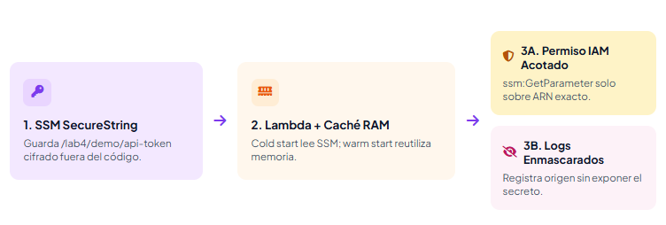
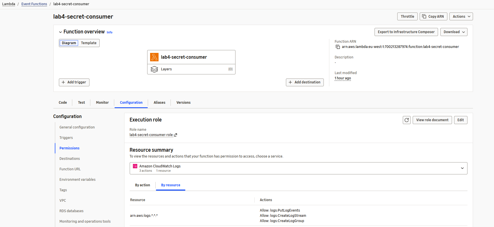
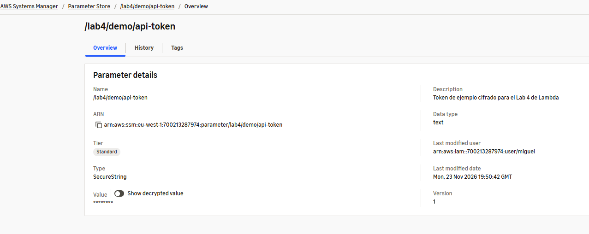
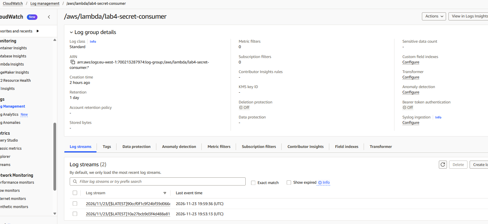
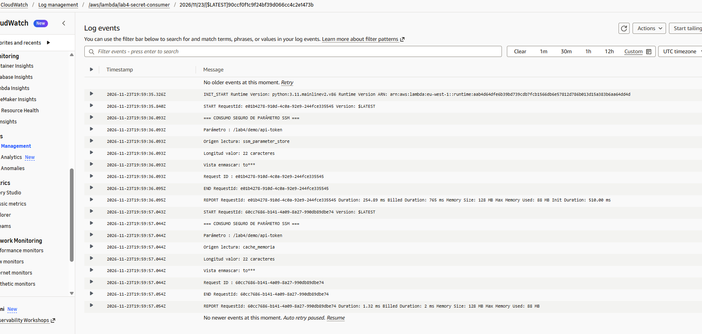

# Lab 4: Consumo seguro de secretos y parámetros (SSM Parameter Store / Secrets Manager)

  

+ **Lab 4: Consumo seguro de secretos y parámetros (SSM Parameter Store / Secrets Manager)**
    - **Utilidad real:** Conectar una Lambda a APIs externas, bases de datos o servicios de terceros sin dejar contraseñas o tokens escritos en el código ni en variables de entorno planas.
    - **Qué aprenderás:** Recuperar parámetros o secretos en tiempo de ejecución usando boto3, cachearlos en memoria entre invocaciones cálidas (warm starts) y conceder permisos ssm:GetParameter o secretsmanager:GetSecretValue con alcance limitado.

## INTRODUCCION

+ **¿Qué resuelve este Lab 4 en la vida real?**: Imagina que tu función Lambda tiene que conectarse a una API externa o a una base de datos usando una clave secreta.
    - **Lo que NO conviene hacer:** Escribir la clave dentro del .py (si subes el código a GitHub, queda expuesta) o dejarla en texto plano en una variable de entorno de Lambda.
    - **Lo que hacemos aquí:** Guardamos el secreto en AWS Systems Manager Parameter Store como tipo SecureString (cifrado con KMS) y hacemos que la Lambda lo pida en tiempo de ejecución usando boto3 y un rol IAM con mínimo privilegio (solo sobre el ARN de ese parámetro concreto).


+ **Cachear en memoria entre invocaciones cálidas (warm starts)**: Cuando AWS Lambda ejecuta tu función por primera vez (o tras un tiempo sin uso), crea un entorno de ejecución (**cold start**). Si declaras una variable fuera de ``lambda_handler(...)`` (a nivel de módulo), ese valor se mantiene en memoria mientras el contenedor siga vivo (warm start).
    - **Ventaja: **En la primera ejecución pedimos el secreto a SSM (``get_parameter``). En las siguientes ejecuciones cálidas reutilizamos la copia en memoria, ahorrando llamadas a la API de AWS y reduciendo latencia.


+ **¿Qué vamos a montar en este Lab 4?**
    - Un parámetro cifrado (``SecureString``) en SSM Parameter Store (por ejemplo ``/lab4/demo/api-token``), gestionado con Terraform.
    - Un Log Group en CloudWatch (``/aws/lambda/lab4-secret-consumer``) con retención de 7 días.
    - Un`` Rol IAM para la Lambda con permiso ``ssm:GetParameter ``(con ``with_decryption = true) restringido únicamente al ARN de ese parámetro, más los permisos de escritura en CloudWatch Logs.``
    - Una función Lambda en Python (secret_reader.py``) que lee el parámetro usando caché en memoria y registra en los logs si lo cargó desde SSM o desde caché (nunca imprimiendo el secreto en claro).

## FUNCION

+ Creamos la función `secret_reader.py`:
```python
import json
import os
import boto3

# Cliente de SSM creado fuera del handler: se reutiliza entre invocaciones cálidas.
ssm_client = boto3.client("ssm")

# Caché en memoria a nivel de módulo: guarda el valor secreto tras la primera lectura.
_CACHED_SECRET = None


def get_secret_from_ssm(parameter_name: str) -> tuple[str, str]:
    """
    Devuelve (valor_secreto, origen_lectura) donde origen_lectura
    indica si salió de 'cache_memoria' o de 'ssm_parameter_store'.
    """
    global _CACHED_SECRET

    # Si ya tenemos el secreto en memoria en este contenedor cálido, no volvemos a llamar a SSM.
    if _CACHED_SECRET is not None:
        return _CACHED_SECRET, "cache_memoria"

    # Primera lectura (o cold start): consultamos SSM Parameter Store descifrando SecureString.
    response = ssm_client.get_parameter(
        Name=parameter_name,
        WithDecryption=True
    )
    _CACHED_SECRET = response["Parameter"]["Value"]
    return _CACHED_SECRET, "ssm_parameter_store"


def lambda_handler(event, context):
    # El nombre del parámetro se pasa como variable de entorno (no es un secreto, es una ruta).
    parameter_name = os.environ["PARAMETER_NAME"]

    secret_value, source = get_secret_from_ssm(parameter_name)

    # Buena práctica de seguridad: nunca imprimimos el secreto en los logs;
    # solo comprobamos su longitud o una pista mínima para verificar que llegó bien.
    secret_length = len(secret_value)
    masked_preview = f"{secret_value[:2]}***" if secret_length >= 2 else "***"

    print("=== CONSUMO SEGURO DE PARÁMETRO SSM ===")
    print(f"Parámetro     : {parameter_name}")
    print(f"Origen lectura: {source}")
    print(f"Longitud valor: {secret_length} caracteres")
    print(f"Vista enmascar: {masked_preview}")
    print(f"Request ID    : {context.aws_request_id if context else 'local'}")

    return {
        "statusCode": 200,
        "body": json.dumps({
            "mensaje": "Parámetro recuperado correctamente",
            "origen_lectura": source,
            "longitud_secreto": secret_length
        })
    }
```
> PARAMETER_NAME va en variable de entorno porque es la ruta (/lab4/demo/api-token), no el secreto en sí.  

> Enmascaramos el valor (masked_preview) en vez de imprimir el secreto completo en CloudWatch Logs, algo muy importante en seguridad para no dejar credenciales en registros de texto.  

+ **SSM Parameter Store:**
    - **Uso habitual:**	API keys, tokens, configuraciones sensibles y secretos sencillos.
    - **Rotación automática:** Requiere integraciones o funciones Lambda programadas por tu cuenta.
    - **Coste:** Los parámetros estándar son gratuitos (o muy económicos con políticas avanzadas / alto volumen de llamadas API).
    - **Llamada en boto3:**	`ssm.get_parameter(Name=..., WithDecryption=True)`

+ AWS Secrets Manager:
    - **Uso habitual:** Credenciales de bases de datos (RDS, etc.), secretos con rotación automática nativa y compartición entre cuentas.
    - **Rotación automática:** Trae rotación automática integrada de serie (con plantillas para bases de datos y flujos de rotación).
    - **Coste:** Tiene un coste mensual por secreto almacenado y por llamadas a la API, pensado para secretos de mayor valor/gestión.
    - **Llamada en boto3:** `secretsmanager.get_secret_value(SecretId=...)`

> Regla práctica: Para tokens de API o secretos simples en laboratorios o proyectos pequeños, SSM Parameter Store (SecureString) es directo y económico; si necesitas rotación automática de credenciales de base de datos o gestión avanzada del ciclo de vida del secreto, Secrets Manager encaja mejor.


## TERRAFORM

+ main.tf:
```bash
# ==========================================
# 1. SECRETO EN SSM PARAMETER STORE
# ==========================================

# Crea un parámetro cifrado (SecureString) en SSM Parameter Store.
# En entornos reales es habitual crear/rotar el valor fuera de Terraform o inyectarlo
# por variable de entorno/CI/CD sin dejar valores sensibles fijos en el repositorio.
resource "aws_ssm_parameter" "api_token" {
  name        = "/lab4/demo/api-token"
  description = "Token de ejemplo cifrado para el Lab 4 de Lambda"
  type        = "SecureString"
  value       = var.demo_api_token

  tags = {
    Laboratorio = "Lab4-SSM-Secrets"
  }
}

# ==========================================
# 2. EMPAQUETADO Y LOGS (CLOUDWATCH)
# ==========================================

# Comprime secret_reader.py en secret_reader.zip para desplegarlo en Lambda.
data "archive_file" "secret_reader_zip" {
  type        = "zip"
  source_file = "${path.module}/secret_reader.py"
  output_path = "${path.module}/secret_reader.zip"
}

# Crea el Log Group antes de ejecutar la función y fija retención a 7 días.
resource "aws_cloudwatch_log_group" "secret_reader_logs" {
  name              = "/aws/lambda/lab4-secret-consumer"
  retention_in_days = 7

  tags = {
    Laboratorio = "Lab4-SSM-Secrets"
  }
}

# ==========================================
# 3. ROL IAM DE MÍNIMO PRIVILEGIO
# ==========================================

# Trust Policy: permite que el servicio AWS Lambda asuma este rol.
data "aws_iam_policy_document" "lambda_assume_role" {
  statement {
    effect  = "Allow"
    actions = ["sts:AssumeRole"]

    principals {
      type        = "Service"
      identifiers = ["lambda.amazonaws.com"]
    }
  }
}

# Rol de ejecución de la función Lambda.
resource "aws_iam_role" "lambda_exec_role" {
  name               = "lab4-secret-consumer-role"
  assume_role_policy = data.aws_iam_policy_document.lambda_assume_role.json
}

# Política 1: permiso para escribir logs en CloudWatch.
data "aws_iam_policy_document" "lambda_logs_doc" {
  statement {
    sid    = "CloudWatchLogsWrite"
    effect = "Allow"
    actions = [
      "logs:CreateLogGroup",
      "logs:CreateLogStream",
      "logs:PutLogEvents"
    ]
    resources = ["arn:aws:logs:*:*:*"]
  }
}

resource "aws_iam_policy" "lambda_logs_policy" {
  name        = "lab4-secret-consumer-logs-policy"
  description = "Permite escribir logs de ejecución del Lab 4 en CloudWatch"
  policy      = data.aws_iam_policy_document.lambda_logs_doc.json
}

resource "aws_iam_role_policy_attachment" "lambda_logs_attach" {
  role       = aws_iam_role.lambda_exec_role.name
  policy_arn = aws_iam_policy.lambda_logs_policy.arn
}

# Política 2: mínimo privilegio para leer ÚNICAMENTE el parámetro /lab4/demo/api-token.
# (Si el parámetro usa la clave KMS por defecto de SSM, aws:GetParameter con WithDecryption
# funciona a través de SSM; si usas una CMK propia, también se añade kms:Decrypt sobre esa clave).
data "aws_iam_policy_document" "lambda_ssm_read_doc" {
  statement {
    sid       = "ReadLab4ParameterOnly"
    effect    = "Allow"
    actions   = ["ssm:GetParameter"]
    resources = [aws_ssm_parameter.api_token.arn]
  }
}

resource "aws_iam_policy" "lambda_ssm_read_policy" {
  name        = "lab4-secret-consumer-ssm-policy"
  description = "Permite leer únicamente el parámetro /lab4/demo/api-token en SSM"
  policy      = data.aws_iam_policy_document.lambda_ssm_read_doc.json
}

resource "aws_iam_role_policy_attachment" "lambda_ssm_read_attach" {
  role       = aws_iam_role.lambda_exec_role.name
  policy_arn = aws_iam_policy.lambda_ssm_read_policy.arn
}

# ==========================================
# 4. FUNCIÓN LAMBDA
# ==========================================

# Crea la función Lambda que leerá el parámetro en ejecución y lo cacheará en memoria.
resource "aws_lambda_function" "secret_consumer" {
  filename         = data.archive_file.secret_reader_zip.output_path
  function_name    = "lab4-secret-consumer"
  role             = aws_iam_role.lambda_exec_role.arn
  handler          = "secret_reader.lambda_handler"
  source_code_hash = data.archive_file.secret_reader_zip.output_base64sha256
  runtime          = "python3.11"
  timeout          = 10

  # Pasamos solo el nombre/ruta del parámetro (no el secreto en claro).
  environment {
    variables = {
      PARAMETER_NAME = aws_ssm_parameter.api_token.name
    }
  }

  depends_on = [
    aws_iam_role_policy_attachment.lambda_logs_attach,
    aws_iam_role_policy_attachment.lambda_ssm_read_attach,
    aws_cloudwatch_log_group.secret_reader_logs
  ]
}
```

+ Outputs.tf:
```bash
# Nombre del parámetro creado en SSM Parameter Store.
output "ssm_parameter_name" {
  description = "Nombre del parámetro SecureString en SSM Parameter Store"
  value       = aws_ssm_parameter.api_token.name
}

# Nombre de la función Lambda desplegada.
output "lambda_function_name" {
  description = "Nombre de la función Lambda que consume el parámetro"
  value       = aws_lambda_function.secret_consumer.function_name
}

# Log Group de CloudWatch donde revisar los orígenes de lectura (SSM vs caché).
output "log_group_name" {
  description = "Log Group de CloudWatch de la función Lambda"
  value       = aws_cloudwatch_log_group.secret_reader_logs.name
}
```

## TEST Y COMPROBACIONES

+ Desplegamos:
```bash
Apply complete! Resources: 8 added, 0 changed, 0 destroyed.

Outputs:

lambda_function_name = "lab4-secret-consumer"
log_group_name = "/aws/lambda/lab4-secret-consumer"
ssm_parameter_name = "/lab4/demo/api-token"
```
  

+ **Probar y ver la diferencia entre ssm_parameter_store y cache_memoria**: Ahora vamos a invocar la función dos veces seguidas (o en un intervalo corto) para ver qué pasa en la primera ejecución y qué pasa en la segunda si reutiliza el entorno cálido (warm start):
```bash
# 1.ª invocación
aws lambda invoke \
  --function-name lab4-secret-consumer \
  --cli-binary-format raw-in-base64-out \
  --payload '{}' \
  res_lab4_1.json && cat res_lab4_1.json && echo ""
{
    "StatusCode": 200,
    "ExecutedVersion": "$LATEST"
}
{"statusCode": 200, "body": "{\"mensaje\": \"Par\\u00e1metro recuperado correctamente\", \"origen_lectura\": \"ssm_parameter_store\", \"longitud_secreto\": 22}"}
terraform (main) ❯ cat res_lab4_1.json 
{"statusCode": 200, "body": "{\"mensaje\": \"Par\\u00e1metro recuperado correctamente\", \"terraform (main) ❯ "ssm_parameter_store\", \"longitud_secreto\": 22}"}`

# 2.ª invocación seguida
aws lambda invoke \
  --function-name lab4-secret-consumer \
  --cli-binary-format raw-in-base64-out \
  --payload '{}' \
  res_lab4_2.json && cat res_lab4_2.json && echo ""
{
    "StatusCode": 200,
    "ExecutedVersion": "$LATEST"
}
{"statusCode": 200, "body": "{\"mensaje\": \"Par\\u00e1metro recuperado correctamente\", \"origen_lectura\": \"cache_memoria\", \"longitud_secreto\": 22}"}
terraform (main) ❯ cat res_lab4_2.json 
{"statusCode": 200, "body": "{\"mensaje\": \"Par\\u00e1metro recuperado correctamente\", \"terraform (main) ❯ "cache_memoria\", \"longitud_secreto\": 22}"}
```

  

+ Revisar los logs en Cloudwatch:
```bash
aws logs tail /aws/lambda/lab4-secret-consumer --since 10m --format short
2026-11-23T19:53:12 INIT_START Runtime Version: python:3.11.mainlinev2.v86      Runtime Version ARN: arn:aws:lambda:eu-west-1::runtime:aab4d64dfe6b39bd739cdb7fcb1566db6e57812d786b013d15a383b6aa64dd4d
2026-11-23T19:53:13 START RequestId: 8581802a-e639-4a41-981a-908f739731a4 Version: $LATEST
2026-11-23T19:53:13 === CONSUMO SEGURO DE PARÁMETRO SSM ===
2026-11-23T19:53:13 Parámetro     : /lab4/demo/api-token
2026-11-23T19:53:13 Origen lectura: ssm_parameter_store
2026-11-23T19:53:13 Longitud valor: 22 caracteres
2026-11-23T19:53:13 Vista enmascar: to***
2026-11-23T19:53:13 Request ID    : 8581802a-e639-4a41-981a-908f739731a4
2026-11-23T19:53:13 END RequestId: 8581802a-e639-4a41-981a-908f739731a4
2026-11-23T19:53:13 REPORT RequestId: 8581802a-e639-4a41-981a-908f739731a4      Duration: 248.03 ms        Billed Duration: 758 ms Memory Size: 128 MB     Max Memory Used: 88 MB  Init Duration: 509.01 ms
2026-11-23T19:54:05 START RequestId: c7ad893a-1b79-4206-a439-c988276c7ea5 Version: $LATEST
2026-11-23T19:54:05 === CONSUMO SEGURO DE PARÁMETRO SSM ===
2026-11-23T19:54:05 Parámetro     : /lab4/demo/api-token
2026-11-23T19:54:05 Origen lectura: cache_memoria
2026-11-23T19:54:05 Longitud valor: 22 caracteres
2026-11-23T19:54:05 Vista enmascar: to***
2026-11-23T19:54:05 Request ID    : c7ad893a-1b79-4206-a439-c988276c7ea5
2026-11-23T19:54:05 END RequestId: c7ad893a-1b79-4206-a439-c988276c7ea5
2026-11-23T19:54:05 REPORT RequestId: c7ad893a-1b79-4206-a439-c988276c7ea5      Duration: 1.35 ms  Billed Duration: 2 ms   Memory Size: 128 MB     Max Memory Used: 88 MB
```
> En la primera ejecución (o tras un cold start): _CACHED_SECRET está vacío (None), así que la Lambda llama a ssm_client.get_parameter(..., WithDecryption=True) y verás Origen lectura: ssm_parameter_store.  

> En la segunda ejecución dentro del mismo contenedor cálido: _CACHED_SECRET ya está guardado en memoria, por lo que no vuelve a consultar SSM y verás Origen lectura: cache_memoria (y verás un Request ID distinto para cada ejecución, confirmando que son dos invocaciones distintas sobre el mismo entorno reutilizado).  

  
  


### FORZAR UN COLD START

+ Forzar cambio de variable y un cold start:
```bash
# 1. Cambiamos una variable de entorno para forzar un nuevo entorno de ejecución (cold start)
aws lambda update-function-configuration \
  --function-name lab4-secret-consumer \
  --environment "Variables={PARAMETER_NAME=/lab4/demo/api-token,FORCE_COLD_START=2}" \
  --output text --query 'LastUpdateStatus'
InProgress

# 2. Invocamos tras el cambio: debería volver a mostrar "ssm_parameter_store"
aws lambda invoke \
  --function-name lab4-secret-consumer \
  --cli-binary-format raw-in-base64-out \
  --payload '{}' \
  res_lab4_cold.json && cat res_lab4_cold.json && echo ""
{
    "StatusCode": 200,
    "ExecutedVersion": "$LATEST"
}
{"statusCode": 200, "body": "{\"mensaje\": \"Par\\u00e1metro recuperado correctamente\", \"origen_lectura\": \"ssm_parameter_store\", \"longitud_secreto\": 22}"}
terraform (main) ❯ cat res_lab4_cold.json 
{"statusCode": 200, "body": "{\"mensaje\": \"Par\\u00e1metro recuperado correctamente\", \"terraform (main) ❯ "ssm_parameter_store\", \"longitud_secreto\": 22}"}`

# 3. Invocamos una segunda vez seguida: debería volver a mostrar "cache_memoria"
terraform (main) ❯ aws lambda invoke \
  --function-name lab4-secret-consumer \
  --cli-binary-format raw-in-base64-out \
  --payload '{}' \
  res_lab4_warm.json && cat res_lab4_warm.json && echo ""
{
    "StatusCode": 200,
    "ExecutedVersion": "$LATEST"
}
{"statusCode": 200, "body": "{\"mensaje\": \"Par\\u00e1metro recuperado correctamente\", \"origen_lectura\": \"cache_memoria\", \"longitud_secreto\": 22}"}
terraform (main) ❯ cat res_lab4_warm.json 
{"statusCode": 200, "body": "{\"mensaje\": \"Par\\u00e1metro recuperado correctamente\", \"terraform (main) ❯ "cache_memoria\", \"longitud_secreto\": 22}"}
```

## RESUMEN

+ Hemos guardado un secreto cifrado (`SecureString`) en SSM Parameter Store, dado a la Lambda un rol IAM de mínimo privilegio limitado a ese parámetro y programado una caché en memoria (``_CACHED_SECRET``) para no consultar SSM en cada invocación cálida. Así evitamos exponer credenciales en código o variables planas y reducimos llamadas y latencia en ejecuciones repetidas.