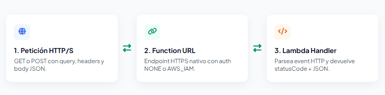
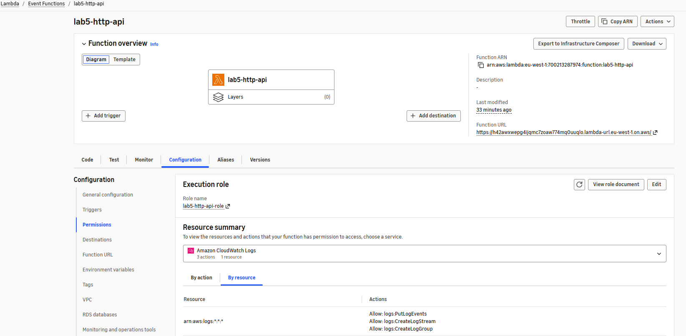
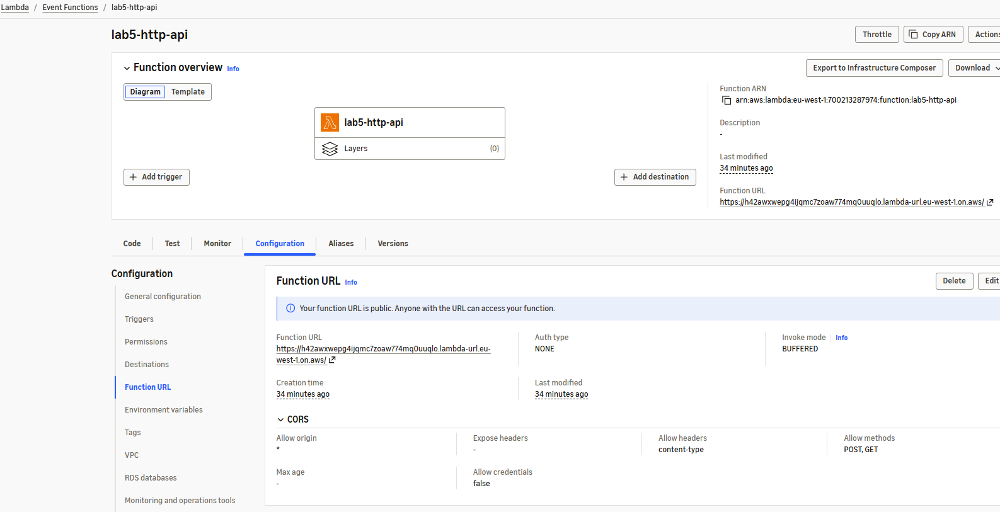
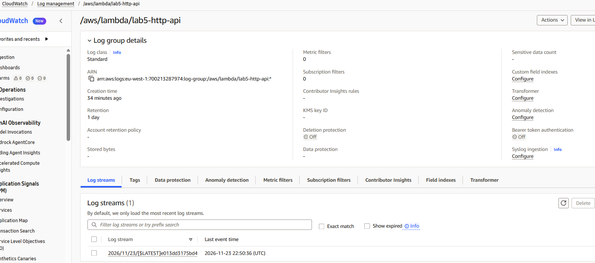
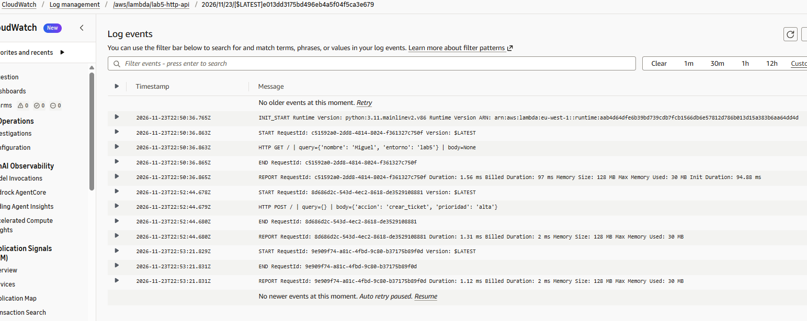

# Lab 5: API HTTP serverless con Lambda Function URL o API Gateway

  

+ **Lab 5: API HTTP serverless con Lambda Function URL o API Gateway**
    - **Utilidad real:** Exponer un webhook, un endpoint de integración o un microservicio ligero accesible por HTTP/HTTPS.
    - **Qué aprenderás:** Parsear cabeceras, parámetros de consulta (queryStringParameters) y cuerpos JSON entrantes (body), devolver respuestas HTTP correctas y entender las diferencias de seguridad y autenticación entre una Function URL y API Gateway.

## INTRODUCCION

+ Cuando expones una función Lambda mediante Lambda Function URL (o API Gateway), AWS actúa como traductor entre Internet y tu función:
    - Un cliente envía una petición HTTP/HTTPS (GET, POST, etc.) con parámetros en la URL (`?nombre=Miguel`), cabeceras (`User-Agent`, `Content-Type`, etc.) y un cuerpo JSON (`{"mensaje":"hola"}`).
    - AWS empaqueta todo eso dentro del diccionario event que recibe `lambda_handler(event, context)`:
        + `event["requestContext"]["http"]["method"]` $\rightarrow$ El método (GET, POST...).
        + `event.get("queryStringParameters")` $\rightarrow$ Diccionario con los parámetros tras el ? de la URL (o None si no hay).
        + `event.get("headers")` $\rightarrow$ Diccionario con las cabeceras HTTP.
        + `event.get("body")` $\rightarrow$ El cuerpo enviado (llega como texto str, así que si es JSON lo convertimos con `json.loads(...)`).
    - Y para que el navegador o curl entiendan la respuesta, tu Lambda devuelve un diccionario con:
        + `statusCode` (200, 400, etc.)
        + `headers` (`{"Content-Type": "application/json"}`)
        + `body` (el JSON convertido a texto con json.dumps(...)).


## FUNCION

+ Funcion python `http_api.py`:
```python
import json
from datetime import datetime, timezone


def lambda_handler(event, context):
    # 1. Extraemos el método HTTP (GET, POST, etc.) desde requestContext
    http_info = event.get("requestContext", {}).get("http", {})
    metodo = http_info.get("method", "UNKNOWN")
    ruta = http_info.get("path", "/")

    # 2. Extraemos los parámetros de consulta (?nombre=Miguel&curso=aws)
    # Si no vienen parámetros, get("queryStringParameters") puede devolver None, por eso usamos "or {}"
    query_params = event.get("queryStringParameters") or {}

    # 3. Extraemos cabeceras relevantes (en Function URL vienen en minúsculas)
    headers = event.get("headers") or {}
    user_agent = headers.get("user-agent", "desconocido")

    # 4. Si llega un cuerpo (body) en un POST, intentamos parsearlo como JSON
    raw_body = event.get("body")
    parsed_body = None
    if raw_body:
        try:
            parsed_body = json.loads(raw_body)
        except json.JSONDecodeError:
            # Si el cliente envió un JSON mal formado, devolvemos HTTP 400 (Bad Request)
            return {
                "statusCode": 400,
                "headers": {"Content-Type": "application/json"},
                "body": json.dumps({
                    "error": "El cuerpo de la petición no es un JSON válido"
                })
            }

    # Dejamos registro en CloudWatch Logs
    print(f"HTTP {metodo} {ruta} | query={query_params} | body={parsed_body}")

    # 5. Devolvemos respuesta HTTP 200 con formato JSON estándar
    respuesta = {
        "mensaje": "API Serverless Lab 5 operativa",
        "timestamp_utc": datetime.now(timezone.utc).isoformat(),
        "peticion_recibida": {
            "metodo": metodo,
            "ruta": ruta,
            "query_params": query_params,
            "user_agent": user_agent,
            "body_json": parsed_body
        }
    }

    return {
        "statusCode": 200,
        "headers": {"Content-Type": "application/json"},
        "body": json.dumps(respuesta)
    }
```
> Piensa en http_api.py como el receptor de peticiones web de tu microservicio o webhook. Cuando alguien llama a la URL HTTPS desde el navegador, curl o un sistema externo:  
    - Lee lo que llega en la petición: saca el método (GET, POST), la ruta, los parámetros de la URL (?nombre=Miguel&entorno=lab5), una cabecera (user-agent) y, si hay cuerpo (body), intenta convertirlo de texto JSON a un diccionario de Python.  
    - Valida si el JSON viene roto: si envías un JSON mal formado, responde con un 400 Bad Request en vez de dejar que reviente la función sin explicación.  
    - Deja rastro y responde en formato HTTP: imprime un resumen en CloudWatch Logs y devuelve un JSON con statusCode: 200 mostrando qué ha recibido y a qué hora UTC lo procesó.  

## TERRAFORM

+ main.tf:
```bash
# ==========================================
# 1. EMPAQUETADO Y LOGS (CLOUDWATCH)
# ==========================================

# Comprime http_api.py en http_api.zip para subirlo a AWS Lambda.
data "archive_file" "http_api_zip" {
  type        = "zip"
  source_file = "${path.module}/http_api.py"
  output_path = "${path.module}/http_api.zip"
}

# Crea el Log Group con retención de 7 días para auditar las peticiones HTTP recibidas.
resource "aws_cloudwatch_log_group" "http_api_logs" {
  name              = "/aws/lambda/lab5-http-api"
  retention_in_days = 7

  tags = {
    Laboratorio = "Lab5-HTTP-Function-URL"
  }
}

# ==========================================
# 2. ROL IAM DE EJECUCIÓN DE LA LAMBDA
# ==========================================

# Trust Policy: permite que el servicio AWS Lambda asuma este rol.
data "aws_iam_policy_document" "lambda_assume_role" {
  statement {
    effect  = "Allow"
    actions = ["sts:AssumeRole"]

    principals {
      type        = "Service"
      identifiers = ["lambda.amazonaws.com"]
    }
  }
}

# Rol IAM asignado a la función Lambda.
resource "aws_iam_role" "lambda_exec_role" {
  name               = "lab5-http-api-role"
  assume_role_policy = data.aws_iam_policy_document.lambda_assume_role.json
}

# Permisos mínimos para que la Lambda escriba sus logs en CloudWatch.
data "aws_iam_policy_document" "lambda_logs_doc" {
  statement {
    sid    = "CloudWatchLogsWrite"
    effect = "Allow"
    actions = [
      "logs:CreateLogGroup",
      "logs:CreateLogStream",
      "logs:PutLogEvents"
    ]
    resources = ["arn:aws:logs:*:*:*"]
  }
}

resource "aws_iam_policy" "lambda_logs_policy" {
  name        = "lab5-http-api-logs-policy"
  description = "Permite a la Lambda del Lab 5 escribir logs en CloudWatch"
  policy      = data.aws_iam_policy_document.lambda_logs_doc.json
}

resource "aws_iam_role_policy_attachment" "lambda_logs_attach" {
  role       = aws_iam_role.lambda_exec_role.name
  policy_arn = aws_iam_policy.lambda_logs_policy.arn
}

# ==========================================
# 3. FUNCIÓN LAMBDA
# ==========================================

# Crea la función Lambda que actuará como backend de nuestro endpoint HTTP.
resource "aws_lambda_function" "http_api" {
  filename         = data.archive_file.http_api_zip.output_path
  function_name    = "lab5-http-api"
  role             = aws_iam_role.lambda_exec_role.arn
  handler          = "http_api.lambda_handler"
  source_code_hash = data.archive_file.http_api_zip.output_base64sha256
  runtime          = "python3.11"
  timeout          = 10

  depends_on = [
    aws_iam_role_policy_attachment.lambda_logs_attach,
    aws_cloudwatch_log_group.http_api_logs
  ]
}

# ==========================================
# 4. LAMBDA FUNCTION URL (ENDPOINT HTTPS)
# ==========================================

# Expone la función Lambda mediante una URL HTTPS dedicada.
# authorization_type = "NONE" permite llamarla públicamente (como un webhook o API abierta);
# en entornos internos donde solo llaman servicios AWS se usa "AWS_IAM".
resource "aws_lambda_function_url" "public_endpoint" {
  function_name      = aws_lambda_function.http_api.function_name
  authorization_type = "NONE"

  # Configuración CORS básica para permitir llamadas desde navegadores o frontends.
  cors {
    allow_origins = ["*"]
    allow_methods = ["GET", "POST"]
    allow_headers = ["content-type"]
  }
}

# ==========================================
# 5. PERMISO DE INVOCACIÓN PÚBLICA A LA FUNCTION URL
# ==========================================

# Sin este permiso en la política de recursos de la Lambda, AWS bloquea las llamadas
# a la Function URL con 403 Forbidden incluso cuando authorization_type = "NONE".
resource "aws_lambda_permission" "allow_public_function_url" {
  statement_id           = "AllowPublicFunctionUrlInvoke"
  action                 = "lambda:InvokeFunctionUrl"
  function_name          = aws_lambda_function.http_api.function_name
  principal              = "*"
  function_url_auth_type = "NONE"
}
```
> Empaqueta y prepara logs: comprime http_api.py en .zip y crea el Log Group /aws/lambda/lab5-http-api (7 días de retención) para ver cada petición.  
> Crea el rol IAM de ejecución: da a la Lambda permisos para escribir en CloudWatch Logs.  
> Crea la función Lambda: despliega el código en Python 3.11.  
> Crea la Function URL: asigna una dirección HTTPS pública (authorization_type = "NONE") y configura CORS (GET, POST).  

+ Añadimos este permiso con version 6.28.0 de aws cli o por comando:
```bash
# terraform
resource "aws_lambda_permission" "allow_public_invoke_via_url" {
  statement_id           = "AllowPublicInvokeViaFunctionUrl"
  action                 = "lambda:InvokeFunction"
  function_name          = aws_lambda_function.http_api.function_name
  principal              = "*"
  invoked_via_function_url = true
}

# aws cli
aws lambda add-permission \
  --function-name lab5-http-api \
  --statement-id AllowPublicInvokeViaFunctionUrl \
  --action lambda:InvokeFunction \
  --principal "*" \
  --invoked-via-function-url
```
> AWS exige dos permisos en la política de recursos de la Lambda para que funcione una Function URL pública: lambda:InvokeFunctionUrl y lambda:InvokeFunction restringido a que venga por Function URL (invoked_via_function_url = true).


+ Outputs.tf:
```bash
# Muestra la URL HTTPS generada por AWS para invocar nuestra función directamente con curl o navegador.
output "function_url" {
  description = "Endpoint HTTPS público de la función Lambda"
  value       = aws_lambda_function_url.public_endpoint.function_url
}

# Nombre de la función Lambda desplegada.
output "lambda_function_name" {
  description = "Nombre de la función Lambda del Lab 5"
  value       = aws_lambda_function.http_api.function_name
}
```

## TEST Y COMPROBACIONES

+ Comprobamos:
```bash
URL=$(terraform output -raw function_url)

# 1. GET con parámetros en la URL
curl -s "${URL}?nombre=Miguel&entorno=lab5"
{"mensaje": "API Serverless Lab 5 operativa", "timestamp_utc": "2026-11-23T22:50:36.863949+00:00", "peticion_recibida": {"metodo": "GET", "ruta": "/", "query_params": {"nombre": "Miguel", "entorno": "lab5"}, "user_agent": "curl/8.18.0", "body_json": null}}

# 2. POST con cuerpo JSON válido
curl -s -X POST "${URL}" \
  -H "Content-Type: application/json" \
  -d '{"accion":"crear_ticket","prioridad":"alta"}'
{"mensaje": "API Serverless Lab 5 operativa", "timestamp_utc": "2026-11-23T22:52:44.679231+00:00", "peticion_recibida": {"metodo": "POST", "ruta": "/", "query_params": {}, "user_agent": "curl/8.18.0", "body_json": {"accion": "crear_ticket", "prioridad": "alta"}}}


# 3. POST con JSON inválido (debe devolver HTTP 400)
curl -i -s -X POST "${URL}" \
  -H "Content-Type: application/json" \
  -d '{"json_roto":'
HTTP/1.1 400 Bad Request
Date: Mon, 23 Nov 2026 22:53:21 GMT
Content-Type: application/json
Content-Length: 68
Connection: keep-alive
x-amzn-RequestId: 9e909f74-a81c-4fbd-9c80-b37175b89f0d
X-Amzn-Trace-Id: Root=1-6b04c3e1-7344a71e6c711f4f5f037b7c;Parent=38005ea8f6540023;Sampled=0;Lineage=1:9fcd9cbd:0

terraform (main) ❯ o de la petici\u00f3n no es un JSON v\u00e1lido"}
```
> De dónde salen los datos: Todo lo que va después de ? (nombre=Miguel&entorno=lab5) lo toma AWS Lambda Function URL y lo mete en event["queryStringParameters"] como un diccionario {"nombre": "Miguel", "entorno": "lab5"}.  
> Por qué devolvió HTTP/1.1 400 Bad Request: json.loads('{"json_roto":') lanzó json.JSONDecodeError porque el JSON estaba incompleto. Tu bloque except json.JSONDecodeError: capturó el error y devolvió explícitamente "statusCode": 400 con el mensaje de JSON no válido.  
  
  

+ Logs del Cloudwatch:
```bash
aws logs tail /aws/lambda/lab5-http-api --since 15m --format short
2026-11-23T22:50:36 INIT_START Runtime Version: python:3.11.mainlinev2.v86      Runtime Version ARN: arn:aws:lambda:eu-west-1::runtime:aab4d64dfe6b39bd739cdb7fcb1566db6e57812d786b013d15a383b6aa64dd4d
2026-11-23T22:50:36 START RequestId: c51592a0-2dd8-4814-8024-f361327c750f Version: $LATEST
2026-11-23T22:50:36 HTTP GET / | query={'nombre': 'Miguel', 'entorno': 'lab5'} | body=None
2026-11-23T22:50:36 END RequestId: c51592a0-2dd8-4814-8024-f361327c750f
2026-11-23T22:50:36 REPORT RequestId: c51592a0-2dd8-4814-8024-f361327c750f      Duration: 1.56 ms  Billed Duration: 97 ms  Memory Size: 128 MB     Max Memory Used: 30 MB  Init Duration: 94.88 ms
2026-11-23T22:52:44 START RequestId: 8d686d2c-543d-4ec2-8618-de3529108881 Version: $LATEST
2026-11-23T22:52:44 HTTP POST / | query={} | body={'accion': 'crear_ticket', 'prioridad': 'alta'}
2026-11-23T22:52:44 END RequestId: 8d686d2c-543d-4ec2-8618-de3529108881
2026-11-23T22:52:44 REPORT RequestId: 8d686d2c-543d-4ec2-8618-de3529108881      Duration: 1.31 ms  Billed Duration: 2 ms   Memory Size: 128 MB     Max Memory Used: 30 MB
2026-11-23T22:53:21 START RequestId: 9e909f74-a81c-4fbd-9c80-b37175b89f0d Version: $LATEST
2026-11-23T22:53:21 END RequestId: 9e909f74-a81c-4fbd-9c80-b37175b89f0d
2026-11-23T22:53:21 REPORT RequestId: 9e909f74-a81c-4fbd-9c80-b37175b89f0d      Duration: 1.12 ms  Billed Duration: 2 ms   Memory Size: 128 MB     Max Memory Used: 30 MB
```
> En CloudWatch Logs (RequestId: c51592a0-...): Ves INIT_START y Init Duration: 94.88 ms porque fue un cold start (Lambda arrancó el entorno Python 3.11 por primera vez). Duration fue de solo 1.56 ms, pero Billed Duration subió a 97 ms al incluir el tramo de inicialización (Init Duration). Fíjate también en Memory Size: 128 MB y Max Memory Used: 30 MB.  
  
  

## RESUMEN

+ El objetivo es aprender a exponer una función Lambda por HTTP/HTTPS para que actúe como un endpoint web sencillo (por ejemplo, recibir un webhook de otro sistema, una llamada de prueba o un microservicio ligero). En concreto, practicas:   
    - Leer datos que llegan por la web (GET / POST, parámetros ?clave=valor, cabeceras y cuerpo JSON).
    - Responder con un código HTTP adecuado (200 si todo va bien, 400 si el JSON llega mal formado) y cabecera Content-Type: application/json.

+ Lambda Function URL vs. API Gateway
    - **Lambda Function URL:** Crea una URL HTTPS directa sobre una única función Lambda. Es rápida, sencilla y sin capa extra de gateway; ideal para webhooks, pruebas o microservicios muy ligeros. Sus opciones de seguridad son NONE o AWS_IAM (firma SigV4).   
    - **Amazon API Gateway:** Es un servicio de gestión de APIs delante de tus servicios. Conviene cuando necesitas múltiples rutas (/usuarios, /pedidos), distintos métodos por ruta, authorizers (JWT, Cognito, Lambda), límites de velocidad (throttling), planes de uso o integración con WAF.

+ En el Lab 5 hemos publicado una función Lambda detrás de una Lambda Function URL para leer parámetros de consulta, cabeceras y cuerpos JSON, validar entradas y devolver respuestas HTTP (200 y 400) con registro en CloudWatch Logs.