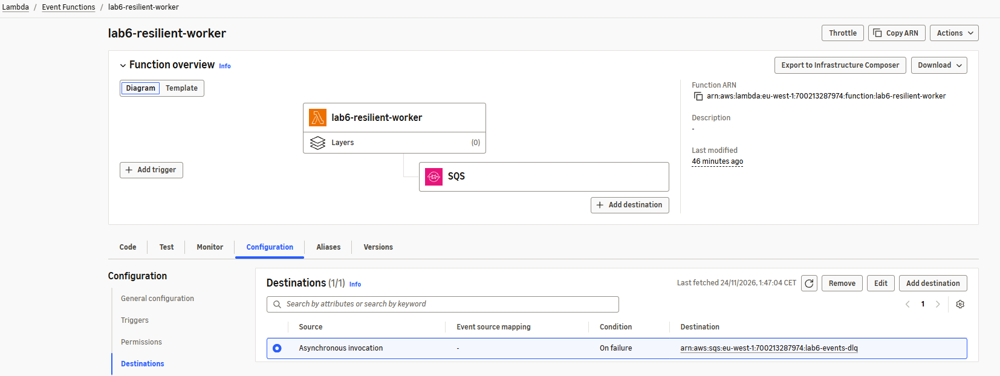
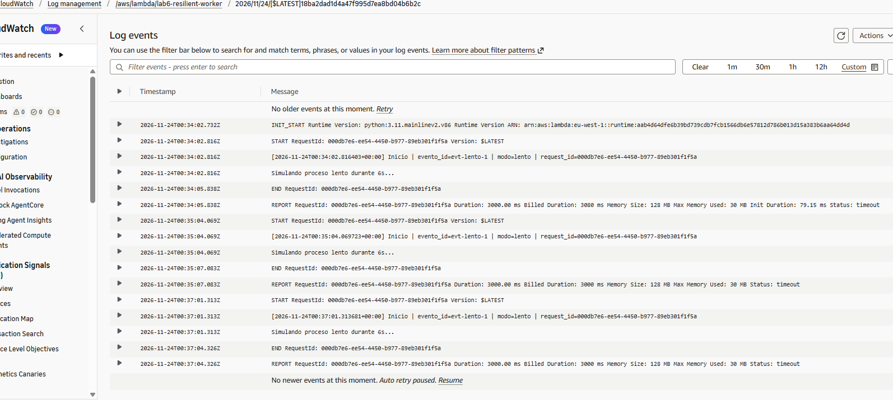
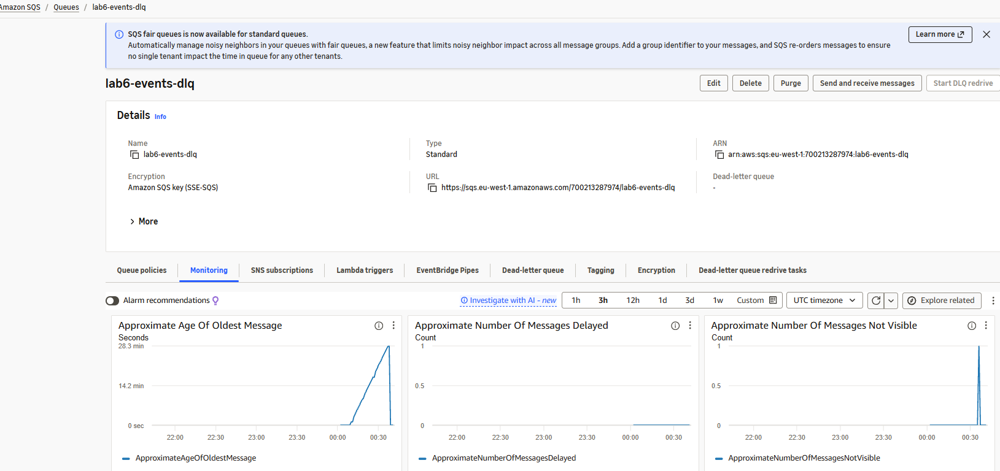

# Lab 6: Manejo de timeouts, reintentos y Dead Letter Queue (SQS)

+ **Lab 6: Manejo de timeouts, reintentos y Dead Letter Queue (SQS)**
    - **Utilidad real:** Evitar que eventos fallidos o procesos lentos se pierdan en silencio cuando una dependencia externa falla o tarda más de lo esperado.
    - **Qué aprenderás:** Ajustar timeout y memory_size (y entender su impacto en CPU y coste), ver qué pasa con los reintentos automáticos en invocaciones asíncronas y enviar los mensajes fallidos a una cola SQS DLQ para su análisis posterior.


## INTRODUCCION

+ En el Lab 6 trabajaremos **timeouts, reintentos y Dead Letter Queue (SQS)**:
    - Ajustaremos timeout y memory_size en la Lambda y veremos cómo la memoria también escala recursos de CPU y afecta al coste.
    - Provocaremos un fallo controlado o un proceso más lento que el timeout para observar cómo AWS reintenta automáticamente en invocaciones asíncronas (por defecto hasta 2 reintentos).
    - Configuraremos una Dead Letter Queue (DLQ) en Amazon SQS para que, cuando se agoten los reintentos sin éxito, el evento fallido no se pierda en silencio y quede en la cola para inspeccionarlo y reprocesarlo.

+ **timeout y memory_size (y su relación con CPU y coste):**
    - **timeout (en segundos):** Es el tiempo máximo que AWS deja ejecutarse a tu función en una invocación (por defecto en Lambda es 3 segundos; el máximo es 900 s = 15 minutos). Si tu código no termina a tiempo, Lambda corta la ejecución y la marca como fallida (Task timed out).
    - **memory_size (en MB):** En AWS Lambda, la memoria que asignas no solo define la RAM disponible, sino que también escala proporcionalmente la potencia de CPU (a partir de ~1769 MB obtienes el equivalente a 1 vCPU completa, y por encima de eso, hasta 2 vCPUs o más).
    - **Impacto en duración y coste:** Pagas por GB-segundo (memoria * duración). A veces subir un poco la memoria hace que un código con cálculo o procesamiento corra tan rápido que termina antes y cuesta igual o menos, mientras que un timeout demasiado corto en una llamada de red lenta provoca fallos evitables.

+ **Reintentos automáticos en invocaciones asíncronas:** Cuando invocas una Lambda de forma asíncrona (por ejemplo, desde S3, EventBridge, o pasando --invocation-type Event en la CLI):
    - Quien llama no espera la respuesta en el momento: Lambda acepta el evento y lo mete en su cola interna de gestión asíncrona.
    - Si tu función lanza una excepción o supera el timeout, AWS reintenta automáticamente la misma invocación por defecto hasta 2 veces (3 intentos en total: 1 inicial + 2 reintentos), esperando unos segundos entre intentos.
**
+ ¿Qué es una Dead Letter Queue (DLQ) en Amazon SQS?**
    - Si la Lambda sigue fallando tras agotarse los reintentos automáticos, ¿dónde va a parar ese evento?
    - Si configuras una Dead Letter Queue (DLQ) con Amazon SQS, AWS envía el mensaje fallido a esa cola en lugar de tirarlo a la basura.
    - Utilidad real: Puedes inspeccionar los mensajes que fallaron, ver cuál era el payload exacto, corregir el fallo (o esperar a que vuelva a estar disponible el servicio externo) y reprocesarlos sin pérdida de datos.

## ARQUITECTURA

+ Vamos a construir:
    - Una cola SQS que actuará como DLQ (lab6-events-dlq).
    - Un Log Group en CloudWatch (`/aws/lambda/lab6-resilient-worker`) con retención de 7 días.
    - Un Rol IAM para la Lambda con permisos para escribir en CloudWatch Logs y para enviar mensajes (`sqs:SendMessage`) únicamente a la cola `lab6-events-dlq`.
    - Una función Lambda en Python (resilient_worker.py) que acepta parámetros en event para simular:
        + Ejecución correcta (`"modo": "ok"`).
        + Un fallo controlado que lanza excepción (`"modo": "error"`).
        + Un proceso que duerme más que el `timeout ("modo": "lento", ej. sleep(6) con timeout = 3)`.
    - Una configuración de invocación asíncrona (`aws_lambda_function_event_invoke_config`) con `maximum_retry_attempts = 2` y `destination_config (on_failure)` apuntando al ARN de nuestra cola SQS DLQ.

## FUNCION

+ Funcion `resilient_worker.py`:
```python
import json
import time
from datetime import datetime, timezone


def lambda_handler(event, context):
    # Leemos el modo de prueba desde 'event' (por defecto 'ok')
    modo = event.get("modo", "ok")
    evento_id = event.get("evento_id", "sin-id")
    ahora = datetime.now(timezone.utc).isoformat()

    print(
        f"[{ahora}] Inicio | evento_id={evento_id} | modo={modo} | "
        f"request_id={context.aws_request_id if context else 'local'}"
    )

    # 1. Simula una dependencia lenta que supera un timeout corto (p. ej. 6s con timeout=3s)
    if modo == "lento":
        segundos = int(event.get("segundos", 6))
        print(f"Simulando proceso lento durante {segundos}s...")
        time.sleep(segundos)

    # 2. Simula un fallo en el código o en un servicio externo
    if modo == "error":
        raise RuntimeError(f"Fallo simulado procesando evento_id={evento_id}")

    # 3. Camino feliz
    return {
        "statusCode": 200,
        "body": json.dumps({
            "mensaje": "Evento procesado correctamente",
            "evento_id": evento_id,
            "modo": modo
        })
    }
```
> Es una función pensada para probar cómo se comporta la Lambda ante distintos escenarios cuando se invoca de forma asíncrona:  
    - Lee modo y evento_id de lo que recibe en event y deja un mensaje en los logs con la hora UTC y el RequestId.  
    - Si modo == "lento", hace time.sleep(...) (por defecto 6 segundos). Como el timeout de la Lambda es de 3 segundos, AWS cortará la ejecución por timeout antes de que termine.  
    - Si modo == "error", lanza RuntimeError(...) a propósito para simular una excepción o caída de un servicio externo.  
    - Si modo == "ok", responde con statusCode: 200 indicando que el evento se procesó bien.  

## TERRAFORM

+ main.tf:
```bash
# ==========================================
# 1. DEAD LETTER QUEUE (COLA SQS)
# ==========================================

# Cola SQS donde aterrizarán los eventos asíncronos que fallen tras agotar los reintentos.
# message_retention_seconds = 86400 conserva los mensajes fallidos 24 horas para analizarlos.
resource "aws_sqs_queue" "dlq" {
  name                      = "lab6-events-dlq"
  message_retention_seconds = 86400

  tags = {
    Laboratorio = "Lab6-Timeouts-Retries-DLQ"
  }
}

# ==========================================
# 2. EMPAQUETADO Y LOGS (CLOUDWATCH)
# ==========================================

# Empaqueta resilient_worker.py en un archivo .zip para desplegarlo en Lambda.
data "archive_file" "resilient_worker_zip" {
  type        = "zip"
  source_file = "${path.module}/resilient_worker.py"
  output_path = "${path.module}/resilient_worker.zip"
}

# Crea el Log Group con retención de 7 días para inspeccionar reintentos y timeouts.
resource "aws_cloudwatch_log_group" "resilient_worker_logs" {
  name              = "/aws/lambda/lab6-resilient-worker"
  retention_in_days = 7

  tags = {
    Laboratorio = "Lab6-Timeouts-Retries-DLQ"
  }
}

# ==========================================
# 3. ROL IAM DE EJECUCIÓN DE LA LAMBDA
# ==========================================

# Trust Policy: permite que el servicio AWS Lambda asuma este rol.
data "aws_iam_policy_document" "lambda_assume_role" {
  statement {
    effect  = "Allow"
    actions = ["sts:AssumeRole"]

    principals {
      type        = "Service"
      identifiers = ["lambda.amazonaws.com"]
    }
  }
}

# Rol IAM que usará la función Lambda.
resource "aws_iam_role" "lambda_exec_role" {
  name               = "lab6-resilient-worker-role"
  assume_role_policy = data.aws_iam_policy_document.lambda_assume_role.json
}

# Permisos para escribir logs en CloudWatch.
data "aws_iam_policy_document" "lambda_logs_doc" {
  statement {
    sid    = "CloudWatchLogsWrite"
    effect = "Allow"
    actions = [
      "logs:CreateLogGroup",
      "logs:CreateLogStream",
      "logs:PutLogEvents"
    ]
    resources = ["arn:aws:logs:*:*:*"]
  }
}

resource "aws_iam_policy" "lambda_logs_policy" {
  name        = "lab6-resilient-worker-logs-policy"
  description = "Permite escribir logs de ejecución del Lab 6 en CloudWatch"
  policy      = data.aws_iam_policy_document.lambda_logs_doc.json
}

resource "aws_iam_role_policy_attachment" "lambda_logs_attach" {
  role       = aws_iam_role.lambda_exec_role.name
  policy_arn = aws_iam_policy.lambda_logs_policy.arn
}

# Permiso de mínimo privilegio para enviar mensajes de fallo ÚNICAMENTE a la cola SQS lab6-events-dlq.
data "aws_iam_policy_document" "lambda_dlq_doc" {
  statement {
    sid       = "SendFailedEventsToLab6DlqOnly"
    effect    = "Allow"
    actions   = ["sqs:SendMessage"]
    resources = [aws_sqs_queue.dlq.arn]
  }
}

resource "aws_iam_policy" "lambda_dlq_policy" {
  name        = "lab6-resilient-worker-dlq-policy"
  description = "Permite enviar eventos fallidos a la cola SQS DLQ del Lab 6"
  policy      = data.aws_iam_policy_document.lambda_dlq_doc.json
}

resource "aws_iam_role_policy_attachment" "lambda_dlq_attach" {
  role       = aws_iam_role.lambda_exec_role.name
  policy_arn = aws_iam_policy.lambda_dlq_policy.arn
}

# ==========================================
# 4. FUNCIÓN LAMBDA (TIMEOUT Y MEMORIA)
# ==========================================

# Definimos un timeout corto de 3s y 128 MB de memoria para poder probar fácilmente
# qué ocurre cuando una tarea tarda 6s ("modo": "lento") y supera el límite.
resource "aws_lambda_function" "resilient_worker" {
  filename         = data.archive_file.resilient_worker_zip.output_path
  function_name    = "lab6-resilient-worker"
  role             = aws_iam_role.lambda_exec_role.arn
  handler          = "resilient_worker.lambda_handler"
  source_code_hash = data.archive_file.resilient_worker_zip.output_base64sha256
  runtime          = "python3.11"
  timeout          = 3
  memory_size      = 128

  depends_on = [
    aws_iam_role_policy_attachment.lambda_logs_attach,
    aws_iam_role_policy_attachment.lambda_dlq_attach,
    aws_cloudwatch_log_group.resilient_worker_logs
  ]
}

# ==========================================
# 5. REINTENTOS ASÍNCRONOS Y DESTINO DE FALLO (DLQ)
# ==========================================

# Configura el comportamiento de invocaciones asíncronas sobre la versión $LATEST:
# - maximum_retry_attempts = 2: AWS reintenta hasta 2 veces si falla la ejecución.
# - on_failure: si tras los reintentos sigue fallando, envía el destino de fallo a la cola SQS DLQ.
resource "aws_lambda_function_event_invoke_config" "async_retry_and_dlq" {
  function_name          = aws_lambda_function.resilient_worker.function_name
  maximum_event_age_in_seconds = 300
  maximum_retry_attempts       = 2

  destination_config {
    on_failure {
      destination = aws_sqs_queue.dlq.arn
    }
  }

  depends_on = [aws_iam_role_policy_attachment.lambda_dlq_attach]
}
```
> Cola SQS (lab6-events-dlq): Crea la Dead Letter Queue con retención de 24 horas para guardar los eventos que fallen tras agotar los reintentos.  

> Empaquetado y logs: Comprime resilient_worker.py en .zip y crea el Log Group /aws/lambda/lab6-resilient-worker (7 días).  

> Rol IAM y políticas: Crea el rol de la Lambda con dos permisos: escribir logs en CloudWatch y hacer sqs:SendMessage solo sobre la cola lab6-events-dlq.  

> Función Lambda (lab6-resilient-worker): Despliega el código con timeout = 3 y memory_size = 128 para que los fallos por lentitud ocurran rápido durante las pruebas.  

> Regla de reintentos y DLQ (aws_lambda_function_event_invoke_config): Configura hasta 2 reintentos automáticos en invocaciones asíncronas y dice que, si sigue fallando, envíe el fallo a lab6-events-dlq.  

+ outputs.tf:
```bash
# Nombre de la función Lambda desplegada en el Lab 6.
output "lambda_function_name" {
  description = "Nombre de la función Lambda del Lab 6"
  value       = aws_lambda_function.resilient_worker.function_name
}

# URL de la cola SQS DLQ para consultar o purgar mensajes fallidos desde CLI.
output "dlq_queue_url" {
  description = "URL de la cola SQS Dead Letter Queue"
  value       = aws_sqs_queue.dlq.url
}

# ARN de la cola SQS DLQ.
output "dlq_queue_arn" {
  description = "ARN de la cola SQS Dead Letter Queue"
  value       = aws_sqs_queue.dlq.arn
}
```

## TEST Y COMPROBACIONES

+ Desplegamos:
```bash
terraform apply
Apply complete! Resources: 9 added, 0 changed, 0 destroyed.

Outputs:

dlq_queue_arn = "arn:aws:sqs:eu-west-1:700213287974:lab6-events-dlq"
dlq_queue_url = "https://sqs.eu-west-1.amazonaws.com/700213287974/lab6-events-dlq"
lambda_function_name = "lab6-resilient-worker"
```

+ **Lanzar una invocación asíncrona con error:** Ejecuta una invocación asíncrona (`--invocation-type Event) con "modo": "error"`:
```bash
aws lambda invoke \
  --function-name lab6-resilient-worker \
  --invocation-type Event \
  --cli-binary-format raw-in-base64-out \
  --payload '{"evento_id":"evt-err-1","modo":"error"}' \
  res_lab6_err.json && cat res_lab6_err.json && echo ""
{
    "StatusCode": 202
}
```
> Verification: La CLI devuelve StatusCode: 202 (aceptado para ejecución asíncrona); espera unos 10–20 segundos a que corran los reintentos automáticos.

+ Revisar reintentos en CloudWatch Logs y mensajes en la cola SQS DLQ:
```bash
aws logs tail /aws/lambda/lab6-resilient-worker --since 5m --format short
aws logs tail /aws/lambda/lab6-resilient-worker --since 5m --format short
2026-11-24T00:06:15 INIT_START Runtime Version: python:3.11.mainlinev2.v86      Runtime Version ARN: arn:aws:lambda:eu-west-1::runtime:aab4d64dfe6b39bd739cdb7fcb1566db6e57812d786b013d15a383b6aa64dd4d
2026-11-24T00:06:15 START RequestId: 0009b8d2-4b02-41c6-8e3f-09d4a8c3e37e Version: $LATEST
2026-11-24T00:06:15 [2026-11-24T00:06:15.602583+00:00] Inicio | evento_id=evt-err-1 | modo=error | request_id=0009b8d2-4b02-41c6-8e3f-09d4a8c3e37e
2026-11-24T00:06:15 [ERROR] RuntimeError: Fallo simulado procesando evento_id=evt-err-1
Traceback (most recent call last):
  File "/var/task/resilient_worker.py", line 25, in lambda_handler
    raise RuntimeError(f"Fallo simulado procesando evento_id={evento_id}")
2026-11-24T00:06:15 END RequestId: 0009b8d2-4b02-41c6-8e3f-09d4a8c3e37e
2026-11-24T00:06:15 REPORT RequestId: 0009b8d2-4b02-41c6-8e3f-09d4a8c3e37e      Duration: 17.25 ms      Billed Duration: 100 ms     Memory Size: 128 MB     Max Memory Used: 30 MB  Init Duration: 82.47 ms
```
> En CloudWatch Logs (00:06:15): Hubo un cold start (INIT_START, Init Duration: 82.47 ms), arrancó resilient_worker.py y lanzó RuntimeError: Fallo simulado procesando evento_id=evt-err-1.  

+ Cola DLQ:
```bash
DLQ_URL=$(terraform output -raw dlq_queue_url)
aws sqs receive-message \
  --queue-url "${DLQ_URL}" \
  --max-number-of-messages 5

{
    "Messages": [
        {
            "MessageId": "a8b859e2-136c-4de0-bd01-63cf231a6986",
            "ReceiptHandle": "AQEB2BpwKHRifm1uRhzvsgzCixwfQkqQleCXGNRdo7a+DQ7vHSEChECfqB/Q1Cotl7GEu/Fzxnb5YgP9zNV3T6zUawr+GqaD6PqTQhV4DQiY3oCXzAFU63PVycEgYoyMvGJFjUERNqJXbrFrw/za0+Onx4dRbtiNCycEAr/alx7qHioM7cUOa/0XT+agzE4SLY2xhyWCr/3Ia/KTjmwoSZnUytLRP9TFraypIupRd9lpZqxUWcJErJNyt/LCq8ZNSvcfVhiJpzqdWknBqBnVq5VlucpsVch5GYz5BXNTbF/SZMm+Ma133JVs3dbwWTAbiu0i0F4x4/CDoprnffdHGLUocS6wsxGWeShnUcPWlU7YBWAwEInhxBcY8xjLCIJ0coZMY/rvCHoVIpN4gLnksdugQA==",
            "MD5OfBody": "59bad7ee2c3af15d4159fa0be1641261",
            "Body": "{\"version\":\"1.0\",\"timestamp\":\"2026-11-24T00:09:21.113Z\",\"requestContext\":{\"requestId\":\"0009b8d2-4b02-41c6-8e3f-09d4a8c3e37e\",\"functionArn\":\"arn:aws:lambda:eu-west-1:700213287974:function:lab6-resilient-worker:$LATEST\",\"condition\":\"RetriesExhausted\",\"approximateInvokeCount\":3},\"requestPayload\":{\"evento_id\":\"evt-err-1\",\"modo\":\"error\"},\"responseContext\":{\"statusCode\":200,\"executedVersion\":\"$LATEST\",\"functionError\":\"Unhandled\"},\"responsePayload\":{\"errorMessage\": \"Fallo simulado procesando evento_id=evt-err-1\", \"errorType\": \"RuntimeError\", \"requestId\": \"0009b8d2-4b02-41c6-8e3f-09d4a8c3e37e\", \"stackTrace\": [\"  File \\\"/var/task/resilient_worker.py\\\", line 25, in lambda_handler\\n    raise RuntimeError(f\\\"Fallo simulado procesando evento_id={evento_id}\\\")\\n\"]}}"
        }
    ]
}
```
> Qué trae el Body dentro del mensaje de SQS DLQ:  
> - "condition": "RetriesExhausted" $\rightarrow$ se agotaron todos los reintentos configurados.  
> - "approximateInvokeCount": 3 $\rightarrow$ 1 intento inicial + 2 reintentos automáticos (maximum_retry_attempts = 2).  
> - "requestPayload": {"evento_id":"evt-err-1","modo":"error"} $\rightarrow$ el evento original intacto, listo para inspeccionar o reprocesar.  
> - "responseContext" y "responsePayload" $\rightarrow$ indican "functionError": "Unhandled" y el RuntimeError exacto con su traceback para diagnosticar qué falló.  

### TEST CASO LENTO

+ **Probar el caso lento (timeout de 3s) y ver cómo llega a la cola SQS DLQ:** Como la Lambda tiene timeout = 3 segundos y segundos = 6, superará el límite de tiempo en cada intento:
```bash
aws lambda invoke \
  --function-name lab6-resilient-worker \
  --invocation-type Event \
  --cli-binary-format raw-in-base64-out \
  --payload '{"evento_id":"evt-lento-1","modo":"lento","segundos":6}' \
  res_lab6_lento.json && cat res_lab6_lento.json && echo ""
{
    "StatusCode": 202
}
```
> Verification: Recibes StatusCode: 202 de inmediato.

  

+ **Observar el Task timed out y los reintentos**: Espera unos segundos y revisa los logs:
```bash
aws logs tail /aws/lambda/lab6-resilient-worker --since 5m --format short
2026-11-24T00:34:02 INIT_START Runtime Version: python:3.11.mainlinev2.v86      Runtime Version ARN: arn:aws:lambda:eu-west-1::runtime:aab4d64dfe6b39bd739cdb7fcb1566db6e57812d786b013d15a383b6aa64dd4d
2026-11-24T00:34:02 START RequestId: 000db7e6-ee54-4450-b977-89eb301f1f5a Version: $LATEST
2026-11-24T00:34:02 [2026-11-24T00:34:02.816403+00:00] Inicio | evento_id=evt-lento-1 | modo=lento | request_id=000db7e6-ee54-4450-b977-89eb301f1f5a
2026-11-24T00:34:02 Simulando proceso lento durante 6s...
2026-11-24T00:34:05 END RequestId: 000db7e6-ee54-4450-b977-89eb301f1f5a
2026-11-24T00:34:05 REPORT RequestId: 000db7e6-ee54-4450-b977-89eb301f1f5a      Duration: 3000.00 ms    Billed Duration: 3080 ms    Memory Size: 128 MB     Max Memory Used: 30 MB  Init Duration: 79.15 ms Status: timeout
2026-11-24T00:35:04 START RequestId: 000db7e6-ee54-4450-b977-89eb301f1f5a Version: $LATEST
2026-11-24T00:35:04 [2026-11-24T00:35:04.069723+00:00] Inicio | evento_id=evt-lento-1 | modo=lento | request_id=000db7e6-ee54-4450-b977-89eb301f1f5a
2026-11-24T00:35:04 Simulando proceso lento durante 6s...
2026-11-24T00:35:07 END RequestId: 000db7e6-ee54-4450-b977-89eb301f1f5a
2026-11-24T00:35:07 REPORT RequestId: 000db7e6-ee54-4450-b977-89eb301f1f5a      Duration: 3000.00 ms    Billed Duration: 3000 ms    Memory Size: 128 MB     Max Memory Used: 30 MB  Status: timeout
```
> Verification: Verás Simulando proceso lento durante 6s... seguido de Task timed out after 3.00 seconds y Billed Duration: 3000 ms (tope del timeout), repitiéndose en los reintentos asíncronos.


+ Comprobar que el evento lento también llega a la DLQ:
```bash
DLQ_URL=$(terraform output -raw dlq_queue_url)
aws sqs receive-message \
  --queue-url "${DLQ_URL}" \
  --max-number-of-messages 5
{
    "Messages": [
        {
            "MessageId": "a8b859e2-136c-4de0-bd01-63cf231a6986",
            "ReceiptHandle": "AQEB+2Y3DvKCRLRIY5nVbMA2JPU/YA7Fw9Py+txJ+fL/8+vpWicQoGGE06s0h4wyZHB4qzRURxabPIKwoqD82VZna7LpaC/noR2VXa0PYqdFnuadHATALhaIXgpbhlFcvPicJ9PLl2drKiN8MzITkiuKeo+QQKjwdGUEJFdgzf8LJ1aK3GXqUk9/ar5DHe2e2QQH+MhnlQnEYrvRI/e02iNnVM2uulvTGWhQoPpR9+EZhujm1eRj99DwrpVTbFCNNBIcIt0BxNcYDMeiGTu6iUlZr9zg3c7udEnYnhj11aihLpgYvr1ESxYe6xYixdOpgHr6ToqXkF9Ieaxq0hmKd4Hgt9cXVaoqk6O1a9jM4/SOrCN1soMzoHm5+vD5377iEks9332g9Fy5q+Gb2RFKi1FoOg==",
            "MD5OfBody": "59bad7ee2c3af15d4159fa0be1641261",
            "Body": "{\"version\":\"1.0\",\"timestamp\":\"2026-11-24T00:09:21.113Z\",\"requestContext\":{\"requestId\":\"0009b8d2-4b02-41c6-8e3f-09d4a8c3e37e\",\"functionArn\":\"arn:aws:lambda:eu-west-1:700213287974:function:lab6-resilient-worker:$LATEST\",\"condition\":\"RetriesExhausted\",\"approximateInvokeCount\":3},\"requestPayload\":{\"evento_id\":\"evt-err-1\",\"modo\":\"error\"},\"responseContext\":{\"statusCode\":200,\"executedVersion\":\"$LATEST\",\"functionError\":\"Unhandled\"},\"responsePayload\":{\"errorMessage\": \"Fallo simulado procesando evento_id=evt-err-1\", \"errorType\": \"RuntimeError\", \"requestId\": \"0009b8d2-4b02-41c6-8e3f-09d4a8c3e37e\", \"stackTrace\": [\"  File \\\"/var/task/resilient_worker.py\\\", line 25, in lambda_handler\\n    raise RuntimeError(f\\\"Fallo simulado procesando evento_id={evento_id}\\\")\\n\"]}}"
        }
    ]
}
```
> Verification: Aparece un mensaje en SQS con "requestPayload" (evt-lento-1, modo: lento) y el error de timeout (Task timed out after 3.00 seconds).  

> (Nota importante en SQS: cuando haces aws sqs receive-message, el mensaje queda con visibilidad oculta temporalmente —por defecto 30 segundos— para que otro consumidor no lo procese a la vez; si no lo borras con delete-message, vuelve a ser visible pasado ese tiempo).  

  

+ **Revisar atributos de la cola SQS y purgarla:** Para ver cuántos mensajes hay en la cola y su configuración antes de vaciarla.
```bash
DLQ_URL=$(terraform output -raw dlq_queue_url)

# Ver atributos clave de la cola (mensajes aproximados, retención, etc.)
aws sqs get-queue-attributes \
  --queue-url "${DLQ_URL}" \
  --attribute-names ApproximateNumberOfMessages ApproximateNumberOfMessagesNotVisible MessageRetentionPeriod
{
    "Attributes": {
        "ApproximateNumberOfMessages": "0",
        "ApproximateNumberOfMessagesNotVisible": "0",
        "MessageRetentionPeriod": "86400"
    }
}
```
  

+ Y para purgar (vaciar) todos los mensajes de la cola SQS:
```bash
aws sqs purge-queue --queue-url "${DLQ_URL}"
```
> Verificación: purge-queue no pide confirmación interactiva y vacía la cola (puede tardar unos segundos en reflejar 0 en ApproximateNumberOfMessages).

### Dead Letter Queue (DLQ) 

+ Cuando un mensaje cae en una Dead Letter Queue (DLQ) de Amazon SQS, no se pierde: queda guardado ahí para que puedas averiguar qué falló, corregir el problema (o ajustar parámetros como el timeout o un servicio externo caído) y volver a lanzarlo de forma controlada:

+ Inspeccionar el mensaje en la cola SQS DLQ:
```bash
DLQ_URL=$(terraform output -raw dlq_queue_url)

aws sqs receive-message \
  --queue-url "${DLQ_URL}" \
  --max-number-of-messages 1 \
  --output json > dlq_msg.json

cat dlq_msg.json
```
> Si falló por modo: "lento" (timeout de 3s): podrías subir el timeout de la Lambda (por ejemplo a 10 segundos) o corregir la lentitud de la dependencia.  

> Si falló por modo: "error": en un caso real sería que la API externa o base de datos ya se ha recuperado, o que has desplegado un fix en el código.  

+ Para reprocesar, extraemos solo el requestPayload original (no el envoltorio de error de la DLQ) y lo volvemos a invocar contra la función Lambda —o lo enviamos a una cola principal/bus de eventos si la arquitectura usa una cola de entrada—. En tu terminal (con jq o python3 para extraer limpio el requestPayload):
```bash
# Extraemos el payload original del mensaje recibido en dlq_msg.json
python3 -c '
import json
with open("dlq_msg.json") as f:
    data = json.load(f)
msg = data["Messages"][0]
body = json.loads(msg["Body"])
payload_original = body["requestPayload"]
with open("reprocess_payload.json", "w") as out:
    json.dump(payload_original, out)
print("Payload original extraído:", json.dumps(payload_original))
'

# Reprocesamos invocando la Lambda (por ejemplo, de forma asíncrona con Event)
aws lambda invoke \
  --function-name lab6-resilient-worker \
  --invocation-type Event \
  --cli-binary-format raw-in-base64-out \
  --payload file://reprocess_payload.json \
  res_reprocess.json && cat res_reprocess.json && echo ""
```

+ En Amazon SQS, recibir un mensaje no lo borra; debes eliminarlo explícitamente usando su ReceiptHandle después de confirmar que el reproceso ha ido bien (en CloudWatch Logs). Si no lo borras, el mensaje quedará ahí y podría reprocesarse dos veces:
```bash
RECEIPT_HANDLE=$(python3 -c '
import json
with open("dlq_msg.json") as f:
    print(json.load(f)["Messages"][0]["ReceiptHandle"])
')

aws sqs delete-message \
  --queue-url "${DLQ_URL}" \
  --receipt-handle "${RECEIPT_HANDLE}"

rm -f dlq_msg.json reprocess_payload.json res_reprocess.json
```

+ Regla práctica de operación con DLQs:
    - Inspecciona requestPayload y el error.
    - Corrige el fallo o ajusta recursos (timeout / memory_size).
    - Reprocesa enviando el requestPayload limpio.
    - Confirma en logs que salió bien y borra el mensaje de la DLQ (delete-message) para no duplicar trabajo.

## RESUMEN

+ En este laboratorio hemos configurado una función Lambda (`lab6-resilient-worker`) con un timeout corto de 3 segundos y 128 MB de RAM, conectada a una cola SQS DLQ (`lab6-events-dlq`) mediante invocación asíncrona con hasta 2 reintentos automáticos. Así hemos comprobado cómo los errores y timeouts se reintentan y aterrizan en la cola SQS con su payload y detalle del fallo para poder inspeccionarlos o purgarlos sin perder eventos en silencio.