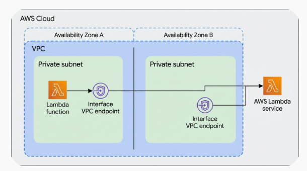
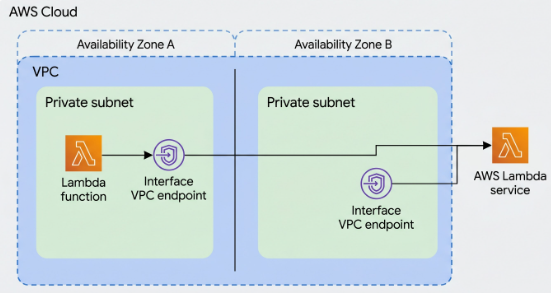
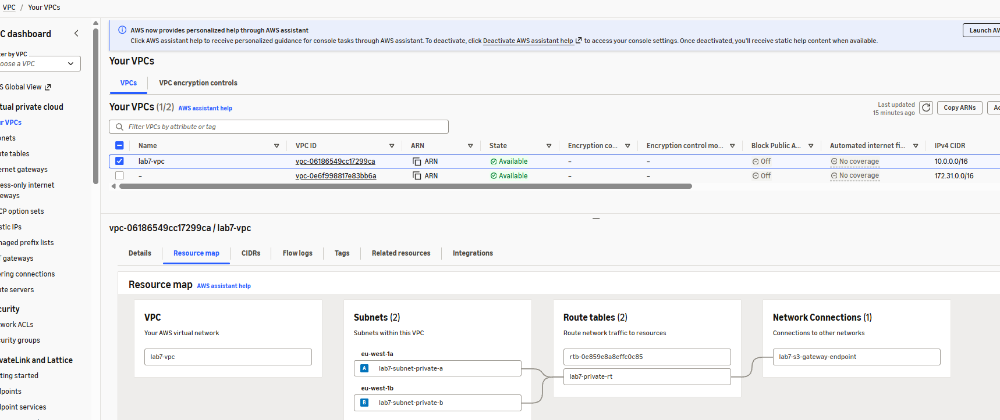
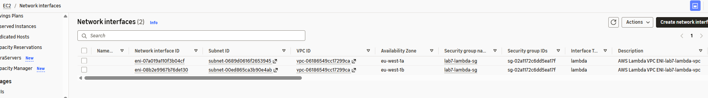
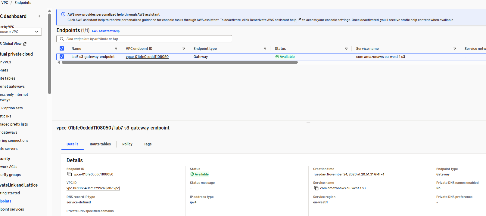
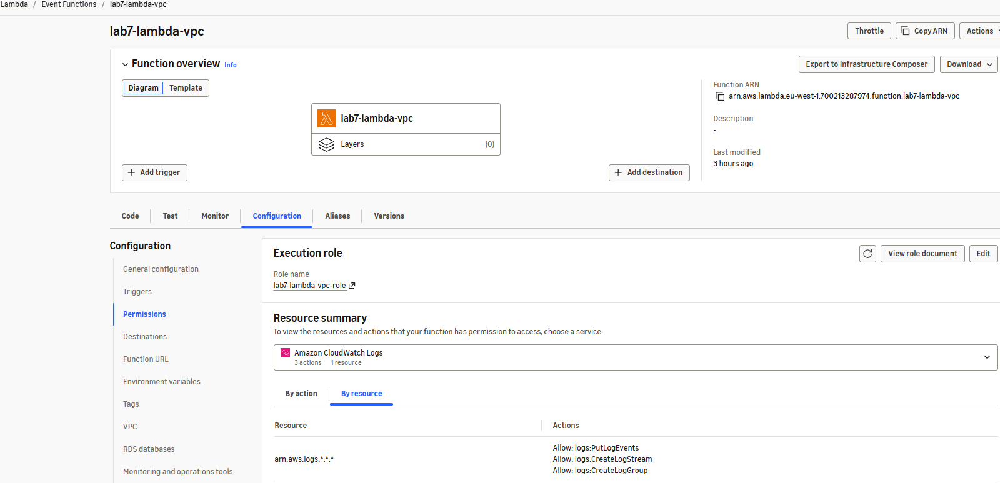
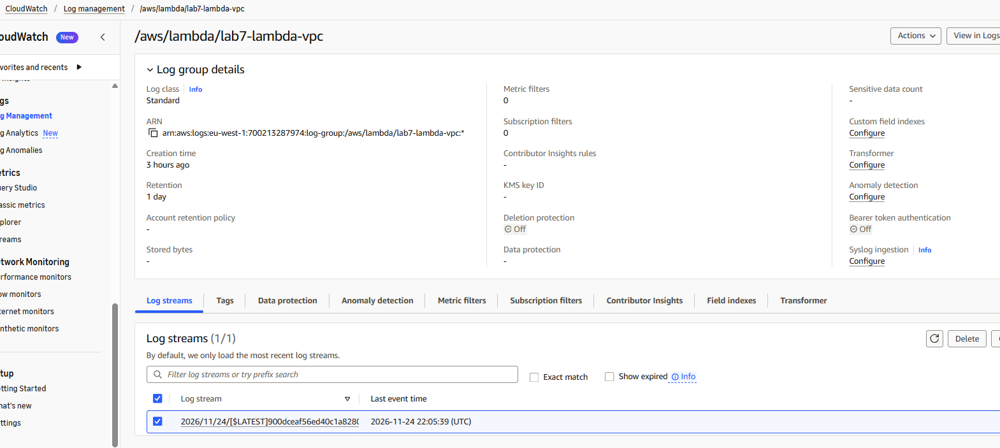

# Lab 7: Lambda dentro de una VPC con Security Groups y VPC Endpoints

  

+ **Lab 7: Lambda dentro de una VPC con Security Groups y VPC Endpoints**
    - **Utilidad real:** Acceder a recursos privados (como una base de datos RDS o servicios internos) manteniendo el aislamiento de red y evitando salidas innecesarias a internet.
    - **Qué aprenderás:** Configurar vpc_config (subnet_ids y security_group_ids), dar a la Lambda permisos para crear interfaces de red (ec2:CreateNetworkInterface, etc.) y entender por qué al meter una Lambda en subredes privadas necesita NAT Gateway o VPC Endpoints para hablar con otros servicios de AWS.

## INTRODUCCION

+ Por defecto, una función Lambda vive en una red gestionada por AWS y puede salir hacia servicios públicos de AWS o a internet sin configurar red. Cuando conectas una Lambda a una VPC (vpc_config), ocurre algo fundamental:
    - **¿Para qué meter una Lambda en una VPC?** Para hablar con recursos privados dentro de tu red (como una base de datos RDS privada o un servicio interno) sin exponerlos a internet.
    - **¿Qué pasa con las ENIs y los permisos IAM?** Lambda crea Elastic Network Interfaces (ENIs) dentro de las subredes privadas que indiques y las asocia a los Security Groups que configures. Su rol de ejecución necesita permisos EC2 para gestionar esas interfaces (`ec2:CreateNetworkInterface`, `ec2:DescribeNetworkInterfaces`, `ec2:DeleteNetworkInterface`, etc. — normalmente cubiertos por la política gestionada `AWSLambdaVPCAccessExecutionRole` o sus equivalentes de mínimo privilegio).
    - **¿Por qué pierdes acceso directo a otros servicios de AWS o a internet en subredes privadas?** Porque una subred privada no tiene ruta directa a una Internet Gateway. Para que la Lambda dentro de la VPC hable con otros servicios de AWS (como S3, SSM, SQS o Secrets Manager) o con APIs externas:
        + **NAT Gateway (en subred pública):** permite salir a internet y a endpoints públicos de AWS, pero añade coste fijo por hora más tráfico.
        + **VPC Endpoints (Interface Endpoint con PrivateLink o Gateway Endpoint para S3/DynamoDB):** mantienen el tráfico dentro de la red privada de AWS sin salir a internet.

  
> En este diagrama ves cómo una Lambda function situada en una Private subnet dentro de una VPC (en una Availability Zone) se comunica a través de un Interface VPC endpoint hacia un servicio de AWS, manteniendo la conexión privada dentro de la red de AWS.

+ Qué vamos a montar en este Lab 7:
    - **Una VPC nueva** y aislada para el laboratorio con dos subredes privadas en distintas zonas de disponibilidad (alta disponibilidad requerida por vpc_config en Lambda).
    - **Un Security Group** para la Lambda (lab7-lambda-sg) y, si lo necesitamos, un VPC Endpoint (por ejemplo, un Gateway Endpoint hacia S3 en la VPC, que es gratuito y muy ilustrativo para ver cómo la Lambda en subred privada puede interactuar con S3 sin NAT Gateway).
    - **El rol IAM** con permisos de CloudWatch Logs y de red (`ec2:CreateNetworkInterface`, `ec2:DescribeNetworkInterfaces`, `ec2:DeleteNetworkInterface`), más permiso limitado a S3 si probamos listar/leer un bucket de pruebas.
    - **Una función Lambda en Python** que compruebe su entorno de red y pruebe el acceso a través del endpoint configurado.

## FUNCION

+ La función intentará hacer una llamada a la API de AWS (para listar buckets de S3) usando un Gateway Endpoint que crearemos en la VPC.
+ La idea de este script es muy sencilla: comprobar desde dentro de la Lambda qué puede ver en la red. No hace lógica de negocio compleja; solo hace tres comprobaciones:
    - **Leer su IP privada:** usa `socket.gethostbyname(socket.gethostname())` para imprimir qué IP interna tiene asignada el entorno de ejecución dentro de la VPC (por ejemplo, `10.0.1.x`). Así confirmas que no está en una red genérica de AWS, sino en tu rango `10.0.0.0/16`.
    - **Probar si hay salida a internet** ([https://www.google.com](https://www.google.com)): intenta abrir una conexión HTTPS a Google con `urllib.request.urlopen(..., timeout=5)`. Como ponemos la Lambda en subredes privadas sin NAT Gateway, esto debe fallar (timeout o error de red). Que falle aquí es una buena noticia: demuestra que la función está aislada de internet.
    - **Probar si puede hablar con S3 por red privada** (`boto3.client("s3").list_buckets())`: intenta listar los buckets S3 de tu cuenta. Como hemos creado un Gateway VPC Endpoint para S3 asociado a la tabla de rutas de las subredes privadas, esta llamada sí debe funcionar sin salir a internet.
```python
import json
import boto3
import os
import socket
import urllib.request
from datetime import datetime, timezone

def lambda_handler(event, context):
    ahora = datetime.now(timezone.utc).isoformat()
    region = os.environ.get("AWS_REGION", "unknown")
    
    # 1. Información de red local de la Lambda (IP, hostname)
    ip_address = socket.gethostbyname(socket.gethostname())
    print(f"[{ahora}] Lambda IP interna: {ip_address}")
    
    # 2. Intentar acceder a un servicio público (sin NAT Gateway esto fallará)
    # Probamos conectar a Google para demostrar que no hay salida a internet
    try:
        print("Probando conexión a internet (google.com)...")
        urllib.request.urlopen("https://www.google.com", timeout=5)
        internet_access = "Conexión a internet detectada"
        print("¡ALERTA! La Lambda tiene salida a internet.")
    except Exception as e:
        internet_access = f"Sin salida a internet directa: {str(e)}"
        print(f"Correcto: Sin salida a internet directa. ({str(e)})")

    # 3. Intentar acceder a AWS S3 (esto SÍ funcionará si está el Gateway Endpoint)
    s3_access = "Desconocido"
    s3_buckets = []
    try:
        print(f"Intentando listar buckets de S3 en región {region} vía VPC Endpoint...")
        # Boto3 usará automáticamente el Gateway Endpoint si la VPC está bien configurada
        s3_client = boto3.client("s3", region_name=region)
        response = s3_client.list_buckets()
        s3_buckets = [bucket["Name"] for bucket in response["Buckets"]]
        s3_access = f"Éxito: {len(s3_buckets)} buckets encontrados"
        print(f"Acceso a S3 vía VPC Endpoint correcto. Buckets: {s3_buckets}")
    except Exception as e:
        s3_access = f"Error de acceso a S3: {str(e)}"
        print(f"Error crítico: No se pudo acceder a S3. {str(e)}")

    return {
        "statusCode": 200,
        "body": json.dumps({
            "mensaje": "Verificación de Lambda dentro de VPC",
            "timestamp_utc": ahоra,
            "ip_lambda": ip_address,
            "estado_internet": internet_access,
            "estado_s3": s3_access,
            "lista_buckets_s3": s3_buckets
        })
    }
```
> Al final devuelve un JSON con el resultado de esas comprobaciones (fíjate en el código anterior que había una pequeña errata tipográfica en ahоra —con o cirílica— en lugar de ahora; asegúrate de escribir ahora en ASCII limpio).


## TERRAFORM

+ vpc.tf: Creación de red: VPC, Subredes Privadas, Route Table y Gateway Endpoint). Lambda en subred privada necesita un VPC Endpoint para hablar con S3 sin salir a internet:
```bash
# ==========================================
# 1. VPC Y RED PRIVADA
# ==========================================

# Definimos la VPC
resource "aws_vpc" "lab_vpc" {
  cidr_block           = "10.0.0.0/16"
  enable_dns_support   = true
  enable_dns_hostnames = true
  tags = {
    Name = "lab7-vpc"
  }
}

# Subredes Privadas (se requieren al menos 2 AZs para alta disponibilidad de Lambda en VPC)
data "aws_availability_zones" "available" {
  state = "available"
}

resource "aws_subnet" "private_subnet_a" {
  vpc_id            = aws_vpc.lab_vpc.id
  cidr_block        = "10.0.1.0/24"
  availability_zone = data.aws_availability_zones.available.names[0]
  tags = {
    Name = "lab7-subnet-private-a"
  }
}

resource "aws_subnet" "private_subnet_b" {
  vpc_id            = aws_vpc.lab_vpc.id
  cidr_block        = "10.0.2.0/24"
  availability_zone = data.aws_availability_zones.available.names[1]
  tags = {
    Name = "lab7-subnet-private-b"
  }
}

# Tabla de rutas para las subredes privadas (sin Internet Gateway)
resource "aws_route_table" "private_rt" {
  vpc_id = aws_vpc.lab_vpc.id
  tags = {
    Name = "lab7-private-rt"
  }
}

# Asociamos las subredes privadas a la tabla de rutas
resource "aws_route_table_association" "private_assoc_a" {
  subnet_id      = aws_subnet.private_subnet_a.id
  route_table_id = aws_route_table.private_rt.id
}

resource "aws_route_table_association" "private_assoc_b" {
  subnet_id      = aws_subnet.private_subnet_b.id
  route_table_id = aws_route_table.private_rt.id
}

# ==========================================
# 2. VPC ENDPOINT (GATEWAY) PARA S3
# ==========================================

# Permite el tráfico privado desde la VPC hacia S3 sin NAT Gateway ni internet.
resource "aws_vpc_endpoint" "s3_endpoint" {
  vpc_id       = aws_vpc.lab_vpc.id
  service_name = "com.amazonaws.eu-west-1.s3"
  # Tipo Gateway (gratuito, se adjunta a la Route Table)
  vpc_endpoint_type = "Gateway"
  
  # Adjuntamos la ruta en la tabla de rutas de subredes privadas
  route_table_ids = [aws_route_table.private_rt.id]

  tags = {
    Name = "lab7-s3-gateway-endpoint"
  }
}

# ==========================================
# 3. SECURITY GROUP PARA LA LAMBDA
# ==========================================

# Permite tráfico de salida (necesario para comunicarse con S3 y AWS)
resource "aws_security_group" "lambda_sg" {
  name        = "lab7-lambda-sg"
  description = "Security Group para Lambda dentro de la VPC"
  vpc_id      = aws_vpc.lab_vpc.id

  # Salida permitida a cualquier destino (necesario para alcanzar los endpoints)
  egress {
    from_port   = 0
    to_port     = 0
    protocol    = "-1" # Todos los protocolos
    cidr_blocks = ["0.0.0.0/0"]
  }
  
  # Entrada (normalmente no se necesita para lambdas que actúan como clientes,
  # a menos que sean invocadas por otros recursos dentro de la VPC)
  # ingress {
  #   from_port   = 0
  #   to_port     = 0
  #   protocol    = "-1"
  #   cidr_blocks = [aws_vpc.lab_vpc.cidr_block] # Solo tráfico interno de la VPC
  # }

  tags = {
    Name = "lab7-lambda-sg"
  }
}
```
> aws_vpc.lab_vpc (10.0.0.0/16): tu red privada virtual.  
> aws_subnet.private_subnet_a y private_subnet_b: dos subredes en distintas zonas de disponibilidad (Availability Zones). AWS exige al menos dos subredes para alta disponibilidad de la Lambda en la VPC. No tienen ruta hacia un Internet Gateway, por lo que son privadas.  
> aws_route_table.private_rt y sus asociaciones: tabla de rutas de las subredes privadas.  
> aws_vpc_endpoint.s3_endpoint (Gateway): inyecta en la tabla de rutas privada una ruta directa hacia S3 dentro de la red de AWS, sin necesidad de NAT Gateway ni internet.  
> aws_security_group.lambda_sg: cortafuegos a nivel de interfaz de red para la Lambda; en este caso permite tráfico de salida (egress) para alcanzar endpoints/servicios.  

+ main.tf: (Empaquetado, Logs, IAM y Lambda). Aquí configuramos el vpc_config para conectar la función a la red creada:
```bash
# ==========================================
# 4. EMPAQUETADO Y LOGS
# ==========================================

data "archive_file" "vpc_checker_zip" {
  type        = "zip"
  source_file = "${path.module}/vpc_checker.py"
  output_path = "${path.module}/vpc_checker.zip"
}

resource "aws_cloudwatch_log_group" "vpc_checker_logs" {
  name              = "/aws/lambda/lab7-lambda-vpc"
  retention_in_days = 7
}

# ==========================================
# 5. ROL IAM Y POLÍTICAS (PERMISOS DE RED Y S3)
# ==========================================

data "aws_iam_policy_document" "lambda_assume_role" {
  statement {
    effect  = "Allow"
    actions = ["sts:AssumeRole"]
    principals {
      type        = "Service"
      identifiers = ["lambda.amazonaws.com"]
    }
  }
}

resource "aws_iam_role" "lambda_exec_role" {
  name               = "lab7-lambda-vpc-role"
  assume_role_policy = data.aws_iam_policy_document.lambda_assume_role.json
}

# Política para logs y (CRÍTICO) permisos de red para ENIs dentro de la VPC
data "aws_iam_policy_document" "lambda_network_doc" {
  # Permisos básicos de CloudWatch Logs
  statement {
    sid    = "CloudWatchLogsWrite"
    effect = "Allow"
    actions = [
      "logs:CreateLogGroup",
      "logs:CreateLogStream",
      "logs:PutLogEvents"
    ]
    resources = ["arn:aws:logs:*:*:*"]
  }
  
  # Permisos necesarios para gestionar ENIs en la VPC (asignar/liberar IPs privadas)
  statement {
    sid    = "LambdaVPCAccess"
    effect = "Allow"
    actions = [
      "ec2:CreateNetworkInterface",
      "ec2:DescribeNetworkInterfaces",
      "ec2:DeleteNetworkInterface",
      "ec2:AssignPrivateIpAddresses",
      "ec2:UnassignPrivateIpAddresses"
    ]
    resources = ["*"]
  }
}

resource "aws_iam_policy" "lambda_network_policy" {
  name        = "lab7-lambda-vpc-network-policy"
  description = "Permite logs y acceso a VPC para Lambda"
  policy      = data.aws_iam_policy_document.lambda_network_doc.json
}

resource "aws_iam_role_policy_attachment" "lambda_network_attach" {
  role       = aws_iam_role.lambda_exec_role.name
  policy_arn = aws_iam_policy.lambda_network_policy.arn
}

# Permiso de mínimo privilegio para listar y leer objetos en TODOS los buckets de la cuenta
data "aws_iam_policy_document" "lambda_s3_read_doc" {
  statement {
    sid       = "ListAndReadS3"
    effect    = "Allow"
    actions   = [
      "s3:ListBucket",
      "s3:GetObject"
    ]
    resources = [
      "arn:aws:s3:*::*",
      "arn:aws:s3:::*/*"
    ]
  }
}

resource "aws_iam_policy" "lambda_s3_read_policy" {
  name        = "lab7-lambda-s3-read-policy"
  description = "Permite leer de S3 desde la VPC"
  policy      = data.aws_iam_policy_document.lambda_s3_read_doc.json
}

resource "aws_iam_role_policy_attachment" "lambda_s3_read_attach" {
  role       = aws_iam_role.lambda_exec_role.name
  policy_arn = aws_iam_policy.lambda_s3_read_policy.arn
}

# ==========================================
# 6. FUNCIÓN LAMBDA CON CONFIGURACIÓN DE VPC
# ==========================================

resource "aws_lambda_function" "vpc_checker" {
  filename         = data.archive_file.vpc_checker_zip.output_path
  function_name    = "lab7-lambda-vpc"
  role             = aws_iam_role.lambda_exec_role.arn
  handler          = "vpc_checker.lambda_handler"
  source_code_hash = data.archive_file.vpc_checker_zip.output_base64sha256
  runtime          = "python3.11"
  timeout          = 15 # Damos un poco más de tiempo por si la inicialización en la VPC es más lenta

  # CONEXIÓN A LA VPC
  vpc_config {
    # IDs de las subredes privadas (mínimo 2 para alta disponibilidad)
    subnet_ids = [
      aws_subnet.private_subnet_a.id,
      aws_subnet.private_subnet_b.id
    ]
    # ID del Security Group que permite el tráfico de salida
    security_group_ids = [aws_security_group.lambda_sg.id]
  }

  depends_on = [
    aws_iam_role_policy_attachment.lambda_network_attach,
    aws_iam_policy.lambda_s3_read_policy,
    aws_cloudwatch_log_group.vpc_checker_logs,
    aws_vpc_endpoint.s3_endpoint
  ]
}
```
> archive_file + aws_cloudwatch_log_group: empaqueta vpc_checker.py en .zip y crea el grupo de logs /aws/lambda/lab7-lambda-vpc (7 días).  
> aws_iam_role + políticas: da a la Lambda tres grupos de permisos: escribir logs en CloudWatch, gestionar interfaces de red (ec2:CreateNetworkInterface, ec2:DescribeNetworkInterfaces, ec2:DeleteNetworkInterface, etc.) y listar/leer en S3.  
> aws_lambda_function con vpc_config: conecta la función a las dos subredes privadas y al Security Group lambda_sg.  

### ENIs

+ Una ENI (Elastic Network Interface) es una tarjeta de red virtual dentro de una subred de tu VPC, con su propia IP privada y sus Security Groups asociados.
    - Tu código de Lambda se ejecuta en micro-VMs gestionadas por AWS, no directamente dentro de una máquina EC2 tuya.
    - Para que ese entorno de ejecución pueda enviar y recibir paquetes dentro de tu VPC (y hablar, por ejemplo, con una base de datos privada o un endpoint interno), AWS conecta el entorno de ejecución a tu subred mediante una ENI vinculada a las subnet_ids y security_group_ids que definiste en vpc_config.
    - Por eso Lambda necesita permisos ec2:CreateNetworkInterface, ec2:DescribeNetworkInterfaces y ec2:DeleteNetworkInterface: para crear, consultar y limpiar esas interfaces de red asociadas a la función.

### FLUJO DE TRABAJO

+ Cómo es el flujo completo de extremo a extremo
    - **Despliegue con Terraform:** creas la VPC 10.0.0.0/16, las dos subredes privadas (10.0.1.0/24 y 10.0.2.0/24), la tabla de rutas privada, el Gateway VPC Endpoint para S3, el Security Group, el rol IAM y la Lambda lab7-lambda-vpc con vpc_config.
    - **Invocación de la Lambda:** llamas a lab7-lambda-vpc. AWS asocia el entorno de ejecución a una ENI en una de tus subredes privadas con el Security Group lambda_sg.
    - **Prueba a internet (google.com): **el paquete intenta salir, pero la tabla de rutas privada no tiene ruta por defecto hacia un Internet Gateway ni NAT Gateway, así que falla.
    - **Prueba a S3 (list_buckets):** la petición hacia S3 coincide con la ruta añadida por el Gateway VPC Endpoint (com.amazonaws.eu-west-1.s3), viaja por la red interna de AWS y devuelve los buckets.
    - **Registro en CloudWatch Logs:** los print(...) del código y el REPORT final quedan guardados en /aws/lambda/lab7-lambda-vpc.

## TEST Y COMPROBACIONES

+ Desplegamos:
```bash
terraform init
terraform apply
Outputs:

lambda_function_name = "lab7-lambda-vpc"
log_group_name = "/aws/lambda/lab7-lambda-vpc"
s3_gateway_endpoint_id = "vpce-01bfe0cddd1108050"
vpc_id = "vpc-06186549cc17299ca"
```
> Confirman el nombre de tu función, su grupo de logs, el ID del Gateway VPC Endpoint de S3 y el ID de tu VPC (10.0.0.0/16).  

  
  
  

+ Invoca la función Lambda de forma síncrona (el resultado no importa tanto como los logs generados):
```bash
aws lambda invoke \
  --function-name lab7-lambda-vpc \
  --cli-binary-format raw-in-base64-out \
  --payload '{}' res_lab7.json && cat res_lab7.json && echo ""
{
    "StatusCode": 200,
    "FunctionError": "Unhandled",
    "ExecutedVersion": "$LATEST"
}
{"errorType":"Sandbox.Timedout","errorMessage":"RequestId: 69c03f45-5379-479d-86d5-1678eacf31a0 Error: Task timed out after 15.00 seconds"}
```
> Al invocar de forma síncrona (--invocation-type RequestResponse por defecto), AWS devuelve en la cabecera/respuesta de la API StatusCode: 200 (la llamada a la API de Lambda fue aceptada), pero incluye "FunctionError": "Unhandled" porque la ejecución no devolvió una respuesta normal: se cortó por Sandbox.Timedout a los 15.00 segundos.

  

+ Revisa los logs de CloudWatch para confirmar el funcionamiento:
```bash
aws logs tail /aws/lambda/lab7-lambda-vpc --since 10m --format short
2026-11-24T22:05:38 INIT_START Runtime Version: python:3.11.mainlinev2.v86      Runtime Version ARN: arn:aws:lambda:eu-west-1::runtime:aab4d64dfe6b39bd739cdb7fcb1566db6e57812d786b013d15a383b6aa64dd4d
2026-11-24T22:05:39 START RequestId: 69c03f45-5379-479d-86d5-1678eacf31a0 Version: $LATEST
2026-11-24T22:05:39 [2026-11-24T22:05:39.067772+00:00] Lambda IP interna: 169.254.30.217
2026-11-24T22:05:39 Probando conexión a internet (google.com)...
2026-11-24T22:05:54 END RequestId: 69c03f45-5379-479d-86d5-1678eacf31a0
2026-11-24T22:05:54 REPORT RequestId: 69c03f45-5379-479d-86d5-1678eacf31a0      Duration: 15000.00 ms   Billed Duration: 15304 ms   Memory Size: 128 MB     Max Memory Used: 68 MB  Init Duration: 303.44 ms        Status: timeout
```
> 169.254.30.217: Ese es el rango de direcciones de enlace local / interfaz interna de comunicación entre el runtime de Lambda y el plano de control/red del micro-VM (169.254.x.x), mientras que la tarjeta virtual conectada a tu VPC tiene las IPs privadas de tus subredes (10.0.1.144 y 10.0.2.183).  

> Sin salida a internet directa: La prueba de conexión a google.com fallará con un timeout o error de conexión, confirmando que la Lambda está aislada de internet.  

> Acceso a S3 vía VPC Endpoint correcto: La llamada a s3_client.list_buckets() tendrá éxito y devolverá la lista de buckets de tu cuenta, demostrando que el tráfico fluye de forma segura por la red privada de AWS gracias al Gateway Endpoint.  

  

+ Comprobar desde AWS CLI que existe la ENI y el Gateway Endpoint en la VPC:
```bash
 VPC_ID=$(terraform output -raw vpc_id)

aws ec2 describe-network-interfaces \
  --filters "Name=vpc-id,Values=${VPC_ID}" \
  --query 'NetworkInterfaces[].{Id:NetworkInterfaceId,Subnet:SubnetId,IP:PrivateIpAddress,Desc:Description}'
[
    {
        "Id": "eni-07a019a110f3b04cf",
        "Subnet": "subnet-0689d0616f2653945",
        "IP": "10.0.1.144",
        "Desc": "AWS Lambda VPC ENI-lab7-lambda-vpc"
    },
    {
        "Id": "eni-08b2e9967b76de130",
        "Subnet": "subnet-00ed865ca3b90e4ab",
        "IP": "10.0.2.183",
        "Desc": "AWS Lambda VPC ENI-lab7-lambda-vpc"
    }
]

aws ec2 describe-vpc-endpoints \
  --filters "Name=vpc-id,Values=${VPC_ID}" \
  --query 'VpcEndpoints[].{Id:VpcEndpointId,Service:ServiceName,Type:VpcEndpointType}'
[
    {
        "Id": "vpce-01bfe0cddd1108050",
        "Service": "com.amazonaws.eu-west-1.s3",
        "Type": "Gateway"
    }
]
```
> AWS creó dos ENIs (eni-07a01... y eni-08b2e9...), una en cada subred privada (10.0.1.144 en subnet-0689... y 10.0.2.183 en subnet-00ed...), con la descripción AWS Lambda VPC ENI-lab7-lambda-vpc. Son los puntos de conexión de tu Lambda dentro de cada zona de disponibilidad.  

> Y el VPC Endpoint vpce-01bfe0cddd1108050 aparece como com.amazonaws.eu-west-1.s3 de tipo Gateway.  

+ Otras opciones para revisar las ENIs y el gateway Endpoint AWS CLI:
```bash
VPC_ID=$(terraform output -raw vpc_id)

# 1. Ver ENIs con su Security Group asociado y estado
aws ec2 describe-network-interfaces \
  --filters "Name=vpc-id,Values=${VPC_ID}" \
  --query 'NetworkInterfaces[].{ENI:NetworkInterfaceId,Subnet:SubnetId,IP:PrivateIpAddress,Status:Status,SG:Groups[0].GroupName}'
[
    {
        "ENI": "eni-07a019a110f3b04cf",
        "Subnet": "subnet-0689d0616f2653945",
        "IP": "10.0.1.144",
        "Status": "in-use",
        "SG": "lab7-lambda-sg"
    },
    {
        "ENI": "eni-08b2e9967b76de130",
        "Subnet": "subnet-00ed865ca3b90e4ab",
        "IP": "10.0.2.183",
        "Status": "in-use",
        "SG": "lab7-lambda-sg"
    }
]

# 2. Ver el Gateway Endpoint y qué tablas de rutas tiene asociadas
aws ec2 describe-vpc-endpoints \
  --vpc-endpoint-ids vpce-01bfe0cddd1108050 \
  --query 'VpcEndpoints[0].{Id:VpcEndpointId,Service:ServiceName,Type:VpcEndpointType,RouteTables:RouteTableIds}'
{
    "Id": "vpce-01bfe0cddd1108050",
    "Service": "com.amazonaws.eu-west-1.s3",
    "Type": "Gateway",
    "RouteTables": [
        "rtb-0134e563e71965035"
    ]
}

# 3. Ver las rutas dentro de la tabla de rutas privada (verás la ruta hacia pl-... de S3)
aws ec2 describe-route-tables \
  --filters "Name=vpc-id,Values=${VPC_ID}" \
  --query 'RouteTables[].Routes[].{Destino:DestinationPrefixListId,Cidr:DestinationCidrBlock,GatewayOrVpce:GatewayId}'
[
    {
        "Destino": null,
        "Cidr": "10.0.0.0/16",
        "GatewayOrVpce": "local"
    },
    {
        "Destino": null,
        "Cidr": "10.0.0.0/16",
        "GatewayOrVpce": "local"
    },
    {
        "Destino": "pl-6da54004",
        "Cidr": null,
        "GatewayOrVpce": "vpce-01bfe0cddd1108050"
    }
]
```

## RESUMEN

+ Metemos la función Lambda dentro de nuestra red privada (VPC) para aislarla por completo de internet, pero le abrimos un túnel privado y gratuito (Gateway VPC Endpoint) para que siga comunicándose de forma segura con S3.