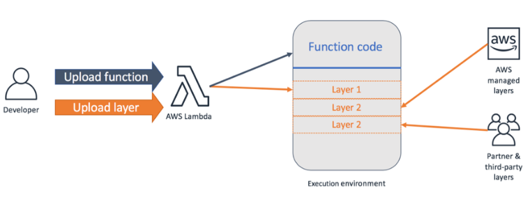
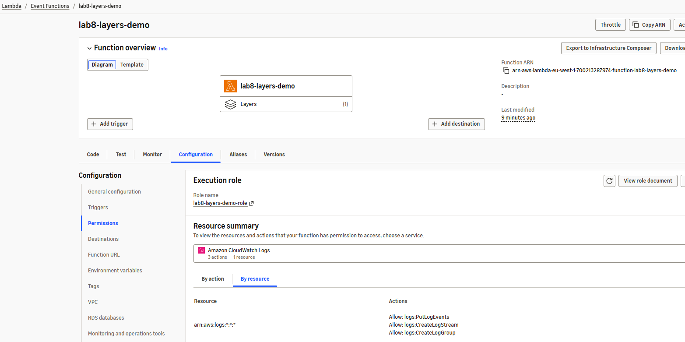
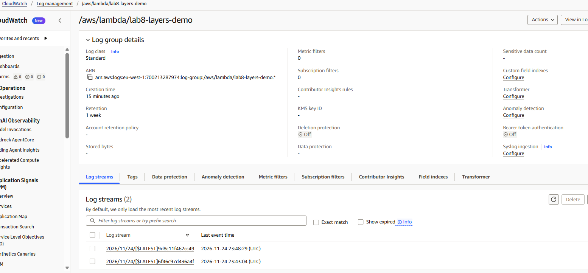
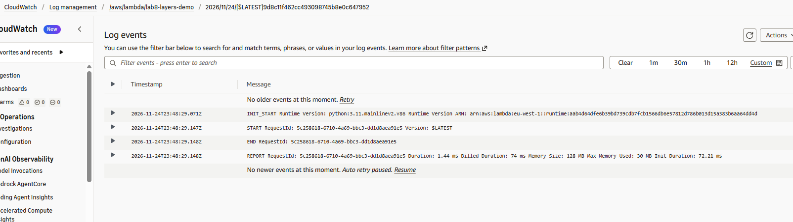

# Lab 8: Capas (Lambda Layers) y empaquetado de dependencias externas

  

+ **Lab 8: Capas (Lambda Layers) y empaquetado de dependencias externas**
    - **Utilidad real:** Reutilizar librerías de terceros (como requests o clientes específicos) o utilidades compartidas entre varias funciones sin duplicar código ni inflar cada despliegue.
    - **Qué aprenderás:** Crear y versionar un aws_lambda_layer_version, estructurar carpetas (python/ para Python) y decidir cuándo usar una Layer, empaquetar dependencias en el .zip o pasar a un contenedor Docker en ECR.

## INTRODUCCION

+ El Lab 8 es serverless. Hasta ahora hemos usado solo la librería estándar de Python y boto3 (que ya viene incluido en el runtime de Lambda). En proyectos reales, casi siempre necesitas librerías externas (como requests, pydantic, etc.) o funciones auxiliares compartidas entre varias Lambdas.

+ Qué es una Lambda Layer y cómo funciona en Python:
    - **Una Lambda Layer es un paquete .zip** (hasta 50 MB comprimido / ~250 MB descomprimido sumando función y capas) que AWS monta automáticamente en el directorio /opt del entorno de ejecución cuando arranca la función.
    - **Estructura obligatoria para Python 3.11:** Python busca librerías adicionales en /opt/python. Por eso, el .zip de la capa debe tener dentro una carpeta python/ (por ejemplo python/requests/... o python/utilidades.py). Si metes los archivos sueltos en la raíz del .zip sin la carpeta python/, Python no los encontrará al hacer import.
    - **Versionado:** Cada vez que cambia el contenido de la capa, Terraform crea una nueva versión (aws_lambda_layer_version, versión 1, 2, 3...) y actualiza la función Lambda para apuntar al nuevo ARN de versión.


+ **¿Cuándo elegir Layer, .zip de función o contenedor Docker en ECR?:**
    - **Dependencia en el propio .zip de la función:** ideal cuando solo una función usa la librería y el paquete es pequeño; el despliegue es autocontenido.
    - **Lambda Layer (aws_lambda_layer_version):** útil cuando varias funciones comparten las mismas librerías o utilidades y quieres separar el código de negocio (que cambia a menudo) de las dependencias (que cambian poco), manteniendo el .zip de cada función ligero.
    - **Contenedor Docker en Amazon ECR:** mejor opción cuando las dependencias son pesadas (superan los límites de .zip + layers), incluyen binarios/librerías del sistema operativo o ya estandarizas tus despliegues como imágenes de contenedor.

+ Qué vamos a montar en este Lab 8:
    - Una carpeta local layer_build/python/ con un módulo de utilidad propio (por ejemplo helpers.py) y/o una librería externa instalada en layer_build/python/.
    - Un recurso aws_lambda_layer_version en Terraform que empaqueta esa carpeta en .zip y publica la capa en eu-west-1 para python3.11.
    - Una función Lambda (lab8-layers-demo) enlazada a esa capa mediante layers = [aws_lambda_layer_version.shared_layer.arn], que importa el módulo desde la capa y responde con un JSON.

+ Elegir entre empaquetar en el .zip de la función, usar una Lambda Layer o desplegar una imagen de contenedor en ECR depende del tamaño de las dependencias, de cuántas funciones las comparten y de qué tan complejo sea el entorno que necesita tu código:
    - **Empaquetar dependencias directamente en el .zip de la función:** Es el enfoque más directo: metes tu código (handler.py) y tus librerías (pip install -t ... o similar) dentro del mismo paquete de despliegue de esa función.
        + Cuándo conviene:
            - Tienes una sola función (o pocas) que necesita una o dos librerías ligeras.
            - Quieres un despliegue autocontenido: al mirar esa Lambda, todo lo que necesita está en su propio paquete sin depender de versiones externas de una capa.
            - El .zip resultante es pequeño y rápido de subir/actualizar.
        + Cuándo no conviene:
            - Tienes 8 o 10 Lambdas que repiten las mismas dependencias pesadas y subes megas innecesarios cada vez que cambias dos líneas de tu código de negocio.

    - **Usar una Lambda Layer (aws_lambda_layer_version):** Una Layer es un paquete .zip separado que AWS monta en /opt (y en Python /opt/python entra en la ruta de importación) y que puedes asociar a una o varias funciones.
        + Cuándo conviene:
            - Varias funciones comparten dependencias o utilidades (por ejemplo, clientes internos, formateadores de logs, validaciones comunes o una librería de terceros usada en varios microservicios).
            - Quieres separar el ciclo de vida: el código de negocio cambia a diario, pero la librería o utilidad compartida cambia poco y se versiona de forma independiente.
            - Quieres mantener el .zip de cada función pequeño para que la revisión de código y el despliegue de la función sean ligeros.
        + Puntos a vigilar en la práctica:
            - Cada nueva versión de la capa (v1, v2, v3...) tiene su propio ARN; si actualizas la capa y quieres que las Lambdas usen la nueva versión, debes actualizar su referencia en Terraform (layers = [...]).
            - Sigue habiendo límites de tamaño (50 MB comprimidos / ~250 MB descomprimidos en total sumando código de función y capas).

    - **Usar un contenedor Docker en Amazon ECR:** En lugar de subir un .zip con un runtime gestionado por AWS, empaquetas tu código y dependencias dentro de una imagen de contenedor (basada en las imágenes base de AWS Lambda o compatible con su runtime API) y la subes a Amazon ECR.
        + Cuándo conviene:
            - Tus dependencias superan cómodamente los límites de .zip + Layers (por ejemplo, librerías pesadas de ciencia de datos, machine learning, procesamiento pesado de imágenes/vídeo o frameworks grandes).
            - Necesitas binarios o librerías del sistema operativo difíciles de empaquetar a mano en un .zip (por ejemplo ffmpeg, herramientas nativas de Linux o compilaciones específicas).
            - Tu equipo ya estandariza todo el CI/CD y las pruebas locales con Docker, o ya tienes pipelines construyendo imágenes en ECR.
        + Puntos a vigilar en la práctica:
            - Construir y subir imágenes Docker suele ser algo más lento en CI/CD que empaquetar un .zip ligero, y los cold starts pueden ser mayores si la imagen es pesada.

## FUNCION

+ **Módulo de utilidad compartido (layer_build/python/helpers.py):** Este módulo simula una utilidad común (por ejemplo, normalizar textos o formatear respuestas/metadatos de evento) que distintas Lambdas podrían reutilizar sin duplicar lógica:
```bash
import re
from datetime import datetime, timezone


def normalizar_etiqueta(texto: str) -> str:
    """Limpia espacios extra y devuelve una etiqueta en minúsculas separada por guiones."""
    if not texto:
        return "sin-etiqueta"
    limpio = re.sub(r"[^a-zA-Z0-9]+", "-", texto.strip().lower()).strip("-")
    return limpio or "sin-etiqueta"


def construir_respuesta(origen: str, etiqueta: str, detalle: dict) -> dict:
    """Construye un diccionario uniforme con marca de tiempo UTC para reutilizar en Lambdas."""
    return {
        "origen_capa": origen,
        "etiqueta_normalizada": normalizar_etiqueta(etiqueta),
        "generado_utc": datetime.now(timezone.utc).isoformat(),
        "detalle": detalle,
    }
```

+ **Función Lambda (layer_handler.py):** La función importa directamente construir_respuesta desde helpers (resuelto automáticamente gracias a que AWS monta la capa en /opt/python):
```bash
import json
from helpers import construir_respuesta


def lambda_handler(event, context):
    etiqueta_entrada = event.get("etiqueta", "Lab 8 Layers Demo")
    payload_extra = event.get("datos", {})

    resultado = construir_respuesta(
        origen="lab8-shared-utils-layer",
        etiqueta=etiqueta_entrada,
        detalle={
            "request_id": context.aws_request_id if context else "local",
            "datos_recibidos": payload_extra,
        },
    )

    return {
        "statusCode": 200,
        "headers": {"Content-Type": "application/json"},
        "body": json.dumps(resultado),
    }
```

## TERRAFORM

+ Main.tf:
```bash
# ==========================================
# 1. EMPAQUETADO DE LA CAPA (LAMBDA LAYER)
# ==========================================

# Empaqueta el contenido de layer_build (que contiene la carpeta python/helpers.py)
# en un archivo layer.zip. Al cambiar helpers.py, cambia output_base64sha256 y se
# publica una nueva versión de la capa.
data "archive_file" "shared_layer_zip" {
  type        = "zip"
  source_dir  = "${path.module}/layer_build"
  output_path = "${path.module}/layer.zip"
}

# Publica una versión de Lambda Layer compatible con Python 3.11.
resource "aws_lambda_layer_version" "shared_layer" {
  layer_name          = "lab8-shared-utils-layer"
  description         = "Utilidades compartidas en python/helpers.py para el Lab 8"
  filename            = data.archive_file.shared_layer_zip.output_path
  source_code_hash    = data.archive_file.shared_layer_zip.output_base64sha256
  compatible_runtimes = ["python3.11"]
}

# ==========================================
# 2. EMPAQUETADO DE LA FUNCIÓN Y LOGS
# ==========================================

# Empaqueta únicamente layer_handler.py (sin duplicar la capa dentro del .zip).
data "archive_file" "lambda_function_zip" {
  type        = "zip"
  source_file = "${path.module}/layer_handler.py"
  output_path = "${path.module}/function.zip"
}

# Log Group con retención de 7 días para revisar ejecuciones y posibles errores de importación.
resource "aws_cloudwatch_log_group" "lambda_logs" {
  name              = "/aws/lambda/lab8-layers-demo"
  retention_in_days = 7
}

# ==========================================
# 3. ROL IAM DE EJECUCIÓN DE LA LAMBDA
# ==========================================

data "aws_iam_policy_document" "lambda_assume_role" {
  statement {
    effect  = "Allow"
    actions = ["sts:AssumeRole"]

    principals {
      type        = "Service"
      identifiers = ["lambda.amazonaws.com"]
    }
  }
}

resource "aws_iam_role" "lambda_exec_role" {
  name               = "lab8-layers-demo-role"
  assume_role_policy = data.aws_iam_policy_document.lambda_assume_role.json
}

data "aws_iam_policy_document" "lambda_logs_doc" {
  statement {
    sid    = "CloudWatchLogsWrite"
    effect = "Allow"
    actions = [
      "logs:CreateLogGroup",
      "logs:CreateLogStream",
      "logs:PutLogEvents"
    ]
    resources = ["arn:aws:logs:*:*:*"]
  }
}

resource "aws_iam_policy" "lambda_logs_policy" {
  name        = "lab8-layers-demo-logs-policy"
  description = "Permite escribir logs de ejecución del Lab 8 en CloudWatch"
  policy      = data.aws_iam_policy_document.lambda_logs_doc.json
}

resource "aws_iam_role_policy_attachment" "lambda_logs_attach" {
  role       = aws_iam_role.lambda_exec_role.name
  policy_arn = aws_iam_policy.lambda_logs_policy.arn
}

# ==========================================
# 4. FUNCIÓN LAMBDA ENLAZADA A LA CAPA
# ==========================================

resource "aws_lambda_function" "layers_demo" {
  filename         = data.archive_file.lambda_function_zip.output_path
  function_name    = "lab8-layers-demo"
  role             = aws_iam_role.lambda_exec_role.arn
  handler          = "layer_handler.lambda_handler"
  source_code_hash = data.archive_file.lambda_function_zip.output_base64sha256
  runtime          = "python3.11"
  timeout          = 10
  memory_size      = 128

  # Asocia la versión publicada de la Lambda Layer.
  layers = [aws_lambda_layer_version.shared_layer.arn]

  depends_on = [
    aws_iam_role_policy_attachment.lambda_logs_attach,
    aws_cloudwatch_log_group.lambda_logs
  ]
}
```

## TEST Y COMPROBACIONES

+ Desplegamos:
```bash
# Inicializa el backend S3 (miguel-labs-terraform-state) y descarga los proveedores
terraform init -reconfigure

# Revisa el plan de recursos (capa, función Lambda, rol/política IAM y log group)
terraform plan

# Aplica los cambios y crea los recursos en eu-west-1
terraform apply

Apply complete! Resources: 6 added, 0 changed, 0 destroyed.

Outputs:

lambda_function_name = "lab8-layers-demo"
layer_version_arn = "arn:aws:lambda:eu-west-1:700213287974:layer:lab8-shared-utils-layer:1"
layer_version_number = "1"
```

  

+ **Invocar lab8-layers-demo desde AWS CLI**: Lanza una invocación síncrona pasando una etiqueta y unos datos de ejemplo en el payload:
```bash
aws lambda invoke \
  --function-name lab8-layers-demo \
  --cli-binary-format raw-in-base64-out \
  --payload '{"etiqueta":"Entorno Lab 8 / Pruebas","datos":{"entorno":"dev","paso":1}}' \
  res_lab8.json && cat res_lab8.json && echo ""
{
    "StatusCode": 200,
    "ExecutedVersion": "$LATEST"
}
{"statusCode": 200, "headers": {"Content-Type": "application/json"}, "body": "{\"origen_capa\": \"lab8-shared-utils-layer\", \"etiqueta_normalizada\": \"entorno-lab-8-pruebas\", \"generado_utc\": \"2026-11-24T23:43:04.258417+00:00\", \"detalle\": {\"request_id\": \"2d2fa62c-7d86-40e8-87d9-8dd0a45c75cd\", \"datos_recibidos\": {\"entorno\": \"dev\", \"paso\": 1}}}"}
```
> En la salida de la CLI verás "StatusCode": 200 (sin FunctionError).  

> Dentro del body (que viene como string JSON escapado) aparecerá "origen_capa": "lab8-shared-utils-layer" y "etiqueta_normalizada": "entorno-lab-8-pruebas", confirmando que construir_respuesta y normalizar_etiqueta vinieron desde /opt/python/helpers.py.  

+ **Revisar los logs en CloudWatch y la configuración de la capa:** Comprueba que la función tiene asociada la capa en su configuración y revisa el bloque REPORT en CloudWatch Logs:
```bash
# Ver qué capas tiene adjuntas la función Lambda
aws lambda get-function-configuration \
  --function-name lab8-layers-demo \
  --query 'Layers[].{Arn:Arn,CodeSize:CodeSize}'
[
    {
        "Arn": "arn:aws:lambda:eu-west-1:700213287974:layer:lab8-shared-utils-layer:1",
        "CodeSize": 538
    }
]

# Ver los logs recientes de la ejecución
aws logs tail /aws/lambda/lab8-layers-demo --since 10m --format short
2026-11-24T23:43:04 INIT_START Runtime Version: python:3.11.mainlinev2.v86      Runtime Version ARN: arn:aws:lambda:eu-west-1::runtime:aab4d64dfe6b39bd739cdb7fcb1566db6e57812d786b013d15a383b6aa64dd4d
2026-11-24T23:43:04 START RequestId: 2d2fa62c-7d86-40e8-87d9-8dd0a45c75cd Version: $LATEST
2026-11-24T23:43:04 END RequestId: 2d2fa62c-7d86-40e8-87d9-8dd0a45c75cd
2026-11-24T23:43:04 REPORT RequestId: 2d2fa62c-7d86-40e8-87d9-8dd0a45c75cd      Duration: 1.72 ms       Billed Duration: 98 ms      Memory Size: 128 MB     Max Memory Used: 30 MB  Init Duration: 95.56 ms
```
> Verificación: Layers mostrará el ARN de lab8-shared-utils-layer:1 y el REPORT indicará la duración y la memoria máxima usada (Max Memory Used).

  
  

### Modificar helpers.py para ver cómo publica la versión 2 de la Layer

+ El truco de este mecanismo está en cómo funciona source_code_hash en aws_lambda_layer_version: en cuanto cambia el contenido de layer_build/python/helpers.py, data.archive_file.shared_layer_zip genera un nuevo layer.zip con un hash distinto, y Terraform publica automáticamente una nueva versión inmutable (:2) de la capa y actualiza la función Lambda (lab8-layers-demo) para que apunte a esa versión.

+ Por ejemplo, añadimos un campo version_utilidad o una pequeña función/campo extra para que el cambio en el archivo sea evidente tanto en el código como en la respuesta JSON de la prueba:
```bash
import re
from datetime import datetime, timezone


def normalizar_etiqueta(texto: str) -> str:
    """Limpia espacios extra y devuelve una etiqueta en minúsculas separada por guiones."""
    if not texto:
        return "sin-etiqueta"
    limpio = re.sub(r"[^a-zA-Z0-9]+", "-", texto.strip().lower()).strip("-")
    return limpio or "sin-etiqueta"


def construir_respuesta(origen: str, etiqueta: str, detalle: dict) -> dict:
    """Construye un diccionario uniforme con marca de tiempo UTC para reutilizar en Lambdas."""
    return {
        "origen_capa": origen,
        "version_utilidad": "v2",
        "etiqueta_normalizada": normalizar_etiqueta(etiqueta),
        "generado_utc": datetime.now(timezone.utc).isoformat(),
        "detalle": detalle,
    }
```

+ Despliegue y comprobaciones:
```bash
terraform apply
Apply complete! Resources: 1 added, 1 changed, 1 destroyed.

Outputs:

lambda_function_name = "lab8-layers-demo"
layer_version_arn = "arn:aws:lambda:eu-west-1:700213287974:layer:lab8-shared-utils-layer:2"
layer_version_number = "2"

aws lambda invoke \
  --function-name lab8-layers-demo \
  --cli-binary-format raw-in-base64-out \
  --payload '{"etiqueta":"Prueba Layer v2","datos":{"paso":2}}' \
  res_lab8_v2.json && cat res_lab8_v2.json && echo ""
{
    "StatusCode": 200,
    "ExecutedVersion": "$LATEST"
}
{"statusCode": 200, "headers": {"Content-Type": "application/json"}, "body": "{\"origen_capa\": \"lab8-shared-utils-layer\", \"version_utilidad\": \"v2\", \"etiqueta_normalizada\": \"prueba-layer-v2\", \"generado_utc\": \"2026-11-24T23:48:29.147434+00:00\", \"detalle\": {\"request_id\": \"5c258618-6710-4a69-bbc3-dd1d8aea91e5\", \"datos_recibidos\": {\"paso\": 2}}}"}`


aws lambda get-function-configuration \
  --function-name lab8-layers-demo \
  --query 'Layers[].{Arn:Arn,CodeSize:CodeSize}'
[
    {
        "Arn": "arn:aws:lambda:eu-west-1:700213287974:layer:lab8-shared-utils-layer:2",
        "CodeSize": 555
    }
]
```
> En el body de la respuesta verás "version_utilidad": "v2".  
> En get-function-configuration verás que lab8-layers-demo ahora apunta a lab8-shared-utils-layer:2.  

## RESUMEN

+ El Lab 8 nos enseñó a desacoplar las dependencias del código de negocio mediante Layers. Aprendimos que para Python es obligatorio estructurar el contenido en una carpeta python/ dentro del .zip para que Lambda lo cargue en /opt/python, permitiendo reutilizar librerías o utilidades compartidas entre varias funciones de forma limpia y versionada.