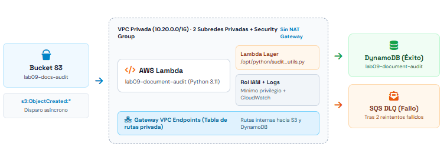
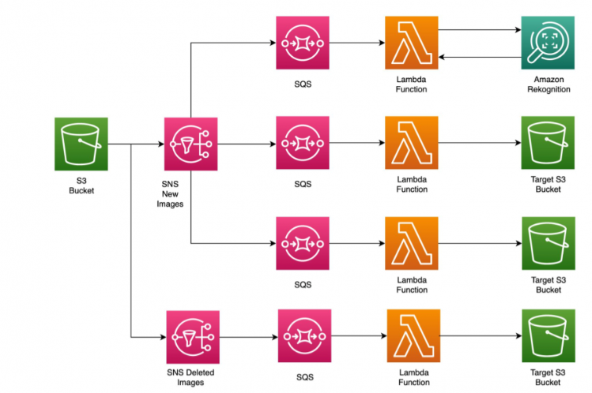
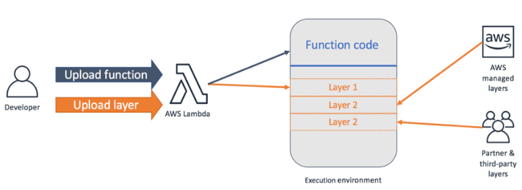
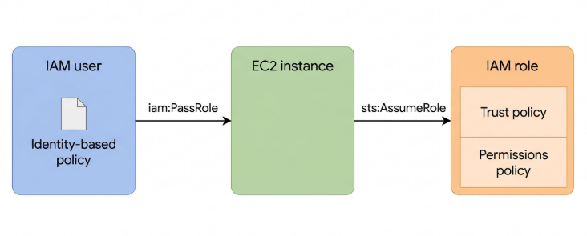
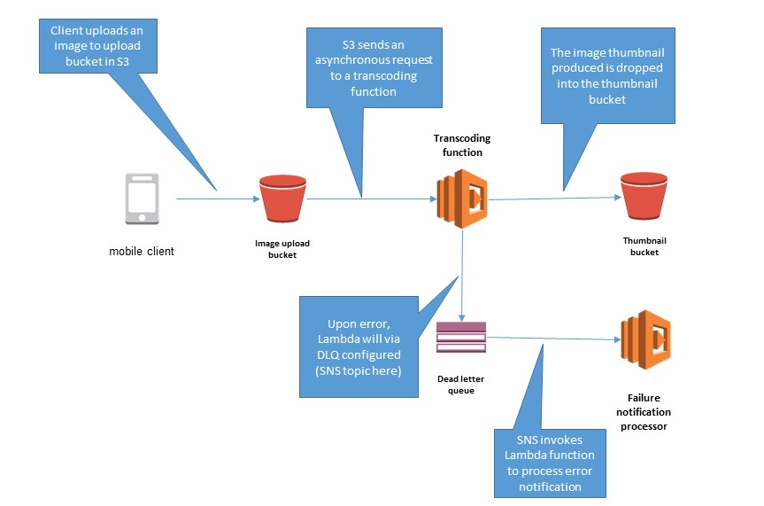
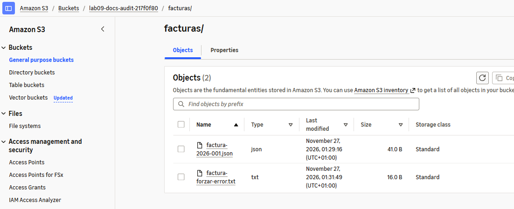
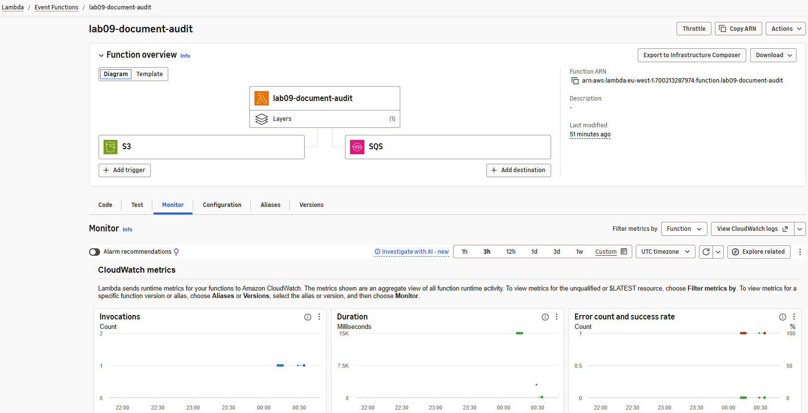
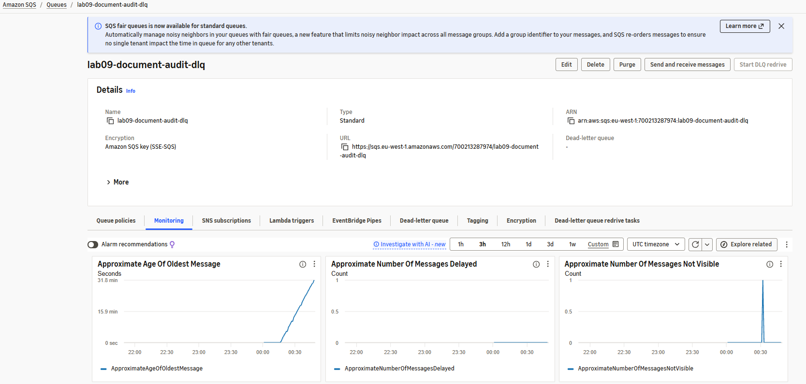
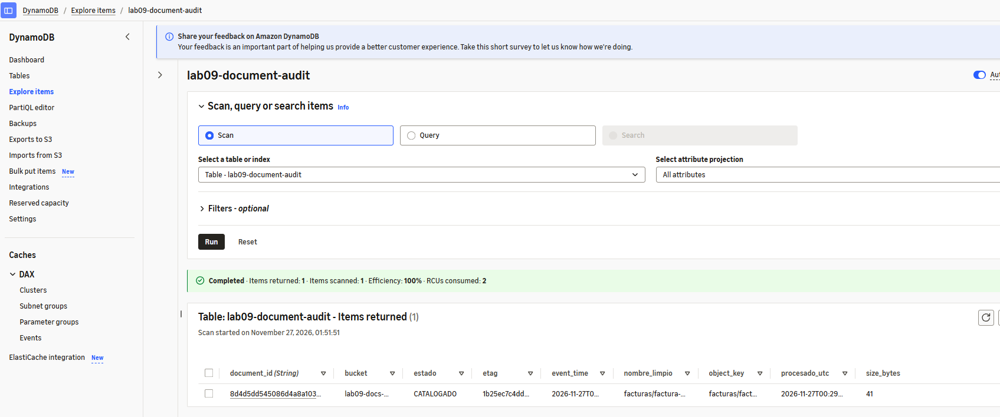
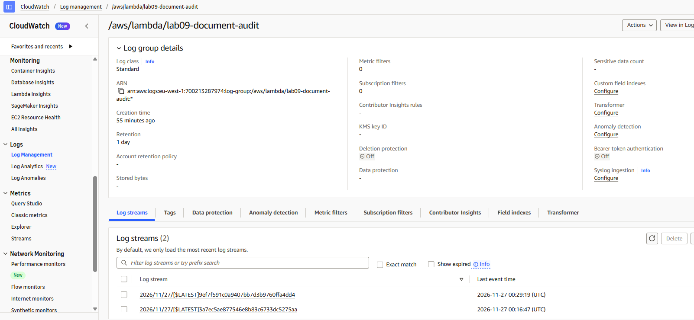

# Lab 9: Auditar documentos empresariales Lambda+S3+DynamoDB+SQS

  

+ El ejemplo clásico de las certificaciones (SAA-C03) y de las entrevistas técnicas es procesar una imagen o archivo subido a S3 y guardar sus metadatos en DynamoDB.

+ Este escenario es el "Hola Mundo" de la arquitectura orientada a eventos porque combina:
    - S3 como disparador.
    - Lambda como lógica de computación.
    - IAM para dar permisos a la Lambda de leer de S3 y escribir en DynamoDB.
    - DynamoDB como almacenamiento persistente.
    - Observabilidad (Logs de CloudWatch para ver que el proceso funcionó).

+ Vamos a simular la Ingesta y Registro de Metadatos de un Documento Sensible:
    - **Seguridad:** El bucket S3 estará en una VPC y la Lambda también. Usaremos un Gateway Endpoint para que la Lambda se conecte a S3 de forma privada.
    - **Evento:** Al subir un archivo (ej. PDF o JSON) al bucket, se dispara la Lambda.
    - **Lógica:** La Lambda lee el evento, calcula un hash (identificador único) del archivo y extrae la fecha de subida. Usaremos una Layer (Lab 8) para tener una función de utilidad que calcule el hash.
    - **Persistencia:** La Lambda guarda en DynamoDB el id (hash), el nombre del archivo, la fecha y el usuario que lo subió (usando el etag como versión).
    - **Resiliencia:** Si la escritura en DynamoDB falla (ej. tabla saturada), configuraremos reintentos automáticos y una SQS DLQ para capturar el evento fallido y no perder el registro del documento.

## INTRODUCCION

+ **Auditoría y catalogación automática de documentos:** Imagina una empresa (por ejemplo, una gestoría, logística o departamento financiero) donde cada día se suben facturas, albaranes o partes en PDF/JSON a un bucket de Amazon S3. *¿Qué necesita la empresa de verdad en producción?*
    - **Que no se pierda ningún documento:** cuando llega un archivo nuevo a S3, un evento dispara una Lambda para registrarlo en DynamoDB (nombre del archivo, tamaño, fecha, ETag y un identificador calculado).
    - **Que el procesamiento sea resiliente:** si la Lambda falla o tarda más de la cuenta, AWS reintenta y, si tras los reintentos sigue fallando, el evento va a una cola SQS DLQ para revisarlo o reprocesarlo sin perder trazabilidad.
    - **Que el código sea reutilizable:** la lógica de formatear/validar metadatos vive en una Lambda Layer (python/), separada del handler principal.
    - **Que la red tenga criterio de seguridad y costes:** la Lambda vive en una VPC con subredes privadas y Security Group, y usamos un Gateway VPC Endpoint para S3 para hablar con S3 por la red interna de AWS sin pagar un NAT Gateway.
    - **Que todo tenga mínimo privilegio y logs:** la Lambda solo puede leer en ese bucket, escribir en esa tabla DynamoDB, enviar a esa cola DLQ y escribir en su Log Group de CloudWatch.
  

+ Plan de construcción:
    - **Pieza 1:** Base del proyecto (backend.tf y providers.tf) + **la red privada y el Gateway Endpoint de S3** (vpc.tf), explicando cada parámetro.
    - **Pieza 2:** Almacenamiento y colas (**bucket S3 de entrada, tabla DynamoDB de auditoría y cola SQS DLQ**).
    - **Pieza 3:** **La Lambda Layer** (layer_build/python/) con la función de utilidad documentada.
    - **Pieza 4:** **El rol IAM de mínimo privilegio** y el **código Python de la Lambda** (handler.py).
    - **Pieza 5:** La conexión del **disparador de S3** (aws_s3_bucket_notification), despliegue, pruebas reales (éxito y fallo hacia DLQ) y terraform destroy.


## FUNCION

+ Código Python de la función Lambda (audit_handler.py):
    - Lee el nombre de la tabla DynamoDB desde os.environ["AUDIT_TABLE_NAME"].
    - Recorre event.get("Records", []) (un evento de S3 puede traer uno o varios registros).
    - Extrae bucket.name, object.key, object.size, object.eTag y eventTime.
    - Si el nombre del archivo contiene "forzar-error" (un gancho limpio y explícito para que podamos probar en el siguiente paso cómo funciona la DLQ sin romper nada), lanza una excepción controlada para provocar fallo + reintentos + envío a SQS DLQ.
    - En caso normal, llama a preparar_registro_auditoria(...) desde nuestra Layer (audit_utils.py) y guarda el ítem en DynamoDB con table.put_item(Item=...).
```bash
import json
import os
import boto3
from audit_utils import preparar_registro_auditoria


def lambda_handler(event, context):
    table_name = os.environ["AUDIT_TABLE_NAME"]
    dynamodb = boto3.resource("dynamodb")
    table = dynamodb.Table(table_name)

    records = event.get("Records", [])
    print(f"Recibidos {len(records)} registro(s) en tabla {table_name}")

    procesados = []

    for record in records:
        s3_info = record.get("s3", {})
        bucket_name = s3_info.get("bucket", {}).get("name", "")
        obj_info = s3_info.get("object", {})
        object_key = obj_info.get("key", "")
        size_bytes = obj_info.get("size", 0)
        etag = obj_info.get("eTag", "")
        event_time = record.get("eventTime")

        # Gancho controlado para probar reintentos y envío a SQS DLQ en el Lab 09
        if "forzar-error" in object_key.lower():
            raise RuntimeError(f"Fallo simulado de auditoria para el archivo: {object_key}")

        item = preparar_registro_auditoria(
            bucket=bucket_name,
            object_key=object_key,
            size_bytes=size_bytes,
            etag=etag,
            event_time=event_time,
        )

        table.put_item(Item=item)
        print(f"Registrado en DynamoDB: document_id={item['document_id']} key={object_key}")
        procesados.append(item["document_id"])

    return {
        "statusCode": 200,
        "body": json.dumps({
            "procesados": len(procesados),
            "document_ids": procesados,
        }),
    }
```

## TERRAFORM

### VPC

+ vpc.tf:
    - aws_vpc (10.20.0.0/16): nuestra red privada virtual para este laboratorio.
    - Dos subredes privadas (10.20.1.0/24 y 10.20.2.0/24 en dos Zonas de Disponibilidad): AWS exige al menos dos AZs para alta disponibilidad de la Lambda en la VPC. No tienen Internet Gateway, así que son privadas.
    - Tabla de rutas privada (aws_route_table) + asociaciones: controla por dónde salen los paquetes de esas subredes.
    - Gateway VPC Endpoint para S3 (aws_vpc_endpoint de tipo Gateway): añade en la tabla de rutas privada una ruta directa hacia S3 dentro de la red interna de AWS, sin NAT Gateway.
    - Security Group (aws_security_group): actúa como cortafuegos de la interfaz de red (ENI) de la Lambda.
```bash
# vpc.tf

# Red privada aislada para el Lab 09
resource "aws_vpc" "lab09_vpc" {
  cidr_block           = "10.20.0.0/16"
  enable_dns_support   = true
  enable_dns_hostnames = true

  tags = {
    Name = "lab09-audit-vpc"
  }
}

# Obtiene las zonas de disponibilidad (AZs) activas en eu-west-1
data "aws_availability_zones" "available" {
  state = "available"
}

# Subred privada A en la primera AZ
resource "aws_subnet" "private_a" {
  vpc_id            = aws_vpc.lab09_vpc.id
  cidr_block        = "10.20.1.0/24"
  availability_zone = data.aws_availability_zones.available.names[0]

  tags = {
    Name = "lab09-private-subnet-a"
  }
}

# Subred privada B en la segunda AZ (necesario mínimo 2 AZs para Lambda en VPC)
resource "aws_subnet" "private_b" {
  vpc_id            = aws_vpc.lab09_vpc.id
  cidr_block        = "10.20.2.0/24"
  availability_zone = data.aws_availability_zones.available.names[1]

  tags = {
    Name = "lab09-private-subnet-b"
  }
}

# Tabla de rutas para las subredes privadas (sin salida a internet)
resource "aws_route_table" "private_rt" {
  vpc_id = aws_vpc.lab09_vpc.id

  tags = {
    Name = "lab09-private-rt"
  }
}

resource "aws_route_table_association" "private_a" {
  subnet_id      = aws_subnet.private_a.id
  route_table_id = aws_route_table.private_rt.id
}

resource "aws_route_table_association" "private_b" {
  subnet_id      = aws_subnet.private_b.id
  route_table_id = aws_route_table.private_rt.id
}

# Gateway VPC Endpoint para S3: tráfico privado hacia S3 sin pagar NAT Gateway
resource "aws_vpc_endpoint" "s3_gateway" {
  vpc_id            = aws_vpc.lab09_vpc.id
  service_name      = "com.amazonaws.eu-west-1.s3"
  vpc_endpoint_type = "Gateway"
  route_table_ids   = [aws_route_table.private_rt.id]

  tags = {
    Name = "lab09-s3-gateway-endpoint"
  }
}

# Gateway VPC Endpoint para DynamoDB: permite a la Lambda en subred privada
# escribir en la tabla DynamoDB por red interna de AWS sin NAT Gateway.
resource "aws_vpc_endpoint" "dynamodb_gateway" {
  vpc_id            = aws_vpc.lab09_vpc.id
  service_name      = "com.amazonaws.eu-west-1.dynamodb"
  vpc_endpoint_type = "Gateway"
  route_table_ids   = [aws_route_table.private_rt.id]

  tags = {
    Name = "lab09-dynamodb-gateway-endpoint"
  }
}

# Security Group para la Lambda dentro de la VPC
resource "aws_security_group" "lambda_sg" {
  name        = "lab09-lambda-sg"
  description = "Permite trafico de salida desde la Lambda hacia endpoints/servicios"
  vpc_id      = aws_vpc.lab09_vpc.id

  egress {
    from_port   = 0
    to_port     = 0
    protocol    = "-1"
    cidr_blocks = ["0.0.0.0/0"]
  }

  tags = {
    Name = "lab09-lambda-sg"
  }
}
```

### BUCKET S3, TABLA DYNAMODB Y COLA SQS

+ Los tres servicios de almacenamiento y mensajería que sostienen el flujo de auditoría de documentos:
    - **Bucket de Amazon S3 (la puerta de entrada):** aquí es donde los usuarios, sistemas o procesos suben los documentos (facturas, partes, JSON). Además, S3 emitirá un evento cuando llegue un objeto nuevo.
    - **Tabla de Amazon DynamoDB (el libro de registro / auditoría):** es una base de datos NoSQL serverless muy rápida donde nuestra Lambda guardará un registro por cada documento procesado (document_id, nombre del archivo, tamaño, ETag, fecha de procesado).
    - **Cola SQS DLQ (la bandeja de incidencias):** si la Lambda falla tras sus reintentos automáticos al procesar un archivo, el evento acaba aquí en vez de perderse. Un administrador o un proceso de reproceso puede revisarlo después.
+ Conceptos clave: 
    - Nombres únicos globales en S3: los nombres de buckets S3 son únicos en todo AWS, no solo en tu cuenta ni en eu-west-1. Por eso en laboratorios se suele añadir un sufijo aleatorio (random_id) para evitar choques de nombre al hacer terraform apply.
    - Bloqueo de acceso público en S3 (aws_s3_bucket_public_access_block): en una empresa, un bucket de documentos sensibles nunca debe ser público por accidente. Activar los cuatro bloqueos es una práctica base de seguridad.
    - force_destroy = true en el bucket: en entornos de laboratorio es muy práctico porque permite que terraform destroy borre el bucket aunque contenga algún archivo de prueba. En producción real se suele dejar en false para evitar borrados accidentales.
    - DynamoDB en modo PAY_PER_REQUEST: pagas por cada lectura/escritura real sin tener que calcular o aprovisionar capacidad (RCU/WCU) de antemano. Ideal para cargas variables o eventos esporádicos.
    - Clave primaria (hash_key) en DynamoDB: definimos document_id (tipo string S) como clave de partición para identificar cada registro de forma única.
    - Retención en SQS DLQ (message_retention_seconds): define cuántos segundos conserva SQS un mensaje fallido si nadie lo lee (por ejemplo, 86400 segundos = 24 horas).
```bash
# storage.tf

# Genera un sufijo aleatorio hexadecimal para que el nombre del bucket S3
# sea único a nivel global en AWS y no falle por colisión de nombres.
resource "random_id" "bucket_suffix" {
  byte_length = 4
}

# Bucket de entrada donde se suben los documentos a auditar.
# force_destroy = true facilita limpiar el lab con terraform destroy.
resource "aws_s3_bucket" "documents_bucket" {
  bucket        = "lab09-docs-audit-${random_id.bucket_suffix.hex}"
  force_destroy = true

  tags = {
    Name = "lab09-docs-audit-bucket"
  }
}

# Bloquea cualquier configuración accidental que exponga el bucket a internet.
resource "aws_s3_bucket_public_access_block" "documents_public_access_block" {
  bucket = aws_s3_bucket.documents_bucket.id

  block_public_acls       = true
  block_public_policy     = true
  ignore_public_acls      = true
  restrict_public_buckets = true
}

# Tabla DynamoDB para almacenar el historial/auditoría de cada documento.
# PAY_PER_REQUEST evita gestionar unidades de capacidad fijas.
resource "aws_dynamodb_table" "audit_table" {
  name         = "lab09-document-audit"
  billing_mode = "PAY_PER_REQUEST"
  hash_key     = "document_id"

  attribute {
    name = "document_id"
    type = "S"
  }

  tags = {
    Name = "lab09-document-audit-table"
  }
}

# Dead Letter Queue (SQS) para recoger eventos que fallen tras los reintentos.
# Conserva los mensajes durante 24 horas (86400 s) para diagnóstico o reproceso.
resource "aws_sqs_queue" "audit_dlq" {
  name                      = "lab09-document-audit-dlq"
  message_retention_seconds = 86400

  tags = {
    Name = "lab09-document-audit-dlq"
  }
}
```

### LAMBDA LAYER

+ Lambda Layer: 
    - Generar un identificador único (document_id) consistente (por ejemplo, un hash SHA-256 calculado a partir del bucket, la clave del objeto y su ETag o versión).
    - Limpiar o normalizar el nombre del archivo para que sea legible y seguro en registros.
    - Construir la estructura del ítem de auditoría con fecha UTC y estado inicial.
> Al meter estas funciones dentro de una Layer, el código del handler de Lambda se queda limpio y centrado en orquestar el evento, mientras que estas utilidades quedan versionadas y listas para reutilizarse en otras Lambdas del proyecto.  

  
> En el diagrama ves cómo AWS combina el código de tu función con las capas (Layers) dentro del entorno de ejecución. En el runtime de Python, el contenido de la capa se monta en /opt y Python añade /opt/python a su ruta de búsqueda (sys.path).

+ Código del módulo compartido (layer_build/python/audit_utils.py):
```bash
import hashlib
import re
from datetime import datetime, timezone


def limpiar_nombre_archivo(object_key: str) -> str:
    """Normaliza la ruta/nombre del objeto de S3 para guardarlo de forma limpia."""
    if not object_key:
        return "archivo-desconocido"
    # Sustituye caracteres especiales por guiones manteniendo letras, números, puntos y barras
    limpio = re.sub(r"[^a-zA-Z0-9._/-]+", "-", object_key.strip())
    return limpio[:256]


def generar_id_documento(bucket: str, object_key: str, etag: str) -> str:
    """Genera un identificador SHA-256 determinista a partir de bucket, clave y ETag."""
    base = f"{bucket}|{object_key}|{etag or 'sin-etag'}"
    return hashlib.sha256(base.encode("utf-8")).hexdigest()


def preparar_registro_auditoria(
    bucket: str,
    object_key: str,
    size_bytes: int,
    etag: str,
    event_time: str | None = None,
) -> dict:
    """Construye el diccionario de metadatos listo para persistir en DynamoDB."""
    procesado_utc = datetime.now(timezone.utc).isoformat()
    return {
        "document_id": generar_id_documento(bucket, object_key, etag),
        "bucket": bucket,
        "object_key": object_key,
        "nombre_limpio": limpiar_nombre_archivo(object_key),
        "size_bytes": int(size_bytes),
        "etag": (etag or "").strip('"'),
        "event_time": event_time or procesado_utc,
        "procesado_utc": procesado_utc,
        "estado": "CATALOGADO",
    }
```

+ layer.tf:
    - data.archive_file.audit_layer_zip comprime layer_build/ en audit_layer.zip.
    - aws_lambda_layer_version.audit_layer publica la versión de la capa para python3.11. Si modificas audit_utils.py, source_code_hash cambia y Terraform publica una nueva versión automáticamente.
```bash
# layer.tf

# Empaqueta layer_build/ (que contiene python/audit_utils.py) en un archivo ZIP.
# Lambda montará el ZIP en /opt, dejando disponible /opt/python/audit_utils.py.
data "archive_file" "audit_layer_zip" {
  type        = "zip"
  source_dir  = "${path.module}/layer_build"
  output_path = "${path.module}/audit_layer.zip"
}

# Publica la versión de la Lambda Layer compatible con Python 3.11.
resource "aws_lambda_layer_version" "audit_layer" {
  layer_name          = "lab09-audit-utils-layer"
  description         = "Utilidades compartidas de auditoría documental en python/audit_utils.py"
  filename            = data.archive_file.audit_layer_zip.output_path
  source_code_hash    = data.archive_file.audit_layer_zip.output_base64sha256
  compatible_runtimes = ["python3.11"]
}
```

### ROL IAM

+ En producción, nunca damos AdministratorAccess ni comodines * innecesarios a una Lambda. Revisemos solo las acciones y recursos que este caso de uso exige:
    - **Política de confianza (assume_role_policy):** permite que el servicio lambda.amazonaws.com asuma el rol (sts:AssumeRole).
    - **Logs en CloudWatch:** solo para crear/escribir en el grupo de logs de esta función (/aws/lambda/lab09-document-audit).
    - **Interfaz de red en VPC (ENIs):** porque la Lambda está conectada a vpc_config en subredes privadas, necesita crear, describir y borrar interfaces de red (ec2:CreateNetworkInterface, ec2:DescribeNetworkInterfaces, ec2:DeleteNetworkInterface, ec2:AssignPrivateIpAddresses, ec2:UnassignPrivateIpAddresses).
    - **Lectura en el bucket S3 de documentos:** solo s3:GetObject sobre arn:aws:s3:::${aws_s3_bucket.documents_bucket.bucket}/* (los objetos de ese bucket concreto, no de toda la cuenta).
    - **Escritura en la tabla DynamoDB de auditoría:** solo dynamodb:PutItem sobre aws_dynamodb_table.audit_table.arn (esa tabla concreta).
    - **Envío a la cola SQS DLQ:** sqs:SendMessage sobre aws_sqs_queue.audit_dlq.arn para que el destino de error (destination) pueda enviar el mensaje fallido cuando se agoten los reintentos.

  
> El esquema muestra la separación entre la política de confianza (Trust policy que permite asumir el rol) y la política de permisos (Permissions policy que define qué acciones puede realizar).

+ Creamos compute.tf para agrupar el rol/políticas IAM, el empaquetado de audit_handler.py, el Log Group, la función Lambda conectada a la VPC y la Layer, y su configuración de reintentos + destino DLQ para invocaciones asíncronas:
```bash
# compute.tf

# Empaqueta el código de la función Lambda (sin duplicar la Layer).
data "archive_file" "audit_lambda_zip" {
  type        = "zip"
  source_file = "${path.module}/audit_handler.py"
  output_path = "${path.module}/audit_handler.zip"
}

# Log Group explícito con retención de 7 días para evitar acumulación indefinida de logs.
resource "aws_cloudwatch_log_group" "audit_lambda_logs" {
  name              = "/aws/lambda/lab09-document-audit"
  retention_in_days = 7
}

# Política de confianza: solo el servicio AWS Lambda puede asumir este rol.
data "aws_iam_policy_document" "audit_lambda_assume_role" {
  statement {
    effect  = "Allow"
    actions = ["sts:AssumeRole"]

    principals {
      type        = "Service"
      identifiers = ["lambda.amazonaws.com"]
    }
  }
}

resource "aws_iam_role" "audit_lambda_role" {
  name               = "lab09-document-audit-role"
  assume_role_policy = data.aws_iam_policy_document.audit_lambda_assume_role.json
}

# Política de mínimo privilegio acotada a los recursos exactos del Lab 09.
data "aws_iam_policy_document" "audit_lambda_least_privilege_doc" {
  # 1. Escritura de logs únicamente en el grupo de logs de esta Lambda
  statement {
    sid    = "CloudWatchLogsScoped"
    effect = "Allow"
    actions = [
      "logs:CreateLogGroup",
      "logs:CreateLogStream",
      "logs:PutLogEvents"
    ]
    resources = [
      aws_cloudwatch_log_group.audit_lambda_logs.arn,
      "${aws_cloudwatch_log_group.audit_lambda_logs.arn}:*"
    ]
  }

  # 2. Gestión de ENIs en VPC para ejecutar la Lambda dentro de las subredes privadas
  statement {
    sid    = "LambdaVPCAccess"
    effect = "Allow"
    actions = [
      "ec2:CreateNetworkInterface",
      "ec2:DescribeNetworkInterfaces",
      "ec2:DeleteNetworkInterface",
      "ec2:AssignPrivateIpAddresses",
      "ec2:UnassignPrivateIpAddresses"
    ]
    resources = ["*"]
  }

  # 3. Leer objetos únicamente del bucket de documentos del Lab 09
  statement {
    sid       = "ReadLab09DocumentsBucket"
    effect    = "Allow"
    actions   = ["s3:GetObject"]
    resources = ["${aws_s3_bucket.documents_bucket.arn}/*"]
  }

  # 4. Insertar registros únicamente en la tabla DynamoDB de auditoría del Lab 09
  statement {
    sid       = "WriteLab09AuditTable"
    effect    = "Allow"
    actions   = ["dynamodb:PutItem"]
    resources = [aws_dynamodb_table.audit_table.arn]
  }

  # 5. Enviar mensajes de fallo únicamente a la cola SQS DLQ del Lab 09
  statement {
    sid       = "SendToLab09Dlq"
    effect    = "Allow"
    actions   = ["sqs:SendMessage"]
    resources = [aws_sqs_queue.audit_dlq.arn]
  }
}

resource "aws_iam_policy" "audit_lambda_least_privilege" {
  name        = "lab09-document-audit-least-privilege"
  description = "Minimo privilegio para auditar documentos de S3 en DynamoDB desde VPC"
  policy      = data.aws_iam_policy_document.audit_lambda_least_privilege_doc.json
}

resource "aws_iam_role_policy_attachment" "audit_lambda_attach" {
  role       = aws_iam_role.audit_lambda_role.name
  policy_arn = aws_iam_policy.audit_lambda_least_privilege.arn
}

# Función Lambda principal conectada a la VPC privada y a la Layer de utilidades.
resource "aws_lambda_function" "document_audit" {
  filename         = data.archive_file.audit_lambda_zip.output_path
  function_name    = "lab09-document-audit"
  role             = aws_iam_role.audit_lambda_role.arn
  handler          = "audit_handler.lambda_handler"
  source_code_hash = data.archive_file.audit_lambda_zip.output_base64sha256
  runtime          = "python3.11"
  timeout          = 15
  memory_size      = 128

  # Conecta la Lambda a las dos subredes privadas y al Security Group (Lab 7)
  vpc_config {
    subnet_ids = [
      aws_subnet.private_a.id,
      aws_subnet.private_b.id
    ]
    security_group_ids = [aws_security_group.lambda_sg.id]
  }

  # Adjunta la versión de Lambda Layer con audit_utils.py (Lab 8)
  layers = [aws_lambda_layer_version.audit_layer.arn]

  # Variables de entorno para no hardcodear nombres de recursos en Python
  environment {
    variables = {
      AUDIT_TABLE_NAME = aws_dynamodb_table.audit_table.name
    }
  }

  depends_on = [
    aws_iam_role_policy_attachment.audit_lambda_attach,
    aws_cloudwatch_log_group.audit_lambda_logs,
    aws_vpc_endpoint.s3_gateway
  ]
}

# Configura reintentos automáticos y envío a SQS DLQ cuando falla una invocación asíncrona (Lab 6)
resource "aws_lambda_function_event_invoke_config" "audit_async_config" {
  function_name                = aws_lambda_function.document_audit.function_name
  maximum_retry_attempts       = 2
  maximum_event_age_in_seconds = 300

  destination_config {
    on_failure {
      destination = aws_sqs_queue.audit_dlq.arn
    }
  }
}
```

### DISPARADOR S3

+ Conectar el disparador de S3 (s3:ObjectCreated:*) a la Lambda, definir los outputs útiles y lanzar pruebas reales tanto del camino feliz (documento catalogado en DynamoDB) como del camino de fallo (archivo con forzar-error que agota reintentos y termina en la SQS DLQ):
  
> En este esquema ves la lógica central que vamos a probar: cuando un evento entra a la función Lambda y falla tras los reintentos, se deriva a una cola de mensajes fallidos (Dead Letter Queue) para que no se pierda y pueda inspeccionarse o tratarse aparte.  

+ Para que un archivo subido al bucket S3 invoque automáticamente a lab09-document-audit, hacen falta dos recursos en Terraform:
    - aws_lambda_permission: autoriza al servicio s3.amazonaws.com a invocar lab09-document-audit, restringido al ARN exacto del bucket documents_bucket (y a tu cuenta con source_account). Sin este permiso, S3 rechaza la notificación.
    - aws_s3_bucket_notification: configura en el bucket la notificación para eventos s3:ObjectCreated:* (subidas mediante PutObject, PostObject, CopyObject o multipart upload) hacia la Lambda. Incluye depends_on = [aws_lambda_permission.allow_s3_invoke] para evitar condiciones de carrera al crear ambos recursos.
```bash
# events.tf

data "aws_caller_identity" "current" {}

# Permite que el bucket S3 del Lab 09 invoque la función Lambda al crear objetos.
resource "aws_lambda_permission" "allow_s3_invoke" {
  statement_id  = "AllowExecutionFromLab09S3Bucket"
  action        = "lambda:InvokeFunction"
  function_name = aws_lambda_function.document_audit.function_name
  principal     = "s3.amazonaws.com"
  source_arn    = aws_s3_bucket.documents_bucket.arn
  source_account = data.aws_caller_identity.current.account_id
}

# Dispara la Lambda de forma asíncrona cada vez que se crea un objeto en el bucket.
resource "aws_s3_bucket_notification" "document_uploaded" {
  bucket = aws_s3_bucket.documents_bucket.id

  lambda_function {
    lambda_function_arn = aws_lambda_function.document_audit.arn
    events              = ["s3:ObjectCreated:*"]
  }

  depends_on = [aws_lambda_permission.allow_s3_invoke]
}
```

### OUTPUTS

+ Añadimos outputs.tf para tener a mano los nombres y URLs/ARNs necesarios en las pruebas de consola/CLI sin copiar IDs a mano:
```bash
# outputs.tf

output "documents_bucket_name" {
  description = "Nombre del bucket S3 donde subir documentos de prueba"
  value       = aws_s3_bucket.documents_bucket.bucket
}

output "audit_table_name" {
  description = "Nombre de la tabla DynamoDB de auditoría"
  value       = aws_dynamodb_table.audit_table.name
}

output "audit_dlq_url" {
  description = "URL de la cola SQS DLQ para inspeccionar eventos fallidos"
  value       = aws_sqs_queue.audit_dlq.url
}

output "lambda_function_name" {
  description = "Nombre de la función Lambda del Lab 09"
  value       = aws_lambda_function.document_audit.function_name
}

output "log_group_name" {
  description = "Grupo de logs de CloudWatch de la función Lambda"
  value       = aws_cloudwatch_log_group.audit_lambda_logs.name
}
```

## TEST Y COMPROBACIONES

+ Desplegamos:
```bash
terraform apply
Apply complete! Resources: 22 added, 0 changed, 0 destroyed.

Outputs:

audit_dlq_url = "https://sqs.eu-west-1.amazonaws.com/700213287974/lab09-document-audit-dlq"
audit_table_name = "lab09-document-audit"
documents_bucket_name = "lab09-docs-audit-217f0f80"
lambda_function_name = "lab09-document-audit"
log_group_name = "/aws/lambda/lab09-document-audit"
```

  
  


+ **Pruebas reales: camino feliz (DynamoDB) y camino de fallo (SQS DLQ):** Guarda los outputs en variables de shell para lanzar las pruebas limpiamente:
```bash
BUCKET_NAME=$(terraform output -raw documents_bucket_name)
TABLE_NAME=$(terraform output -raw audit_table_name)
DLQ_URL=$(terraform output -raw audit_dlq_url)
LOG_GROUP=$(terraform output -raw log_group_name)
```

+ **Prueba A: Subir un documento válido y verificar el registro en DynamoDB:**
    - Crea un archivo de ejemplo (factura-2026-001.json) y súbelo al bucket S3:
    ```bash
    echo '{"factura":"2026-001","importe":1250.00}' > factura-2026-001.json
    aws s3 cp factura-2026-001.json "s3://${BUCKET_NAME}/facturas/factura-2026-001.json"
    upload: ./factura-2026-001.json to s3://lab09-docs-audit-217f0f80/facturas/factura-2026-001.json
    ```
    - Espera unos segundos y consulta los ítems guardados en DynamoDB y los logs:
    ```bash
    aws dynamodb scan \
    --table-name "${TABLE_NAME}" \
    --query 'Items[].{Id:document_id.S,Archivo:nombre_limpio.S,Tamano:size_bytes.N,Estado:estado.S}'
    [
    {
        "Id": "8d4d5dd545086d4a8a103a3a5be6bc75ae37fb9f2236d6ef1bef2b6d0359bbcd",
        "Archivo": "facturas/factura-2026-001.json",
        "Tamano": "41",
        "Estado": "CATALOGADO"
    }
    ]

    aws logs tail "${LOG_GROUP}" --since 5m --format short
    2026-11-27T00:29:16 INIT_START Runtime Version: python:3.11.mainlinev2.v86      Runtime Version ARN: arn:aws:lambda:eu-west-1::runtime:aab4d64dfe6b39bd739cdb7fcb1566db6e57812d786b013d15a383b6aa64dd4d
    2026-11-27T00:29:16 START RequestId: 6a5f534e-6f5d-4699-8372-d9975a4a3c92 Version: $LATEST
    2026-11-27T00:29:19 Recibidos 1 registro(s) en tabla lab09-document-audit
    2026-11-27T00:29:19 Registrado en DynamoDB: document_id=8d4d5dd545086d4a8a103a3a5be6bc75ae37fb9f2236d6ef1bef2b6d0359bbcd key=facturas/factura-2026-001.json
    2026-11-27T00:29:19 END RequestId: 6a5f534e-6f5d-4699-8372-d9975a4a3c92
    2026-11-27T00:29:19 REPORT RequestId: 6a5f534e-6f5d-4699-8372-d9975a4a3c92      Duration: 3031.37 ms    Billed Duration: 3428 ms    Memory Size: 128 MB     Max Memory Used: 88 MB  Init Duration: 395.87 ms
    ```
    > Verificación: Aparece un registro en lab09-document-audit con estado = CATALOGADO, su document_id calculado desde la Layer (audit_utils.py) y el log Registrado en DynamoDB.  
    - Resultados:
        + aws dynamodb scan ...: Devuelve el ítem guardado en lab09-document-audit con Id (hash SHA-256 de 64 caracteres), Archivo: "facturas/factura-2026-001.json", Tamano: "41" (los 41 bytes del JSON escrito) y Estado: "CATALOGADO".
        + INIT_START (00:29:16): Arranque en frío (cold start) del entorno Python 3.11 (Init Duration: 395.87 ms), cargando código + Layer.
        + START / Recibidos 1 registro(s) / Registrado en DynamoDB: Confirma que el evento llegó de S3, s
        + END / REPORT: Duration: 3031.37 ms (~3 segundos en total), Max Memory Used: 88 MB de 128 MB, sin errores ni timeout.


+ **Prueba B: Subir un archivo con forzar-error y verificar reintentos + SQS DLQ:**
    - Sube un archivo cuyo nombre contenga forzar-error para disparar la excepción controlada en audit_handler.py:
    ```bash
    echo 'prueba de fallo' > factura-forzar-error.txt
    aws s3 cp factura-forzar-error.txt "s3://${BUCKET_NAME}/facturas/factura-forzar-error.txt"
    upload: ./factura-forzar-error.txt to s3://lab09-docs-audit-217f0f80/facturas/factura-forzar-error.txt
    ```
    - La invocación asíncrona fallará y AWS reintentará automáticamente (maximum_retry_attempts = 2) antes de enviar el evento a la DLQ. Espera ~30-60 segundos y revisa la cola SQS DLQ y los logs:
    ```bash
    aws sqs receive-message \
    --queue-url "${DLQ_URL}" \
    --max-number-of-messages 5 \
    --wait-time-seconds 5
    {
    "Messages": [
        {
            "MessageId": "d86a97bd-7694-49c6-81a8-2dbaf032d7b1",
            "ReceiptHandle": "AQEBr+9DV8YFeX33aKNE6FcimchBrhYTrsBV/DKcZVmDl7wW+WVShoHp1xgLGjm6Mv+CbOV7tuzYmiWW24TZuWLAZxFFcF4dYCwxTqyoDMqUpsAXE9gqvJIecBL72HdtfMEk80g+I4kDtbh6Iu9y+x0dCPUQXuICm2MAyPffKpBLkBOAw/N8fmZI9vvjqL5Pg+fJ0sYnkpYOA9eTXpJ6shq/DO/kJFtcqmILAKDBfMktYuPsUQx1O4GGjwtmQzfbiSXazPJb+6jv2WUG4GhacxrAr/d3VkiQQNZdKw28l29lo7CLMwHsyJJCgoH7PBmmROXIUuIVaK+crxe/0NmA6m2yG/H+HjtD60OEv01NbIf0lByN94ebIb+GAbOTTcsVCzpzcs+O4xzCGsA4kEhDbxRabg==",
            "MD5OfBody": "71ff617da1f6c438b40f0b3306b4d643",
            "Body": "{\"version\":\"1.0\",\"timestamp\":\"2026-11-27T00:16:47.971Z\",\"requestContext\":{\"requestId\":\"25b2158e-15e5-4946-bcbb-16ccbc275f2c\",\"functionArn\":\"arn:aws:lambda:eu-west-1:700213287974:function:lab09-document-audit:$LATEST\",\"condition\":\"RetriesExhausted\",\"approximateInvokeCount\":3},\"requestPayload\":{\"Records\":[{\"eventVersion\":\"2.6\",\"eventSource\":\"aws:s3\",\"awsRegion\":\"eu-west-1\",\"eventTime\":\"2026-11-27T00:12:50.434Z\",\"eventName\":\"ObjectCreated:Put\",\"userIdentity\":{\"principalId\":\"AWS:AIDA2GB7W3QTMWZ2KPRSE\"},\"requestParameters\":{\"sourceIPAddress\":\"90.168.118.230\"},\"responseElements\":{\"x-amz-request-id\":\"X3RN2MXCV11R1SAZ\",\"x-amz-id-2\":\"6FYa1oCMFRNtuDW2mH/b96NjGPcpc3hMZMesx2DJhlwaSEQrTSUpeCZUyDm2dtm3QByAdM3e9TzDHT8+qTfn6amui4P/LdIy\"},\"s3\":{\"s3SchemaVersion\":\"1.0\",\"configu
    rationId\":\"tf-s3-lambda-20261127000207808600000004\",\"bucket\":{\"name\":\"lab09-docs-audit-217f0f80\",\"ownerIdentity\":
    {\"principalId\":\"A2UCDGBQ57Q61K\"},\"arn\":\"arn:aws:s3:::lab09-docs-audit-217f0f80\"},\"object\":{\"key\":\"facturas/fact
    ura-2026-001.json\",\"size\":41,\"eTag\":\"1b25ec7c4ddda97db3273b5626702f14\",\"sequencer\":\"006B08CB025C7E290A\"}}}]},\"re
    sponseContext\":{\"statusCode\":200,\"executedVersion\":\"$LATEST\",\"functionError\":\"Unhandled\"},\"responsePayload\":{\"
    errorType\":\"Sandbox.Timedout\",\"errorMessage\":\"RequestId: 25b2158e-15e5-4946-bcbb-16ccbc275f2c Error: Task timed out af
    ter 15.00 seconds\"}}"
            }
        ]
    }

    aws logs tail "${LOG_GROUP}" --since 5m --format short
    2026-11-27T00:31:49 START RequestId: 54d654da-9bc9-4fc4-a9e4-c320098786a9 Version: $LATEST
    2026-11-27T00:31:49 Recibidos 1 registro(s) en tabla lab09-document-audit
    2026-11-27T00:31:49 [ERROR] RuntimeError: Fallo simulado de auditoria para el archivo: facturas/factura-forzar-error.txt
    Traceback (most recent call last):
    File "/var/task/audit_handler.py", line 28, in lambda_handler
        raise RuntimeError(f"Fallo simulado de auditoria para el archivo: {object_key}")
    2026-11-27T00:31:49 END RequestId: 54d654da-9bc9-4fc4-a9e4-c320098786a9
    2026-11-27T00:31:49 REPORT RequestId: 54d654da-9bc9-4fc4-a9e4-c320098786a9      Duration: 138.31 ms     Billed Duration: 139 ms     Memory Size: 128 MB     Max Memory Used: 88 MB
    ```
    > Verificación: Verás los intentos fallidos en CloudWatch Logs y al menos un mensaje en lab09-document-audit-dlq con el evento original de S3 (factura-forzar-error.txt), demostrando que el fallo no se perdió.  
    - Resultados:
        + aws sqs receive-message en lab09-document-audit-dlq:
            - Fíjate en el Body del mensaje: contiene "condition":"RetriesExhausted", "approximateInvokeCount":3 y el requestPayload con el evento original de S3 (facturas/factura-2026-001.json, size: 41, eTag: "1b25ec7c4ddda97db3273b5626702f14"), junto a "errorType":"Sandbox.Timedout".
            - Por qué aparece aquí ese archivo: Es el registro que dejó en la DLQ el timeout anterior (RequestId: 25b2158e-15e5-4946-bcbb-16ccbc275f2c de las 00:12–00:16) tras agotar sus 3 intentos antes de que arregláramos la red. ¡Demuestra en la práctica que la DLQ conservó el evento fallido para poder auditarlo o reprocesarlo!
        + Log de 00:31:49 (RequestId: 54d654da-9bc9-4fc4-a9e4-c320098786a9):
            - Corresponde a la subida de facturas/factura-forzar-error.txt. Fíjate que no hay INIT_START (reutilizó el entorno caliente de la ejecución anterior), entró en el if "forzar-error" in object_key.lower():, lanzó el RuntimeError en la línea 28 de audit_handler.py y terminó rápido (Duration: 138.31 ms). A continuación, AWS aplica los reintentos asíncronos y, si se agotan, enviará también este evento a la DLQ.


+ **Esquema y explicación tramo por tramo del flujo construido en el Lab 09:**
    - **Tramo 1 — Subida a Amazon S3 (lab09-docs-audit-217f0f80):** Subes un archivo (facturas/factura-2026-001.json o facturas/factura-forzar-error.txt). S3 tiene bloqueado el acceso público y emite un evento s3:ObjectCreated:*. Gracias a aws_lambda_permission y aws_s3_bucket_notification, S3 invoca la Lambda de forma asíncrona.
    - **Tramo 2 — Arranque de Lambda en VPC privada + montaje de Layer (audit_handler.py + /opt/python/audit_utils.py):** AWS crea o reutiliza el entorno de ejecución de Python 3.11 dentro de las subredes privadas de la VPC (con su Security Group y rol IAM de mínimo privilegio) y monta la Lambda Layer en /opt/python, dejando audit_utils.py listo para importar.
    - **Tramo 3A — Camino feliz (Prueba A: factura-2026-001.json):** La Lambda lee el evento, llama a preparar_registro_auditoria() desde la Layer (calculando el document_id con SHA-256, limpiando el nombre y asignando estado: CATALOGADO), y escribe en DynamoDB (lab09-document-audit) a través del Gateway VPC Endpoint de DynamoDB sin salir a internet.
    - **Tramo 3B — Camino de fallo (Prueba B: factura-forzar-error.txt):** La Lambda detecta "forzar-error" en el nombre del archivo y lanza RuntimeError: Fallo simulado de auditoria.... Al ser una invocación asíncrona, AWS reintenta automáticamente y, cuando se agotan los reintentos (RetriesExhausted), event_invoke_config envía el mensaje a la cola SQS DLQ (lab09-document-audit-dlq).

  
  
  

## RESUMEN

+ Este laboratorio implementa una auditoría automática y resiliente de documentos en AWS mediante Terraform: cuando se sube un archivo a Amazon S3, se dispara de forma asíncrona una función Lambda aislada en una VPC privada (conectada por red privada mediante Gateway VPC Endpoints y con lógica reutilizable en una Lambda Layer). Si todo va bien, cataloga el documento en DynamoDB; si falla o hace timeout tras los reintentos, envía el evento a una cola SQS DLQ para no perderlo.